# 🎬 Manhwa → Anime (M2A) Complete Architecture & Excalidraw Mermaid Guide

> **Repository**: `Manhwa → Anime (M2A)`  
> **Status**: Phase 0 & Phase 1 **COMPLETED** | Phase 2–5 **SCAFFOLDED & IN PROGRESS** | Phase 6 **PLANNED**  
> **Target Video Format**: 9:16 Portrait Anime Video (`.mp4`, `.avi`, `.webp`)  
> **Hardware Tiers**: T0 (CPU Only), T1 (12–16 GB VRAM), T2 (24–48 GB VRAM)

---

## 1. How to Use in Excalidraw

1. Open [Excalidraw](https://excalidraw.com).
2. Click the **More Tools** button (`...` or toolbar menu) or click **Insert**.
3. Select **Mermaid to Excalidraw**.
4. Copy the Mermaid code from [Section 2: Master Excalidraw Mermaid Code](#2-master-excalidraw-mermaid-code) (or from [`architecture_excalidraw.mmd`](./architecture_excalidraw.mmd)).
5. Paste it into the modal and click **Insert**.
6. Excalidraw will automatically convert every node, subgraph box, decision diamond, and arrow into clean, editable vector shapes and colors!

---

## 2. Master Excalidraw Mermaid Code

```mermaid
flowchart TD

    %% -------------------------------------------------------------
    %% SUBGRAPH 0: INPUT & PHASE 0 FOUNDATIONS
    %% -------------------------------------------------------------
    subgraph SG_Phase0["PHASE 0: Foundations & Data Contracts (COMPLETED)"]
        RawPages["Input Manhwa Strip<br/>(2-3 vertical webtoon pages: .png/.jpg)"]
        GroundTruth["Eval Ground Truth<br/>(ground_truth.json + schema.json)"]
        ConfigLoader["Config System<br/>(default.yaml + tiers: t0/t1/t2)"]
        RunStateInit["RunState Initializer<br/>(UUID, ConfigHash, Timestamps)"]
        
        RawPages --> RunStateInit
        GroundTruth -.-> RunStateInit
        ConfigLoader --> RunStateInit
    end

    %% -------------------------------------------------------------
    %% SUBGRAPH 1: PHASE 1 INGEST, SLICING & BASELINE MOTION
    %% -------------------------------------------------------------
    subgraph SG_Phase1["PHASE 1: Ingest, Slicing & Baseline Motion Comic (COMPLETED)"]
        NodeIngest["1. IngestNode<br/>(workers/ingest.py)<br/>Vertical Strip Stitching"]
        StitchedImg["Artifact: stitched.png<br/>(Full concatenated strip)"]
        NodeSegment["2. SegmentNode<br/>(workers/slicer.py)<br/>Gutter Variance Slicing"]
        PanelCrops["Artifact: panels/panel_00X.png<br/>(BBox + Reading Order)"]
        EvalF1["Segmentation Eval<br/>(eval_segmentation.py - F1 >= 0.90)"]
        
        NodeKenBurns["Ken Burns Engine<br/>(render_kenburns.py)<br/>Cubic Ease Pan & Zoom"]
        NodeParallax["2.5D Parallax Engine<br/>(render_parallax.py)<br/>Depth Mask + Differential Motion"]
        AssemblerP1["Timeline Assembler<br/>(assembler.py)<br/>Alpha Crossfade + Container Encoders"]
        BaselineOut["Baseline Artifacts<br/>(baseline.avi / baseline.webp / .mp4)"]

        RunStateInit --> NodeIngest
        NodeIngest --> StitchedImg
        StitchedImg --> NodeSegment
        NodeSegment --> PanelCrops
        PanelCrops -.-> EvalF1
        
        PanelCrops --> NodeKenBurns
        PanelCrops --> NodeParallax
        NodeKenBurns --> AssemblerP1
        NodeParallax --> AssemblerP1
        AssemblerP1 --> BaselineOut
    end

    %% -------------------------------------------------------------
    %% SUBGRAPH 2: PHASE 2 UNDERSTANDING & CLEAN PLATES
    %% -------------------------------------------------------------
    subgraph SG_Phase2["PHASE 2: Narrative Understanding & Clean Plates (IN PROGRESS)"]
        NodeUnderstand["3. UnderstandNode<br/>(Qwen3-VL-8B / 4-bit / 2B VLM)"]
        StructPanelJSON["Core Data Contract: PanelJSON<br/>- PanelID, BBox, ShotType<br/>- Characters Ref, Action<br/>- Dialogue Line, SFX<br/>- MotionPrompt, StyleAnchor"]
        StructBible["Character Bible<br/>(CharacterEntry: Name, Crops, VoiceProfile)"]
        
        CP1{"Checkpoint CP1<br/>(Human Review in UI)<br/>Validate Text, Speaker, BBox"}
        
        NodeCleanPlates["4. CleanPlatesNode<br/>(LaMa Text Mask Inpainting)"]
        CleanPlatesImg["Artifact: clean_plates/panel_00X_clean.png<br/>(Speech bubbles & text removed)"]

        PanelCrops --> NodeUnderstand
        NodeUnderstand --> StructPanelJSON
        NodeUnderstand --> StructBible
        StructPanelJSON --> CP1
        CP1 -->|Approved / Edited| NodeCleanPlates
        CleanPlatesImg -.-> CP1
        NodeCleanPlates --> CleanPlatesImg
    end

    %% -------------------------------------------------------------
    %% SUBGRAPH 3: PHASE 3 VIDEO GENERATION & ROUTING
    %% -------------------------------------------------------------
    subgraph SG_Phase3["PHASE 3 & 5: Intelligent Shot Routing & Video Bake-off"]
        NodeRoute["5. RouteNode (Shot Router)<br/>Rules + GPU Budget Allocation"]
        
        CP2{"Checkpoint CP2<br/>(Human Review in UI)<br/>Approve / Override Routes"}
        
        RouteHero["Route: HERO PANEL<br/>Close-up / High Motion / Action<br/>(Wan 2.2 / Hunyuan 1.5 / LTX-2.3)"]
        RouteSubtle["Route: SUBTLE PANEL<br/>Medium Shot / Atmosphere<br/>(2.5D Parallax with Depth Mask)"]
        RouteStatic["Route: STATIC PANEL<br/>Wide / Establishing Shot<br/>(Ken Burns Pan & Zoom)"]

        ComfyUI["ComfyUI Model Server (:8188)<br/>Wan 2.2 TI2V-5B / I2V-A14B<br/>HunyuanVideo 1.5 / LTX-2.3"]
        ParallaxGen["Parallax Generator<br/>(workers/render_parallax.py)"]
        KenBurnsGen["Ken Burns Generator<br/>(workers/render_kenburns.py)"]
        
        NodeQC["6. QCNode (Quality Assurance Gate)<br/>- IdentitySimilarity >= 0.85<br/>- FlickerScore <= 0.15<br/>- NewTextCount == 0<br/>- MotionSanity: 0.1 to 0.9"]
        
        FallbackLogic{"QC Gate Pass?"}
        FallbackDegrade["Degrade to Fallback Lane<br/>Wan2.2 -> Hunyuan -> Parallax -> KenBurns"]
        AcceptedClips["Artifact: clips/panel_00X_accepted.mp4<br/>(Passed Clip Candidates)"]

        CleanPlatesImg --> NodeRoute
        CP1 --> NodeRoute
        NodeRoute --> CP2
        CP2 -->|Hero Beat| RouteHero
        CP2 -->|Dialogue Beat| RouteSubtle
        CP2 -->|Establishing| RouteStatic
        
        RouteHero --> ComfyUI
        RouteSubtle --> ParallaxGen
        RouteStatic --> KenBurnsGen
        
        ComfyUI --> NodeQC
        ParallaxGen --> NodeQC
        KenBurnsGen --> NodeQC
        
        NodeQC --> FallbackLogic
        FallbackLogic -->|NO / Max Retries Exceeded| FallbackDegrade
        FallbackDegrade --> ParallaxGen
        FallbackLogic -->|YES| AcceptedClips
    end

    %% -------------------------------------------------------------
    %% SUBGRAPH 4: PHASE 4 AUDIO SYNTHESIS & FINAL ASSEMBLY
    %% -------------------------------------------------------------
    subgraph SG_Phase4["PHASE 4: Audio Synthesis & Final Composition"]
        NodeTTS["7. TTSNode<br/>(MeloTTS Korean / Kokoro / Chatterbox)"]
        AudioTracks["Artifact: audio/panel_00X_speaker.wav<br/>(Emotion-tagged speech files)"]
        TimelineCalc["Timeline Sync & Pacing<br/>Duration = Max(VisualDuration, DialogueLength)"]
        
        NodeAssemble["8. AssembleNode<br/>(FFmpeg Video Engine / Pure Python)"]
        FinalAnime["Final Anime Video<br/>(output/final_anime.mp4, 9:16 Portrait)<br/>- Crossfade Transitions<br/>- Subtitles & Overlays<br/>- Mixed Audio & Normalization"]

        StructPanelJSON -.->|Dialogue Lines| NodeTTS
        StructBible -.->|Voice Profiles| NodeTTS
        NodeTTS --> AudioTracks
        AudioTracks --> TimelineCalc
        AcceptedClips --> TimelineCalc
        TimelineCalc --> NodeAssemble
        NodeAssemble --> FinalAnime
    end

    %% -------------------------------------------------------------
    %% SUBGRAPH 5: ORCHESTRATION & STATE MANAGEMENT
    %% -------------------------------------------------------------
    subgraph SG_Orchestrator["GO BACKEND ORCHESTRATOR & RESILIENCE (cmd/m2a & internal/)"]
        GoCLI["Go CLI Entrypoint<br/>(cmd/m2a/main.go)"]
        EngineDAG["Pipeline Engine State Machine<br/>(internal/pipeline/engine.go)<br/>Stage Transitions & Resume-from-Crash"]
        StateDB["Artifact & State Store<br/>runs/<run_id>/state.json<br/>- CostLedger (GPU & Wall Sec)<br/>- StageHistory & Errors"]
        
        GoCLI --> EngineDAG
        EngineDAG <--> StateDB
        EngineDAG -.-> NodeIngest
        EngineDAG -.-> NodeSegment
        EngineDAG -.-> NodeUnderstand
        EngineDAG -.-> NodeCleanPlates
        EngineDAG -.-> NodeRoute
        EngineDAG -.-> NodeQC
        EngineDAG -.-> NodeTTS
        EngineDAG -.-> NodeAssemble
    end

    %% -------------------------------------------------------------
    %% SUBGRAPH 6: API SERVICES & HARDWARE COMPUTE TIERS
    %% -------------------------------------------------------------
    subgraph SG_Infrastructure["API SERVICES & COMPUTE TIERS"]
        FastAPIWorker["FastAPI Worker Server (:8100)<br/>/segment | /understand | /inpaint | /tts"]
        JobAPI["FastAPI Job Queue API<br/>POST /jobs | GET /jobs/{id} | Redis Queue"]
        StreamlitUI["Streamlit Review App (:8501)<br/>CP1 Panel Editor + CP2 Route Approval"]
        
        Tier0["Tier T0: CPU Only<br/>Ken Burns + Qwen3-VL-2B + Kokoro"]
        Tier1["Tier T1: 12-16GB VRAM (RTX 3080/4070)<br/>Wan2.2-Ti2V-5B + Qwen3-VL-8B-4bit + MeloTTS"]
        Tier2["Tier T2: 24-48GB VRAM (RTX 4090/A5000)<br/>Wan2.2-I2V-A14B + Qwen3-VL-8B + MeloTTS"]

        StreamlitUI --> JobAPI
        JobAPI --> GoCLI
        GoCLI <--> FastAPIWorker
    end

    %% Node Styling for Excalidraw Clarity
    classDef done fill:#d4edda,stroke:#28a745,stroke-width:2px;
    classDef inprogress fill:#fff3cd,stroke:#ffc107,stroke-width:2px;
    classDef planned fill:#e2e3e5,stroke:#6c757d,stroke-width:2px;
    classDef checkpoint fill:#f8d7da,stroke:#dc3545,stroke-width:2px;
    classDef coreContract fill:#cce5ff,stroke:#004085,stroke-width:2px;

    class RawPages,GroundTruth,ConfigLoader,RunStateInit,NodeIngest,StitchedImg,NodeSegment,PanelCrops,EvalF1,NodeKenBurns,NodeParallax,AssemblerP1,BaselineOut,GoCLI,EngineDAG,StateDB done;
    class NodeUnderstand,StructBible,NodeCleanPlates,CleanPlatesImg,NodeRoute,RouteHero,RouteSubtle,RouteStatic,NodeQC,FallbackLogic,FallbackDegrade,AcceptedClips,FastAPIWorker,JobAPI,StreamlitUI inprogress;
    class NodeTTS,AudioTracks,TimelineCalc,NodeAssemble,FinalAnime,ComfyUI planned;
    class CP1,CP2 checkpoint;
    class StructPanelJSON coreContract;
```



---

## 3. Frame-by-Frame Data Flow & Struct Wiring

Every single frame in the pipeline transforms an input struct into a downstream artifact. Here is the step-by-step lifecycle:

```
[Frame 01: Raw Manhwa Files]
          │
          ▼ (IngestNode via workers/ingest.py)
[Frame 02: stitched.png]
          │
          ▼ (SegmentNode via workers/slicer.py)
[Frame 03: []BBox {X, Y, W, H} + ReadingOrder]
          │
          ▼ (Slices saved into panels/panel_001.png...panel_00N.png)
[Frame 04: UnderstandNode via Qwen3-VL VLM]
          │
          ├──► CharacterBible (CharacterEntry with voice & appearance mapping)
          └──► PanelJSON (Structured contract per panel)
          │
          ▼ (Checkpoint 1: Human review & validation of text/speakers)
[Frame 05: CleanPlatesNode via LaMa]
          │
          ▼ (Inpainted background plates without bubbles: panel_00X_clean.png)
[Frame 06: RouteNode (Shot Routing Heuristic)]
          │
          ├── Hero Panel (Close-up / Action / High Motion) ──► Image-to-Video (Wan 2.2 / Hunyuan 1.5)
          ├── Subtle Panel (Medium Shot / Atmosphere)     ──► 2.5D Parallax with Depth Salience
          └── Static Panel (Wide / Establishing Shot)    ──► Ken Burns Pan & Zoom (Cubic Easing)
          │
          ▼ (Checkpoint 2: Route Approval)
[Frame 07: GenerateNode + ComfyUI]
          │
          ▼ (Produces ClipCandidate with TakeNumber)
[Frame 08: QCNode (Auto-QC Quality Gate)]
          │
          ├── Pass (Identity >= 0.85, Flicker <= 0.15, No new text) ──► Accepted clip
          └── Fail (After max retries) ──► Fallback lane (Parallax or Ken Burns)
          │
          ▼ (TTSNode via MeloTTS / Kokoro / Chatterbox)
[Frame 09: AudioTrack per dialogue line + Emotion tag]
          │
          ▼ (Timeline synchronization: duration = max(clip_duration, dialogue_length))
[Frame 10: AssembleNode via FFmpeg / Pure Python MJPEG AVI / WebP]
          │
          ▼
[Frame 11: Final 9:16 Anime Deliverable (final_anime.mp4)]
```

---

## 4. Comprehensive Struct Catalog & Data Contracts

The architecture defines strict typed contracts mirrored across **Go** (`internal/model/`) and **Python Pydantic** (`src/m2a/state.py`):

### 1. `BBox` (Bounding Box)
```go
type BBox struct {
    X int `json:"x"`
    Y int `json:"y"`
    W int `json:"w"`
    H int `json:"h"`
}
```
*Purpose*: Represents panel coordinates, character bounding boxes, and speech bubble regions in pixel coordinates.

### 2. `DialogueLine` (Speech Region)
```go
type DialogueLine struct {
    SpeakerID  string  `json:"speaker_id"`
    Text       string  `json:"text"`
    Lang       string  `json:"lang"`       // "ko", "ja", "en"
    Emotion    string  `json:"emotion"`    // "urgent", "angry", "shocked", "neutral"
    BBox       *BBox   `json:"bbox,omitempty"`
    Confidence float64 `json:"confidence"` // OCR confidence (0.0 to 1.0)
}
```
*Purpose*: Extracted by VLM/OCR; feeds directly into the TTS engine to synthesize speech for the character.

### 3. `SFX` (Sound Effects)
```go
type SFX struct {
    Text string `json:"text"`
    Kind string `json:"kind"` // "impact", "ambient", "motion"
    BBox *BBox  `json:"bbox,omitempty"`
}
```
*Purpose*: Captures onomatopoeia and sound effects to trigger ambient audio and visual overlays.

### 4. `CharacterRef` & `CharacterBible`
```go
type CharacterRef struct {
    ID       string `json:"id"`
    Name     string `json:"name"`
    Emotion  string `json:"emotion"`
    Pose     string `json:"pose"`
    CropPath string `json:"crop_path,omitempty"`
}

type CharacterEntry struct {
    Name           string       `json:"name"`
    Description    string       `json:"description"`
    ReferenceCrops []string     `json:"reference_crops"`
    Voice          VoiceProfile `json:"voice"`
    Appearances    []string     `json:"appearances"`
}

type CharacterBible struct {
    Characters map[string]CharacterEntry `json:"characters"`
}
```
*Purpose*: Tracks character identities, appearance crops across panels, and assigns consistent TTS voices.

### 5. `PanelJSON` (THE Central Pipeline Contract)
```go
type PanelJSON struct {
    PanelID         string         `json:"panel_id"`
    BBox            BBox           `json:"bbox"`
    Shot            ShotType       `json:"shot"`             // "close_up" | "medium" | "wide" | "splash"
    Characters      []CharacterRef `json:"characters"`
    Action          string         `json:"action"`           // Narrative summary
    Dialogue        []DialogueLine `json:"dialogue"`
    SFX             []SFX          `json:"sfx"`
    MotionPrompt    string         `json:"motion_prompt"`    // Prompt for I2V model
    StyleAnchor     string         `json:"style_anchor"`     // e.g. "2D anime, flat colors, clean line art"
    MotionIntensity float64        `json:"motion_intensity"` // 0.0 to 1.0
    Route           AnimationRoute `json:"route"`            // "i2v" | "parallax" | "kenburns"
    DurationS       float64        `json:"duration_s"`       // 0.5 to 10.0 seconds
}
```
*Purpose*: The immutable contract between Understanding and Generation. Generated by VLM, inspectable and editable by humans at Checkpoint 1.

### 6. `QCScores` & `ClipCandidate`
```go
type QCScores struct {
    IdentitySimilarity float64 `json:"identity_similarity"` // CLIP/face embedding match
    NewTextCount       int     `json:"new_text_count"`       // Text leakage detector (must be 0)
    FlickerScore       float64 `json:"flicker_score"`        // Frame delta variance
    MotionScore        float64 `json:"motion_score"`         // Optical flow magnitude
    OverallPass        bool    `json:"overall_pass"`
}

type ClipCandidate struct {
    PanelID    string   `json:"panel_id"`
    Path       string   `json:"path"`
    TakeNumber int      `json:"take_number"`
    QC         QCScores `json:"qc_scores"`
    Accepted   bool     `json:"accepted"`
}
```

### 7. `AudioTrack` & `CostLedger`
```go
type AudioTrack struct {
    PanelID   string  `json:"panel_id"`
    SpeakerID string  `json:"speaker_id"`
    AudioPath string  `json:"audio_path"`
    DurationS float64 `json:"duration_s"`
    Emotion   string  `json:"emotion"`
}

type CostLedger struct {
    TotalGPUSeconds  float64            `json:"total_gpu_seconds"`
    TotalWallSeconds float64            `json:"total_wall_seconds"`
    PerModel         map[string]float64 `json:"per_model_seconds"`
    PerStage         map[string]float64 `json:"per_stage_seconds"`
}
```

### 8. `RunState` & `PipelineStage`
```go
type RunState struct {
    Config          RunConfig                  `json:"config"`
    CurrentStage    PipelineStage              `json:"current_stage"`
    Panels          []PanelJSON                `json:"panels"`
    CharacterBible  *CharacterBible            `json:"character_bible,omitempty"`
    CleanPlatePaths map[string]string          `json:"clean_plate_paths"`
    ClipCandidates  map[string][]ClipCandidate `json:"clip_candidates"`
    AudioTracks     []AudioTrack               `json:"audio_tracks"`
    CostLedger      CostLedger                 `json:"cost_ledger"`
    Errors          []string                   `json:"errors"`
    StageHistory    []StageTransition          `json:"stage_history"`
}
```

---

## 5. Phase-by-Phase Roadmap & Completion Status

| Phase | Title | Scope & Objectives | Key Files & Artifacts | Status |
| :--- | :--- | :--- | :--- | :--- |
| **Phase 0** | **Foundations & Eval Set** | Ground truth labeling, synthetic test generator, config system, state persistence | `data/eval/ground_truth.json`<br/>`configs/default.yaml`<br/>`internal/config/config.go`<br/>`internal/model/state.go` | **COMPLETED (100%)** ✅ |
| **Phase 1** | **Ingest, Slicing & Baseline Motion Comic** | Gutter slicing, reading-order sort, Ken Burns cubic easing, 2.5D parallax, pure Python AVI & WebP video engine | `workers/ingest.py`<br/>`workers/slicer.py`<br/>`workers/render_kenburns.py`<br/>`workers/render_parallax.py`<br/>`workers/assembler.py`<br/>`baseline.avi` / `baseline.webp` | **COMPLETED (100%)** ✅ |
| **Phase 2** | **Narrative Understanding & Clean Plates** | VLM structured extraction, Character Bible, LaMa bubble inpainting, CP1 review checkpoint | `src/m2a/nodes/understand.py`<br/>`src/m2a/nodes/clean_plates.py`<br/>`workers/server.py` (`/understand`, `/inpaint`) | **IN PROGRESS (45%)** 🟡 |
| **Phase 3** | **Video Model Bake-off & Calibration** | ComfyUI workflows for Wan 2.2 / Hunyuan 1.5 / LTX-2.3; QC threshold calibration | `workflows/comfyui/*.json`<br/>`src/m2a/eval/bakeoff.py`<br/>`src/m2a/providers/video/` | **WORKFLOWS READY (40%)** 🟡 |
| **Phase 4** | **Audio Synthesis & Assembly** | MeloTTS Korean voice generation, dialogue timing sync, FFmpeg composition | `src/m2a/nodes/tts.py`<br/>`src/m2a/nodes/assemble.py`<br/>`workers/server.py` (`/tts`) | **SCAFFOLDED (30%)** 🟡 |
| **Phase 5** | **Orchestration, Router & QC Gate** | Go DAG engine with resume-from-crash, shot router heuristic, FastAPI job queue, Streamlit UI | `internal/pipeline/engine.go`<br/>`cmd/m2a/main.go`<br/>`api/app.py`<br/>`ui/streamlit_app.py` | **CORE ENGINE BUILT (75%)** 🟡 |
| **Phase 6** | **Hardening, Evaluation & Demo** | Regression testing, 3-reviewer blind rubric evaluation, failure taxonomy | `src/m2a/eval/rubric.py`<br/>`data/eval/` | **PLANNED (10%)** 🔵 |

---

## 6. AI Models, Hardware Compute Tiers & Fallbacks

### Hardware Compute Tiers Matrix

| Feature | Tier T0 (CPU Only) | Tier T1 (12–16 GB VRAM) | Tier T2 (24–48 GB VRAM) |
| :--- | :--- | :--- | :--- |
| **Target Hardware** | Standard Laptop / CPU Server | RTX 3080 / RTX 4070 (12–16 GB) | RTX 4090 / A5000 / Cloud GPU |
| **Perception Detector** | OpenCV Gutter Slicing | OpenCV Gutter Slicing + Magiv3 | OpenCV Gutter Slicing + Magiv3 |
| **Vision-Language Model (VLM)** | Qwen3-VL-2B | Qwen3-VL-8B (4-bit GPTQ/AWQ) | Qwen3-VL-8B (Full FP16) |
| **Inpainter** | LaMa (CPU) | LaMa (GPU FP16) | LaMa (GPU FP16) |
| **Primary Video Model** | Ken Burns Pan & Zoom (Rule-based) | **Wan2.2-Ti2V-5B (FP8)** | **Wan2.2-I2V-A14B (FP8)** |
| **Fallback Video Model** | N/A | Ken Burns / 2.5D Parallax | Wan2.2-Ti2V-5B → HunyuanVideo 1.5 → Parallax |
| **TTS Speech Engine** | Kokoro (CPU) / Edge-TTS | MeloTTS (Korean primary) / Kokoro | MeloTTS / Chatterbox (Cloning) |
| **Final Resolution & FPS** | 720x1280 @ 15fps | 720x1280 @ 24fps | 1080x1920 @ 24fps |

### Shot Routing & Fallback Heuristic
```
Panel Shot Analysis:
  ├── IF (Shot == close_up AND Motion == high) OR is_action:
  │     └─► ROUTE = i2v (Wan 2.2 / Hunyuan 1.5)
  │           └─► IF QC Fails or VRAM OOM:
  │                 └─► Fallback to Wan2.2-Ti2V-5B
  │                       └─► Fallback to Parallax
  │                             └─► Fallback to Ken Burns
  ├── IF Shot == medium AND Motion == moderate:
  │     └─► ROUTE = parallax (2.5D Depth Salience + Differential Motion)
  └── ELSE (Establishing / Wide Shot / Static):
        └─► ROUTE = kenburns (Cubic Easing Pan & Zoom)
```

---

## 7. API Specifications & Communication Channels

The architecture relies on 4 distinct communication channels:

```text
+-----------------------------------------------------------------------------------------+
|                                    USER INTERFACE                                       |
|                                Streamlit App (:8501)                                    |
|                   - CP1: Panel & Dialogue Editor (Human-in-the-loop)                     |
|                   - CP2: Shot Route Approver & Overrides                                |
+-----------------------------------------------------------------------------------------+
                                             │ HTTP REST
                                             ▼
+-----------------------------------------------------------------------------------------+
|                                   FASTAPI JOB API                                       |
|  POST /jobs               Submit new strip conversion job                               |
|  GET  /jobs/{job_id}      Poll status, current stage & progress percentage              |
|  GET  /jobs/{job_id}/result Download final compiled video                               |
|  DELETE /jobs/{job_id}    Cancel active execution                                       |
+-----------------------------------------------------------------------------------------+
                                             │ Redis Queue / CLI
                                             ▼
+-----------------------------------------------------------------------------------------+
|                            GO BACKEND ORCHESTRATOR (m2a)                                |
|  - Manages RunState machine (INGEST -> SEGMENT -> ... -> DONE)                          |
|  - Saves checkpoints to runs/<run_id>/state.json                                        |
|  - Enforces content-hash caching and automatic resume-from-crash                        |
+-----------------------------------------------------------------------------------------+
                    │ Subprocess CLI / HTTP                │ ComfyUI Workflow JSON
                    ▼                                      ▼
+--------------------------------------+  +-----------------------------------------------+
|      FASTAPI WORKER SERVER (:8100)   |  |             COMFYUI API (:8188)               |
|  POST /segment     OpenCV Slicer     |  |  POST /prompt     Submit I2V generation graph |
|  POST /understand  Qwen3-VL VLM      |  |  GET  /history    Poll execution progress     |
|  POST /inpaint     LaMa inpainting   |  |  GET  /view       Fetch rendered video clip   |
|  POST /tts         MeloTTS / Kokoro  |  |  Models: Wan 2.2, HunyuanVideo 1.5, LTX-2.3   |
|  GET  /health      GPU status        |  +-----------------------------------------------+
+--------------------------------------+
```

---

## 8. Verification & Execution Proof

The pipeline was executed and verified against real manhwa evaluation data (`data/eval/sample_page_*.png`):
- **Stitching**: Successfully concatenated 3 manhwa pages into `runs/396d8463-dbfb-4263-b474-d9c558263b20/stitched.png`.
- **Segmentation**: Extracted 7 distinct manhwa panels with bounding boxes.
- **Motion Comic Video**: Rendered alternating Ken Burns and 2.5D Parallax frames with cubic easing and alpha crossfade transitions.
- **Output Artifacts**: Generated `baseline.avi` (5.6 MB), `baseline.webp` (2.2 MB), and `state.json` recording complete state progression from `INGEST` to `DONE`.
