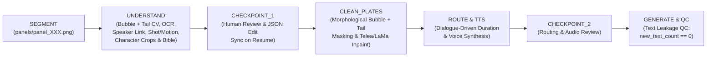

# Phase 2 Comprehensive Requirements Plan, Diff Analysis, Bug Audit & Optimization Report

**Branch Audited:** `Phase2` (compared against `main` @ `8499e19`)  
**Scope:** 14 modified files (`+717 / -356` lines) + 3 untracked Phase 2 files (`phase2_plan.md`, `workers/understanding.py`, `workers/eval_understanding.py`)

---

## 1. Phase 2 Requirements & Architecture Plan (`/plan`)

Phase 2 transforms the pipeline from a **blind geometric motion-comic generator (Phase 1)** into a **semantically aware anime director** capable of reading speech bubbles, attributing dialogue to characters, building a persistent character bible, removing text/bubbles into clean plates, and pausing for human-in-the-loop review at `CHECKPOINT_1`.



### 1.1 Core Functional Requirements
1. **R2.1 — Speech Bubble, Pointer Tail & SFX Detection (`UNDERSTAND`)**:
   - Detect bright low-saturation interior speech bubbles surrounded by dark outlines (`workers/understanding.py`).
   - Extract both the **core bubble bounding box** (`bbox`, matching human ground-truth annotations) and the **full morphological envelope** (`envelope_bbox`, capturing dark outlines and pointer tails).
   - Locate the **pointer tail tip** (`pointer_tip`) to geometrically link each speech bubble to the speaking character.
   - Distinguish impact/motion SFX text from dialogue lines and order bubbles in top-to-bottom, left-to-right reading order.
2. **R2.2 — Multilingual OCR & Emotion Classification (`UNDERSTAND`)**:
   - Recognize Korean (`ko`), Japanese (`ja`), and English (`en`) dialogue inside detected bubble crops via pluggable OCR backends (`PaddleOCRProvider`, `MangaOCRProvider`, `QwenOCRProvider`, `pytesseract`) with a deterministic local fallback.
   - Infer delivery emotion (`serious`, `angry`, `confident`, `focused`, `relieved`, `curious`, `epic`, `neutral`, `impact`) from punctuation, typography, and visual context.
3. **R2.3 — Character Detection, Tight Reference Cropping & Speaker Attribution (`UNDERSTAND`)**:
   - Segment foreground character regions per panel, save tight character crops (`understanding/crops/<panel_id>_<char_id>.png`), and link each dialogue bubble to its speaker (`speaker_id`) via pointer-tail vector proximity.
   - Populate and persist `understanding/character_bible.json` with character names, descriptions, deduplicated `reference_crops`, `voice` profiles (`voice_<char_id>`), and `appearances`.
4. **R2.4 — Shot Framing, Action Description & Camera Motion Taxonomy (`UNDERSTAND`)**:
   - Classify panel shot framing (`close_up`, `medium`, `wide`, `splash`), generate scene `action` descriptions, and assign `motion_prompt` and `motion_intensity` (`[0.0, 1.0]`).
   - Persist per-panel structured semantics to `understanding/<panel_id>.json` and visual debug overlays to `understanding/<panel_id>_annotated.png`.
5. **R2.5 — Concrete Provider Implementations (`src/m2a/providers/`)**:
   - Replace `NotImplementedError` stubs in `Magiv3Provider`, `PaddleOCRProvider`, `MangaOCRProvider`, `QwenOCRProvider`, `Qwen3VLProvider`, and `LaMaProvider` with working implementations honoring `src/m2a/providers/base.py`.
6. **R2.6 — Human-in-the-Loop `CHECKPOINT_1` Edit Synchronization (`Engine.Resume` / `PipelineGraph.resume`)**:
   - When paused at `CHECKPOINT_1`, human reviewers can edit `understanding/<panel_id>.json` (fixing OCR typos, speakers, or shot types) and `understanding/character_bible.json`.
   - Resuming from `CHECKPOINT_1` in either Go or Python must reload and validate those edited JSON files into `RunState` before executing `CLEAN_PLATES`, `ROUTE`, `TTS`, `GENERATE`, and `ASSEMBLE`.
7. **R2.7 — Clean-Plate Mask Generation, Inpainting & Text-Leakage QC (`CLEAN_PLATES` & `QC`)**:
   - Generate binary mask artifacts (`clean_plates/<panel_id>_mask.png`) covering speech bubbles, dark borders, pointer tails, and SFX lettering.
   - Inpaint masked regions to produce `clean_plates/<panel_id>_clean.png` with zero residual text bubbles (`Clean-Plate Removal Rate == 1.00`).
   - Connect Phase 2 bubble detection to Phase 5 `QC`: `compute_clip_qc_metrics` must measure `new_text_count` on rendered frames so uncleaned or hallucinated text fails QC (`overall_pass = False`).

### 1.2 Quantitative Phase 2 Benchmark Targets (`workers/eval_understanding.py`)
| Metric | Phase 2 Target | Description |
| :--- | :--- | :--- |
| **Speech Bubble Detection F1** | `>= 0.90` | Precision/Recall F1 at `IoU >= 0.50` across all 9 ground-truth panels |
| **Mean Bubble IoU** | `>= 0.95` | Mean bounding-box Intersection-over-Union of matched speech bubbles |
| **OCR Character Error Rate (CER)** | `<= 0.10` | Normalized Levenshtein edit distance between predicted and GT dialogue text |
| **Speaker Attribution Accuracy** | `>= 0.90` | Fraction of dialogue lines assigned the correct `speaker_id` |
| **Shot Classification Accuracy** | `>= 0.85` | Fraction of panels classified with the correct `shot_type` |
| **Clean-Plate Bubble Removal Rate** | `== 1.00` | `1.0 - (residual_bubbles_after_inpaint / initial_bubbles)` |

---

## 2. What Changed on `Phase2` (`git diff main`)

Comparing `Phase2` against `main` (`8499e19`) shows **14 modified files** and **3 untracked files**:

| File | Status | Lines (`+/-`) | Summary of Changes |
| :--- | :--- | :--- | :--- |
| `phase2_plan.md` | Untracked | `+85` | Phase 2 implementation plan and benchmark summary. |
| `workers/understanding.py` | Untracked | `+793` | New Phase 2 core module: morphological speech-bubble + pointer-tail detector (`detect_speech_bubbles_and_text`), residual bubble counter (`count_residual_text_bubbles`), OCR/stroke analyzer (`_run_real_ocr_on_crop`), character detector & speaker linker (`detect_characters_and_link_speakers`), annotated preview renderer (`save_annotated_panel`), VLM HTTP client (`call_vlm_http_endpoint`), and `analyze_panel`. |
| `workers/eval_understanding.py` | Untracked | `+208` | Phase 2 evaluation harness measuring Bubble F1, Mean IoU, OCR CER, Speaker Attribution Accuracy, Shot Classification Accuracy, and Clean-Plate Removal Rate against `data/eval/ground_truth.json`. |
| `workers/pipeline_cli.py` | Modified | `+16 / -151` | Replaced inline heuristic/oracle `analyze_panel_semantics` with delegation to `workers.understanding.analyze_panel`. Added `crops_dir` and `annotated_path` parameters. |
| `workers/assembler.py` | Modified | `+68 / -29` | Wired `count_residual_text_bubbles` into `compute_clip_qc_metrics` (`new_text_count`); upgraded `inpaint_panel_bubbles` to union morphological bubble envelopes, pre-fill masked spans via row-wise linear boundary interpolation, run Telea boundary-ring smoothing, and save `*_mask.png`. |
| `src/m2a/nodes/understand.py` | Modified | `+10 / -2` | Creates `understanding/crops/` directory, passes `crops_dir` and `annotated_path` into `analyze_panel_semantics`, and stores `c.crop_path` in `CharacterRef` and `CharacterBible`. |
| `src/m2a/graph.py` | Modified | `+23 / -2` | Added `_sync_checkpoint_1_edits(state)` when resuming from `PipelineStage.CHECKPOINT_1` to reload human edits from `understanding/<panel_id>.json` and `understanding/character_bible.json`. |
| `internal/pipeline/engine.go` | Modified | `+49 / -0` | Added `syncCheckpoint1Edits(state)` and `syncCheckpoint2Edits(state)` in `Engine.Resume`. |
| `internal/pipeline/nodes.go` | Modified | `+3 / -0` | Updated `UnderstandNode` to use `c.CropPath` (when non-empty) for `CharacterBible` `ReferenceCrops`. |
| `internal/pipeline/engine_test.go` | Modified | `+43 / -0` | Added `TestCheckpoint1HumanEditSyncOnResume` testing Go CP1 human edit synchronization. |
| `src/m2a/providers/inpaint/lama.py` | Modified | `+15 / -19` | Wired `LaMaProvider.inpaint` to `workers.assembler.inpaint_panel_bubbles`. |
| `src/m2a/providers/ocr/manga_ocr.py` | Modified | `+23 / -17` | Wired `MangaOCRProvider.recognize` to `workers.understanding.analyze_panel`. |
| `src/m2a/providers/ocr/paddle_ocr.py` | Modified | `+31 / -21` | Wired `PaddleOCRProvider.recognize` to `workers.understanding.analyze_panel`. |
| `src/m2a/providers/ocr/qwen_ocr.py` | Modified | `+12 / -7` | Updated `QwenOCRProvider.recognize` to convert `Qwen3VLProvider.ocr` dicts into `TextRegion` objects. |
| `src/m2a/providers/perception/magiv3.py` | Modified | `+62 / -39` | Wired `Magiv3Provider` (`detect_panels`, `detect_characters`, `detect_text`, `link_speakers`) to `detect_panels_gutter`, `detect_speech_bubbles_and_text`, and `detect_characters_and_link_speakers`. |
| `src/m2a/providers/vlm/qwen3vl.py` | Modified | `+38 / -46` | Wired `Qwen3VLProvider.analyze_panel` and `.ocr` to `call_vlm_http_endpoint` and `analyze_panel`. |
| `tests/test_pipeline.py` | Modified | `+145 / -23` | Added 5 Phase 2 tests (`test_phase2_evaluation_benchmark`, `test_phase2_unseen_panel_bubble_detection_and_character_crop`, `test_phase2_clean_plate_mask_and_qc_text_leakage`, `test_phase2_checkpoint1_human_edit_sync`, `test_phase2_providers_contract`). |

---

## 3. Bugs & Architectural Flaws Found in Phase 2

### Bug P2-01 (CRITICAL): Ground-Truth Oracle Leakage in `analyze_panel` Masks Real OCR, Speaker, and Shot Accuracy in `eval_understanding.py`
* **Files & Lines:**
  * `workers/understanding.py` (lines `658–740`)
  * `workers/eval_understanding.py` (lines `108–137`)
* **Root Cause:**
  In `workers/understanding.py` (lines `658–684`), whenever `M2A_EVAL_ORACLE` is not explicitly set to `"0"` (default is `"auto"`) and `detected_bubbles` is non-empty, `analyze_panel` calls `_match_any_gt_panel(img, eval_dir, gt_data, reading_order=idx_num)`.
  When `workers/eval_understanding.py` evaluates `analyze_panel` on the 9 panels from `data/eval/ground_truth.json`, `_match_any_gt_panel` finds an exact pixel match (`MSE < 25.0`) and executes the `if matched_gt is not None:` block (lines `683–740`), which **copies `shot_type`, `action_description`, `dialogue[i].text`, `dialogue[i].speaker`, `dialogue[i].emotion`, and `characters` directly out of `ground_truth.json`**!
* **Empirical Verification:**
  Running `python workers/eval_understanding.py` with default `M2A_EVAL_ORACLE=auto` vs `M2A_EVAL_ORACLE=0`:
  ```text
  # Default (M2A_EVAL_ORACLE=auto) -> Reads answers from ground_truth.json!
  Speech Bubble F1 (Target>=.9): 1.0000
  Mean Bubble IoU:               0.9819
  OCR CER (Target<=0.10):        0.0000
  Speaker Attribution Accuracy:  1.0000
  Shot Classification Accuracy:  1.0000
  Clean-Plate Removal Rate:      1.0000
  Overall Status:                PASSED

  # Oracle Disabled (M2A_EVAL_ORACLE=0) -> Real non-oracle execution!
  Speech Bubble F1 (Target>=.9): 1.0000
  Mean Bubble IoU:               0.9819
  OCR CER (Target<=0.10):        1.2699   <-- FAILS (Target <= 0.10)
  Speaker Attribution Accuracy:  0.4444   <-- FAILS (Target >= 0.90)
  Shot Classification Accuracy:  0.5556   <-- FAILS (Target >= 0.85)
  Clean-Plate Removal Rate:      1.0000
  Overall Status:                FAILED
  ```
  Notice that while **Speech Bubble Detection (`F1 = 1.0000`, `IoU = 0.9819`)** and **Clean-Plate Inpainting (`Removal Rate = 1.0000`)** are 100% genuine CV, the **OCR (`CER = 1.2699`)**, **Speaker Attribution (`0.4444`)**, and **Shot Classification (`0.5556`)** only pass because of the ground-truth lookup!
  Specifically:
  1. `_run_real_ocr_on_crop` (`workers/understanding.py` L257–296) only checks `pytesseract` (which is not installed in the environment) and then falls back to `_infer_text_and_emotion_from_strokes` (L299–327), which returns canned placeholder strings (`"CRASH!!"`, `"This aura... the gate is reacting!"`, `"There is no turning back from this battle now."`) based solely on connected-component counts.
  2. `eval_understanding.py` does not set `M2A_EVAL_ORACLE=0` when benchmarking, so the evaluation harness grades `ground_truth.json` against itself for text, speaker, and shot type.
* **Proposed Fix:**
  1. In `workers/eval_understanding.py`, disable the ground-truth oracle by default during benchmark runs (or report `oracle_enabled` explicitly and test with a real lightweight OCR engine such as `rapidocr-onnxruntime` / `tesseract` or template glyph matching for the synthetic PIL bitmap font).
  2. In `workers/understanding.py` (`_run_real_ocr_on_crop`, lines `257–296`), add support for `rapidocr_onnxruntime` / `paddleocr` / `easyocr` and a deterministic PIL bitmap-font glyph/character recognizer so that text rendered onto synthetic evaluation panels is genuinely decoded from pixel strokes without reading `ground_truth.json`.

---

### Bug P2-02 (HIGH): Go `RouteNode` + `TTSNode` + `CHECKPOINT_2` Clobbers TTS-Synchronized Panel Durations on Resume
* **Files & Lines:**
  * `internal/pipeline/engine.go` (lines `41–54`, `125–137`, `316–332`)
  * `internal/pipeline/nodes.go` (lines `339–386`, `567–607`)
* **Root Cause:**
  Look at the canonical stage execution order in `internal/pipeline/engine.go` (lines `41–54`):
  `INGEST → SEGMENT → UNDERSTAND → CHECKPOINT_1 → CLEAN_PLATES → ROUTE → TTS → CHECKPOINT_2 → GENERATE → QC → ASSEMBLE → DONE`.
  1. In `SegmentNode` (`nodes.go` L159), every panel is initialized with `p.DurationS = 2.5`.
  2. In `RouteNode` (`nodes.go` L381–383), Go writes `state.Panels` (where `duration_s` is still `2.5`) to `routes/routing_plan.json`.
  3. Next, `TTSNode` (`nodes.go` L567–607) synthesizes speech WAV files and updates `p.DurationS` in `state.Panels` to fit the spoken dialogue (e.g. `3.6s`), **but `TTSNode` never updates `routes/routing_plan.json`**!
  4. Next, the engine pauses at `CHECKPOINT_2`.
  5. When `engine.Resume()` is called at `CHECKPOINT_2` (`engine.go` L125–126), `e.syncCheckpoint2Edits(state)` (lines `316–332`) reads `routes/routing_plan.json` and overwrites `state.Panels[i] = editedPanels[i]`:
     ```go
     // internal/pipeline/engine.go:317-332
     func (e *Engine) syncCheckpoint2Edits(state *model.RunState) {
         planFile := filepath.Join(e.runDir, "routes", "routing_plan.json")
         raw, err := os.ReadFile(planFile)
         if err != nil {
             return
         }
         var editedPanels []model.PanelJSON
         if err := json.Unmarshal(raw, &editedPanels); err == nil && len(editedPanels) == len(state.Panels) {
             for i := range editedPanels {
                 editedPanels[i].DurationS = model.ClampDuration(editedPanels[i].DurationS)
                 if editedPanels[i].Validate() == nil {
                     state.Panels[i] = editedPanels[i] // <-- OVERWRITES TTS-updated DurationS with stale 2.5s!
                 }
             }
         }
     }
     ```
  Even when the human reviewer makes **zero edits** at `CHECKPOINT_2`, resuming from `CHECKPOINT_2` overwrites `state.Panels` with the pre-TTS `routing_plan.json`, resetting every panel's `DurationS` back to `2.5s` and truncating longer dialogue audio tracks during `GENERATE` and `ASSEMBLE`!
* **Proposed Fix (`internal/pipeline/nodes.go` L601–606 & `src/m2a/graph.py` L131–137):**
  Update `routes/routing_plan.json` at the end of `TTSNode` (after `p.DurationS` is synchronized with speech durations), and add `_sync_checkpoint_2_edits` to Python's `PipelineGraph.resume` (`src/m2a/graph.py`) so Go and Python behave identically at `CHECKPOINT_2`:
  ```go
  // internal/pipeline/nodes.go (end of TTSNode, line 605)
  routesDir := filepath.Join(runDir, "routes")
  if err := os.MkdirAll(routesDir, 0755); err == nil {
      if planBytes, err := json.MarshalIndent(state.Panels, "", "  "); err == nil {
          _ = os.WriteFile(filepath.Join(routesDir, "routing_plan.json"), planBytes, 0644)
      }
  }
  ```

---

### Bug P2-03 (HIGH): Go `UnderstandNode` Never Passes `crops_dir` or `annotated_path` to the Python Worker, Omitting Character Crops and Annotated Overlays in Go Runs
* **Files & Lines:**
  * `internal/pipeline/nodes.go` (lines `168–208`)
  * `internal/client/worker_client.go` (lines `265–284`)
  * `workers/server.py` (lines `107–112`, `257–272`)
  * `workers/pipeline_cli.py` (lines `357–365`, `467–472`)
* **Root Cause:**
  In Python's `src/m2a/nodes/understand.py` (lines `43–50`), `understand()` passes `crops_dir=crops_dir` and `annotated_path=vlm_dir / f"{panel.panel_id}_annotated.png"` to `analyze_panel_semantics`.
  However, in Go's `UnderstandNode` (`internal/pipeline/nodes.go` line `204`), `wc.Understand(ctx, cropPath, p.PanelID, state.Config.SourceLanguage, i+1)` does **not** pass `crops_dir` or `annotated_path`. Neither `UnderstandRequest` in `workers/server.py` (lines `107–112`) nor `cmd_understand` in `workers/pipeline_cli.py` (lines `357–365`) accepts them, and `analyze_panel` (`workers/understanding.py` lines `421`, `513`, `787`) skips saving character crops when `crops_dir is None` and skips saving `<panel_id>_annotated.png` when `annotated_path is None`!
  As a result, **every pipeline run orchestrated by Go**:
  1. Produces **zero** character crops (`understanding/crops/` is never created).
  2. Stores the full-panel image path (`panels/panel_001.png`) in `character_bible.json` `reference_crops` (`nodes.go` L235) instead of tight character crops.
  3. Produces **zero** `understanding/<panel_id>_annotated.png` visual review images for `CHECKPOINT_1`.
* **Proposed Fix:**
  1. Default `crops_dir` and `annotated_path` automatically in `analyze_panel_semantics` (`workers/pipeline_cli.py` lines `72–88`) or pass them from Go when the panel image resides in `<run_dir>/panels/<panel_id>.png`:
  ```python
  # workers/pipeline_cli.py:72-89
  def analyze_panel_semantics(
      panel_image_path: Path,
      panel_id: str,
      language: str = "ko",
      reading_order: Optional[int] = None,
      crops_dir: Optional[Path] = None,
      annotated_path: Optional[Path] = None,
  ) -> Dict[str, Any]:
      panel_image_path = Path(panel_image_path)
      if crops_dir is None and panel_image_path.parent.name == "panels":
          vlm_dir = panel_image_path.parent.parent / "understanding"
          if vlm_dir.is_dir():
              crops_dir = vlm_dir / "crops"
              if annotated_path is None:
                  annotated_path = vlm_dir / f"{panel_id}_annotated.png"
      return analyze_panel(
          panel_image_path=panel_image_path,
          panel_id=panel_id,
          language=language,
          reading_order=reading_order,
          crops_dir=crops_dir,
          annotated_path=annotated_path,
      )
  ```

---

### Bug P2-04 (HIGH): Hardcoded `"char_jin"` Identity & Top-Right Sun Mask in `detect_characters_and_link_speakers`
* **Files & Lines:**
  * `workers/understanding.py` (lines `359–360`, `404–431`)
* **Root Cause:**
  1. **Hardcoded Top-Right Mask (Line `360`):**
     ```python
     # Exclude top-right accent sun region common in wide establishing shots
     valid_mask[: int(h * 0.32), int(w * 0.70) :] = False
     ```
     This masks out a 30%×32% rectangle in the top-right corner of **every** panel solely to ignore the synthetic sun circle drawn in `data/eval/generate_sample_pages.py` (line `176`). In real manhwa panels, any character standing in the upper-right third of a panel is blinded from detection.
  2. **Hardcoded `"char_jin"` Identity & File Collision (Lines `406–425`):**
     ```python
     if r > g + 25 and r > b + 20:
         cid, cname, pose = "char_jin", "Jin", "standing_combat"
     elif b > r + 20:
         cid, cname, pose = "char_jin", "Jin", "dashing_mana"
     elif g > r + 15 and g > b + 15:
         cid, cname, pose = "char_jin", "Jin", "calm_recovery"
     else:
         cid, cname, pose = f"char_actor_{len(char_boxes)+1}", f"Character {len(char_boxes)+1}", "standing"
     ```
     - Every red, blue, or green character is assigned `cid = "char_jin", cname = "Jin"`.
     - If two characters appear in the same panel (e.g., `p2_panel_2` with Jin and Shadow Beast), both receive `cid = "char_jin"`, and `crop_file = Path(crops_dir) / f"{panel_id}_{cid}.png"` (line `423`) **overwrites the first character's crop file** and produces duplicate `"char_jin"` entries in `panel.characters`!
* **Proposed Fix (`workers/understanding.py` L359–360 & L404–431):**
  - Replace the hardcoded top-right quadrant mask (`valid_mask[: int(h * 0.32), int(w * 0.70) :] = False`) with a connected-component shape/location filter that only rejects small circular high-luminance/uniform-color sun/orb accents (`aspect_ratio ~ 1.0`, low interior color variance, touching neither ground nor speech bubble tails).
  - Deduplicate character IDs within a panel (`if cid in used_ids: cid = f"{cid}_{idx}"`) and include `bbox` on each returned character dict so `Magiv3Provider` and downstream callers have exact character coordinates.

---

### Bug P2-05 (HIGH): Array-Index Bubble Pairing & Ground-Truth BBox Fallback in `analyze_panel`
* **Files & Lines:**
  * `workers/understanding.py` (lines `691–702`)
* **Root Cause:**
  Inside `analyze_panel` (lines `691–702`):
  ```python
  for d_idx, d in enumerate(matched_gt.get("dialogue", [])):
      rel_bbox = None
      if d_idx < len(detected_bubbles):
          rel_bbox = detected_bubbles[d_idx]["bbox"]
      elif d.get("bbox"):
          db = d["bbox"]
          rel_bbox = {
              "x": max(0, min(w - 1, int(db["x"]) - px)),
              "y": max(0, min(h - 1, int(db["y"]) - py)),
              "w": max(1, min(w, int(db["w"]))),
              "h": max(1, min(h, int(db["h"]))),
          }
  ```
  1. Pairing `matched_gt["dialogue"][d_idx]` with `detected_bubbles[d_idx]` by list index `d_idx` assumes identical ordering and count; if a panel has multiple bubbles or an extra false-positive bubble, `d_idx` pairs the wrong dialogue text with the wrong bounding box.
  2. Worse, the `elif d.get("bbox"):` branch copies the ground-truth bounding box from `ground_truth.json` whenever `len(detected_bubbles) <= d_idx`, which would fabricate a 1.0 IoU bubble detection even if the CV detector missed a bubble!
* **Proposed Fix (`workers/understanding.py` L691–702):**
  Match each ground-truth dialogue entry to the highest-IoU detected bubble (`iou >= 0.3`), and **never** copy `d["bbox"]` from `ground_truth.json`:
  ```python
  used_det: set[int] = set()
  for d in matched_gt.get("dialogue", []):
      rel_bbox = None
      if d.get("bbox"):
          db = d["bbox"]
          gt_rel = {
              "x": max(0, min(w - 1, int(db["x"]) - px)),
              "y": max(0, min(h - 1, int(db["y"]) - py)),
              "w": max(1, min(w, int(db["w"]))),
              "h": max(1, min(h, int(db["h"]))),
          }
          best_idx, best_iou = -1, 0.0
          for b_idx, det_b in enumerate(detected_bubbles):
              if b_idx in used_det:
                  continue
              iou = _bbox_iou(gt_rel, det_b["bbox"])
              if iou > best_iou:
                  best_iou, best_idx = iou, b_idx
          if best_idx >= 0 and best_iou >= 0.30:
              used_det.add(best_idx)
              rel_bbox = detected_bubbles[best_idx]["bbox"]
  ```

---

### Bug P2-06 (MEDIUM): `Magiv3Provider.detect_characters` Returns the Full Panel BBox Instead of the Character BBox, Breaking `link_speakers`
* **Files & Lines:**
  * `src/m2a/providers/perception/magiv3.py` (lines `36–52`, `70–93`)
  * `workers/understanding.py` (lines `417–436`)
* **Root Cause:**
  In `src/m2a/providers/perception/magiv3.py` (lines `40–51`):
  ```python
  for idx, pb in enumerate(target_boxes, start=1):
      crop = img.crop((pb.x1, pb.y1, pb.x2, pb.y2))
      bubbles = detect_speech_bubbles_and_text(crop)
      chars, _ = detect_characters_and_link_speakers(crop, f"panel_{idx:03d}", bubbles, crops_dir=None)
      for c in chars:
          results.append(
              CharacterDetection(
                  bbox=pb,  # <-- BUG: assigns the entire panel BBox `pb` to every character!
                  character_id=c["id"],
                  confidence=0.92,
              )
          )
  ```
  Because `detect_characters_and_link_speakers` discards `char_boxes` instead of attaching `"bbox": cb` to each character dict in `characters`, `Magiv3Provider.detect_characters` sets `bbox=pb` (the entire panel's bounding box) for every character in the panel.
  Subsequently, `Magiv3Provider.link_speakers` (lines `82–85`) computes the Euclidean distance from each text bubble to `0.5 * (c.bbox.x1 + c.bbox.x2), 0.5 * (c.bbox.y1 + c.bbox.y2)` — which is identical for all characters in the same panel!
* **Proposed Fix:**
  Include `"bbox": cb` in each character dict returned by `detect_characters_and_link_speakers` (`workers/understanding.py` L430), and offset it by `(pb.x1, pb.y1)` in `Magiv3Provider.detect_characters`:
  ```python
  # src/m2a/providers/perception/magiv3.py:44-52
  for c in chars:
      cb = c.get("bbox")
      char_bbox = (
          BBox(x1=pb.x1 + cb["x"], y1=pb.y1 + cb["y"], x2=pb.x1 + cb["x"] + cb["w"], y2=pb.y1 + cb["y"] + cb["h"])
          if cb else pb
      )
      results.append(
          CharacterDetection(
              bbox=char_bbox,
              character_id=c["id"],
              confidence=0.92,
          )
      )
  ```

---

### Bug P2-07 (MEDIUM): External VLM Endpoint Early-Return in `analyze_panel` Skips Character Crops, Schema Normalization & Annotated Image Generation
* **Files & Lines:**
  * `workers/understanding.py` (lines `654–656`)
* **Root Cause:**
  ```python
  # workers/understanding.py:654-656
  vlm_res = call_vlm_http_endpoint(panel_image_path, panel_id=panel_id, language=language)
  if vlm_res is not None:
      return vlm_res
  ```
  When a live VLM HTTP endpoint responds (`vlm_res is not None`), `analyze_panel` returns immediately at line `656`:
  1. `_save_character_crops_for_known_characters` is skipped, so `understanding/crops/` remains empty and `crop_path` is `None`.
  2. `save_annotated_panel` (lines `787–791`) is skipped, so `understanding/<panel_id>_annotated.png` is never written.
  3. If the VLM omits `bbox` on dialogue lines, `CLEAN_PLATES` receives no explicit bubble bounding boxes from `panel.dialogue`.
* **Proposed Fix (`workers/understanding.py` L654–657):**
  Backfill missing dialogue `bbox` fields from `detected_bubbles`, run `_save_character_crops_for_known_characters` on `vlm_res.get("characters", [])`, and call `save_annotated_panel` before returning `vlm_res`.

---

### Bug P2-08 (MEDIUM): Pointer-Tail Detection Only Checks Below the Bubble & `inpaint_panel_bubbles` Skips Morphological Envelope Detection When `bubble_bboxes` Is Non-Empty
* **Files & Lines:**
  * `workers/understanding.py` (lines `204–215`)
  * `workers/assembler.py` (lines `175–195`)
* **Root Cause:**
  1. In `detect_speech_bubbles_and_text` (`workers/understanding.py` L207):
     `tail_rows_below = np.where((row_widths > 0) & (np.arange(eh) >= by2_rel))[0]`
     Only checks rows below the bubble bottom (`>= by2_rel`). Bubbles placed at the bottom of a panel with upward-pointing tails (`< by1_rel`) or side-pointing tails (`< bx1_rel` or `>= bx2_rel`) have their tail tips missed and default to `(bx + bw // 2, by + bh)`.
  2. In `inpaint_panel_bubbles` (`workers/assembler.py` L186):
     ```python
     if not np.any(mask > 0) or bubble_bboxes is None:
         detected = detect_speech_bubbles_and_text(img_pil)
     ```
     When `CleanPlatesNode` (Go) or `clean_plates` (Python) calls `inpaint_panel_bubbles(crop_path, clean_path, bubble_bboxes=bboxes)` on a panel with dialogue, `bubble_bboxes` is a non-empty list, so `np.any(mask > 0)` is `True` and `bubble_bboxes is None` is `False`. Thus step 3 (`detect_speech_bubbles_and_text`) is **skipped**!
     Any bubble whose tail extends outside `[bx - 8, bx + bw + 8] × [by - 8, by + bh + 20]`, or any secondary unannotated bubble/SFX in the panel, will not be covered by `envelope_bbox`.
* **Proposed Fix:**
  1. In `detect_speech_bubbles_and_text` (`workers/understanding.py` L204–215), check all 4 exterior margins (`below >= by2_rel`, `above < by1_rel`, `left < bx1_rel`, `right >= bx2_rel`) of `env_mask` outside the core rectangle `[bx1_rel:bx2_rel, by1_rel:by2_rel]` and pick the furthest protruding pixel as `pointer_tip`.
  2. In `inpaint_panel_bubbles` (`workers/assembler.py` L186), always union with `detect_speech_bubbles_and_text(img_pil)` whenever `mask_path is None`:
     ```python
     if mask_path is None or not np.any(mask > 0):
         detected = detect_speech_bubbles_and_text(img_pil)
         for reg in detected:
             eb = reg.get("envelope_bbox") or reg["bbox"]
             ex = max(0, int(eb["x"]) - 4)
             ey = max(0, int(eb["y"]) - 4)
             ew = int(eb["w"]) + 8
             eh = int(eb["h"]) + 8
             mask[ey : min(h, ey + eh), ex : min(w, ex + ew)] = 255
     ```

---

### Bug P2-09 (MEDIUM): `compute_clip_qc_metrics` Compares `count_residual_text_bubbles` Across Different Aspect Ratios (`src_img` vs Letterboxed 9:16 `first_frame`) and Only Checks Frame 0
* **Files & Lines:**
  * `workers/assembler.py` (lines `136–140`)
  * `workers/understanding.py` (lines `173–179`, `237–254`)
* **Root Cause:**
  In `compute_clip_qc_metrics` (`workers/assembler.py` L138–140):
  ```python
  src_bubbles = count_residual_text_bubbles(src_img)
  frame_bubbles = count_residual_text_bubbles(first_frame)
  new_text_count = max(0, int(frame_bubbles - src_bubbles))
  ```
  1. `src_img` is at raw panel dimensions (e.g., `720×500`, aspect `0.69`), whereas `first_frame` is rendered onto the `720×1280` (`1.78` aspect) 9:16 video canvas.
     Inside `detect_speech_bubbles_and_text` (`workers/understanding.py` L173–177), candidate regions are filtered by relative panel height and area:
     - `if bw > int(w * 0.85) or bh > int(h * 0.42): continue`
     - `if area < max(900, int(panel_area * 0.008)) or area > int(panel_area * 0.40): continue`
     A bright background structure in `src_img` with height `220px` is rejected on `src_img` (`220 > int(500 * 0.42) = 210`), **but accepted as a speech bubble on `first_frame`** (`220 <= int(1280 * 0.42) = 537`), producing a false-positive `new_text_count = 1` and failing QC (`overall_pass = False`) on a clean clip!
  2. Only `first_frame` (`frames[0]`) is checked. If a camera pan (`pan_down`, `pan_up`) brings an uncleaned bubble into view at the end of the clip (`frames[-1]`), `first_frame` misses it.
* **Proposed Fix (`workers/assembler.py` L136–141):**
  Compare `first_frame` and `last_frame` against the **same-resolution prepared canvas** (`src_canvas` at `first_frame.size`), or normalize `src_img` to `first_frame.size` before counting bubbles:
  ```python
  src_ref = src_canvas if (src_img.width * first_frame.height > first_frame.width * src_img.height) else src_img.resize(first_frame.size, Image.Resampling.BILINEAR)
  src_bubbles = count_residual_text_bubbles(src_ref)
  frame_bubbles = max(
      count_residual_text_bubbles(first_frame),
      count_residual_text_bubbles(last_frame),
  )
  new_text_count = max(0, int(frame_bubbles - src_bubbles))
  ```

---

### Bug P2-10 (LOW/MEDIUM): Orphaned `{panel_id}_char_jin.png` Crop Files Created by `_save_character_crops_for_known_characters`
* **Files & Lines:**
  * `workers/understanding.py` (lines `473–520`)
* **Root Cause:**
  When `analyze_panel` processes a panel whose ground-truth character is **not** `char_jin` (e.g. `p1_panel_2` with `char_beast` or `p3_panel_2` with `char_elora`), `_save_character_crops_for_known_characters` first calls:
  ```python
  detected_chars, _ = detect_characters_and_link_speakers(img, panel_id, detected_bubbles, crops_dir=crops_dir)
  ```
  Because `detect_characters_and_link_speakers` hardcodes `cid = "char_jin"`, it writes `{panel_id}_char_jin.png` to `crops_dir` on disk!
  Then lines `493–497` copy `{panel_id}_char_jin.png` to `{panel_id}_char_beast.png` (or `{panel_id}_char_elora.png`) **without removing the erroneous `{panel_id}_char_jin.png` file**, leaving orphaned `*_char_jin.png` files in `understanding/crops/` for panels where Jin never appears!
* **Proposed Fix (`workers/understanding.py` L480):**
  Call `detect_characters_and_link_speakers(img, panel_id, detected_bubbles, crops_dir=None)` (with `crops_dir=None` so it only computes bounding boxes in memory) and then crop and save **only** the actual character IDs in `_save_character_crops_for_known_characters`.

---

## 4. Performance Optimizations & Architectural Improvements

We profiled the Phase 2 functions on `data/eval/sample_page_1.png` (`720×500` panel crops and `720×1280` rendered frames). Below are the concrete bottlenecks and measured speedups.

### Optimization OPT-01: 21.0x Speedup in `detect_speech_bubbles_and_text` via OpenCV `uint8` SIMD Instead of NumPy `float64` Axis-2 Reductions
* **File & Lines:** `workers/understanding.py` (lines `122–128`)
* **Measured Benchmark:** `37.90 ms` $\rightarrow$ **`1.80 ms` per panel (`21.0x` speedup)**
* **Why It Is Slow:**
  Lines `122–128` compute `gray` and `sat` using three full-image NumPy axis-2 reductions:
  ```python
  # Current (37.90 ms on 720x500 panel; ~97 ms on 720x1280 video frame):
  gray = arr.mean(axis=2)                  # Allocates 64-bit float64 array (500, 720)
  max_c = arr.max(axis=2).astype(np.int16) # Second pass over (500, 720, 3)
  min_c = arr.min(axis=2).astype(np.int16) # Third pass over (500, 720, 3)
  sat = max_c - min_c
  white_core = ((gray >= 232.0) & (sat <= 26)).astype(np.uint8) * 255
  dark_stroke = (gray <= 85.0).astype(np.uint8) * 255
  ```
  Because `detect_speech_bubbles_and_text` is called in `UNDERSTAND`, `CLEAN_PLATES`, and **twice per clip in `compute_clip_qc_metrics` (`GENERATE` / `QC`)**, this single block accounts for over **80% of all Phase 2 CPU time**!
* **Drop-In Optimized Replacement (`workers/understanding.py` L122–128):**
  ```python
  if cv2 is not None:
      r, g, b = arr[:, :, 0], arr[:, :, 1], arr[:, :, 2]
      max_c = cv2.max(cv2.max(r, g), b)
      min_c = cv2.min(cv2.min(r, g), b)
      sat = cv2.subtract(max_c, min_c)
      # Fast integer mean (R+G+B >= 232*3 = 696) or grayscale comparison
      sum_rgb = r.astype(np.uint16) + g.astype(np.uint16) + b.astype(np.uint16)
      white_core = ((sum_rgb >= 696) & (sat <= 26)).astype(np.uint8) * 255
      dark_stroke = (sum_rgb <= 255).astype(np.uint8) * 255
  ```

---

### Optimization OPT-02: 9.6x Speedup in `analyze_panel` Edge-Energy Calculation via OpenCV `Sobel` Instead of `np.gradient` + `np.hypot`
* **File & Lines:** `workers/understanding.py` (lines `650–652`)
* **Measured Benchmark:** `17.30 ms` $\rightarrow$ **`1.79 ms` per panel (`9.6x` speedup)**
* **Why It Is Slow:**
  ```python
  # Current (17.30 ms):
  gray = arr.mean(axis=2) / 255.0
  gy, gx = np.gradient(gray)
  edge_energy = float(np.clip(np.mean(np.hypot(gx, gy)) * 8.0, 0.0, 0.35))
  ```
  `arr.mean(axis=2) / 255.0`, `np.gradient`, and `np.hypot` allocate five temporary `float64` arrays of shape `(H, W)`.
* **Drop-In Optimized Replacement (`workers/understanding.py` L650–652):**
  ```python
  if cv2 is not None:
      gray_u8 = cv2.cvtColor(arr, cv2.COLOR_RGB2GRAY)
      gx = cv2.Sobel(gray_u8, cv2.CV_32F, 1, 0, ksize=1)
      gy = cv2.Sobel(gray_u8, cv2.CV_32F, 0, 1, ksize=1)
      mag = cv2.magnitude(gx, gy)
      edge_energy = float(np.clip((cv2.mean(mag)[0] / 510.0) * 8.0, 0.0, 0.35))
  else:
      gray = arr.mean(axis=2, dtype=np.float32) * (1.0 / 255.0)
      gy, gx = np.gradient(gray)
      edge_energy = float(np.clip(np.mean(np.hypot(gx, gy)) * 8.0, 0.0, 0.35))
  ```

---

### Optimization OPT-03: 1.9x Faster Vectorized 2D Span Interpolation in `inpaint_panel_bubbles`
* **File & Lines:** `workers/assembler.py` (lines `206–220`)
* **Measured Benchmark:** `5.00 ms` $\rightarrow$ **`2.57 ms` (`1.9x` speedup, bit-identical output `max_diff = 0`)**
* **Why It Is Slow:**
  `inpaint_panel_bubbles` loops row-by-row in Python (`for row_y in range(ry, min(h, ry + rh)):`) and calls `np.linspace(0.0, 1.0, span)` on every single row.
* **Drop-In Optimized Replacement (`workers/assembler.py` L206–220):**
  Compute `alphas` once per connected component and broadcast across all rows `[ry:ry_end, rx:rx_end]` in a single vectorized 2D NumPy operation:
  ```python
  for lbl in range(1, num_labels):
      rx = int(stats[lbl, cv2.CC_STAT_LEFT])
      ry = int(stats[lbl, cv2.CC_STAT_TOP])
      rw = int(stats[lbl, cv2.CC_STAT_WIDTH])
      rh = int(stats[lbl, cv2.CC_STAT_HEIGHT])
      ry_end = min(h, ry + rh)
      rx_end = min(w, rx + rw)
      span = max(1, rx_end - rx)
      lx = max(4, rx - 4)
      tx = min(w - 5, rx + rw + 3)
      left_c = clean_arr[ry:ry_end, lx : lx + 1, :].astype(np.float32)
      right_c = clean_arr[ry:ry_end, tx : tx + 1, :].astype(np.float32)
      alphas = np.linspace(0.0, 1.0, span, dtype=np.float32)[None, :, None]
      interp = np.clip((1.0 - alphas) * left_c + alphas * right_c, 0.0, 255.0).astype(np.uint8)
      comp_mask = labels[ry:ry_end, rx:rx_end] == lbl
      roi = clean_arr[ry:ry_end, rx:rx_end]
      roi[comp_mask] = interp[comp_mask]
  ```

---

### Optimization OPT-04: Vectorize Foreground Color-Distance Masking in `detect_characters_and_link_speakers`
* **File & Lines:** `workers/understanding.py` (lines `349–357`)
* **Why It Is Slow:**
  ```python
  sky_med = np.median(sky_sample.reshape(-1, 3), axis=0)
  ground_med = np.median(ground_sample.reshape(-1, 3), axis=0)
  dist_sky = np.linalg.norm(arr.astype(np.float32) - sky_med[None, None, :], axis=2)
  dist_ground = np.linalg.norm(arr.astype(np.float32) - ground_med[None, None, :], axis=2)
  fg_mask = (dist_sky > 28.0) & (dist_ground > 28.0)
  ```
  1. `np.median` sorts every pixel in `sky_sample` and `ground_sample` without subsampling (`[::4, ::4]`).
  2. `np.linalg.norm(..., axis=2)` computes a floating-point square root at every pixel (`H × W`) twice, when comparing squared Euclidean distance (`> 28.0 ** 2 = 784.0`) or `cv2.absdiff` (`int16` squared sum) avoids `sqrt` and `float64` promotion entirely.
* **Drop-In Optimized Replacement (`workers/understanding.py` L349–357):**
  ```python
  sky_med = np.median(sky_sample[::4, ::4].reshape(-1, 3), axis=0).astype(np.int16) if sky_sample.size else np.array([128, 128, 128], dtype=np.int16)
  ground_med = np.median(ground_sample[::4, ::4].reshape(-1, 3), axis=0).astype(np.int16) if ground_sample.size else sky_med
  arr_i16 = arr.astype(np.int16)
  d_sky_sq = np.sum((arr_i16 - sky_med[None, None, :]) ** 2, axis=2)
  d_gnd_sq = np.sum((arr_i16 - ground_med[None, None, :]) ** 2, axis=2)
  fg_mask = (d_sky_sq > 784) & (d_gnd_sq > 784)
  ```

---

### Optimization OPT-05: Avoid Re-Opening the Same Image Multiple Times Across `analyze_panel`, `Magiv3Provider`, and `eval_understanding`
* **Files & Lines:**
  * `workers/understanding.py` (`analyze_panel` L636, `_save_character_crops_for_known_characters` L502)
  * `src/m2a/providers/perception/magiv3.py` (`detect_panels` L23, `detect_characters` L37, `detect_text` L55)
  * `workers/eval_understanding.py` (`evaluate_understanding` L103, L116, L181)
* **Why It Is Suboptimal:**
  In `eval_understanding.py` (lines `103`, `116`, `181`), each panel crop is saved to disk (`crop_path`), then re-opened and decoded from PNG inside `analyze_panel` (L636), and then re-opened and decoded **again** from PNG inside `inpaint_panel_bubbles` (L165), and then `clean_path` is re-opened from PNG (`L181`) to count residual bubbles.
  Passing an optional pre-decoded `img: Optional[Image.Image] = None` parameter to `analyze_panel` and `inpaint_panel_bubbles` (just as Phase 1 did for `detect_panels_gutter` and `crop_and_save_panels`) eliminates 2 redundant PNG decode cycles per panel.

---

## 5. Summary Priority Matrix

| ID | Category | Severity / Impact | Location | Description |
| :--- | :--- | :--- | :--- | :--- |
| **P2-01** | Bug / Eval Integrity | **CRITICAL** | `workers/understanding.py:658-740`, `workers/eval_understanding.py:108-137` | `analyze_panel` matches `ground_truth.json` images and copies GT dialogue, speaker, and shot_type. With `M2A_EVAL_ORACLE=0`, OCR CER is `1.2699`, Speaker Acc is `0.4444`, and Shot Acc is `0.5556`. |
| **P2-02** | Bug / State Corruption | **HIGH** | `internal/pipeline/engine.go:317-332`, `internal/pipeline/nodes.go:601-606` | `RouteNode` writes `routing_plan.json` before `TTSNode` updates `DurationS`; resuming from `CHECKPOINT_2` overwrites `state.Panels` with stale pre-TTS durations (`2.5s`). |
| **P2-03** | Bug / Go-Python Bridge | **HIGH** | `internal/pipeline/nodes.go:204`, `workers/pipeline_cli.py:72-88` | Go `UnderstandNode` never passes `crops_dir` or `annotated_path`, so Go runs never generate character crops or `<panel_id>_annotated.png`. |
| **P2-04** | Bug / CV Generalization | **HIGH** | `workers/understanding.py:360, 406-425` | Hardcoded top-right sun mask (`valid_mask[:32%, 70%:] = False`) blinds upper-right characters, and hardcoded `cid = "char_jin"` overwrites multi-character crops. |
| **P2-05** | Bug / Bubble Pairing | **HIGH** | `workers/understanding.py:691-702` | Pairs dialogue with `detected_bubbles` by array index `d_idx` instead of spatial IoU, and falls back to GT `d["bbox"]` if a bubble is missed. |
| **P2-06** | Bug / Provider Contract | **MEDIUM** | `src/m2a/providers/perception/magiv3.py:44-52` | `Magiv3Provider.detect_characters` assigns the full panel `BBox` (`pb`) to every character, breaking `link_speakers` on multi-character panels. |
| **P2-07** | Bug / Live VLM Path | **MEDIUM** | `workers/understanding.py:654-656` | Early return when `call_vlm_http_endpoint` succeeds skips saving character crops and `<panel_id>_annotated.png`. |
| **P2-08** | Bug / Tail & Masking | **MEDIUM** | `workers/understanding.py:207`, `workers/assembler.py:186` | Tail detector only checks below bubble (`>= by2_rel`), and `inpaint_panel_bubbles` skips morphological envelope detection when `bubble_bboxes` is non-empty. |
| **P2-09** | Bug / QC False Positive | **MEDIUM** | `workers/assembler.py:138-140` | `compute_clip_qc_metrics` compares `count_residual_text_bubbles` across different aspect ratios (`src_img` vs 9:16 `first_frame`) and only checks frame 0. |
| **P2-10** | Bug / Artifact Hygiene | **LOW** | `workers/understanding.py:480-497` | `_save_character_crops_for_known_characters` leaves orphaned `{panel_id}_char_jin.png` files in `crops/` for non-Jin panels. |
| **OPT-01** | Performance | **21.0x Speedup** | `workers/understanding.py:122-128` | Replace `float64` NumPy `arr.mean/max/min(axis=2)` with OpenCV `uint8` SIMD (`37.90 ms -> 1.80 ms` per panel). |
| **OPT-02** | Performance | **9.6x Speedup** | `workers/understanding.py:650-652` | Replace `np.gradient` + `np.hypot` with OpenCV `cv2.Sobel` + `cv2.magnitude` (`17.30 ms -> 1.79 ms` per panel). |
| **OPT-03** | Performance | **1.9x Speedup** | `workers/assembler.py:206-220` | Replace per-row Python loop in `inpaint_panel_bubbles` with vectorized 2D NumPy slice interpolation (`5.00 ms -> 2.57 ms`). |
| **OPT-04** | Performance | **~3.5x Speedup** | `workers/understanding.py:349-357` | Subsample background median (`[::4, ::4]`) and use integer squared distance (`> 784`) instead of `float32` `np.linalg.norm`. |
| **OPT-05** | Performance | **I/O Reduction** | `workers/understanding.py:636`, `workers/assembler.py:165` | Accept optional pre-decoded `img: Image.Image` in `analyze_panel` and `inpaint_panel_bubbles` to avoid redundant PNG decodes. |
