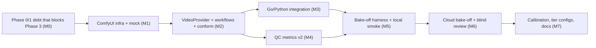
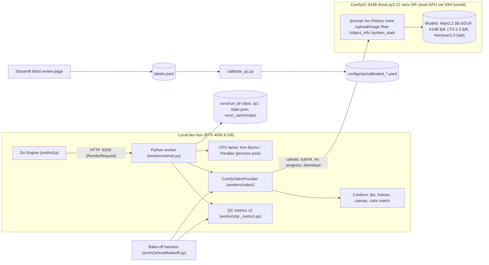
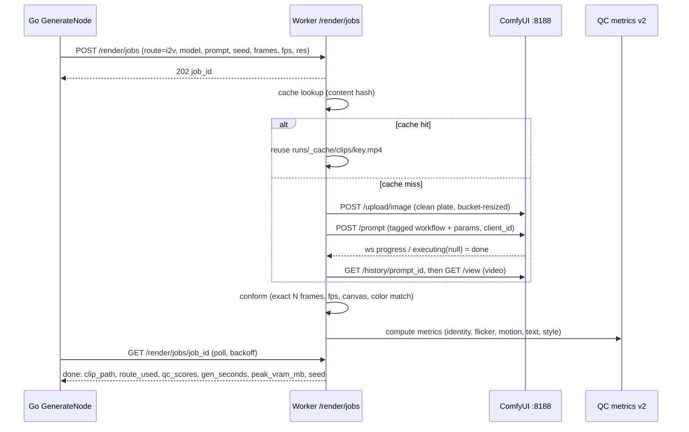
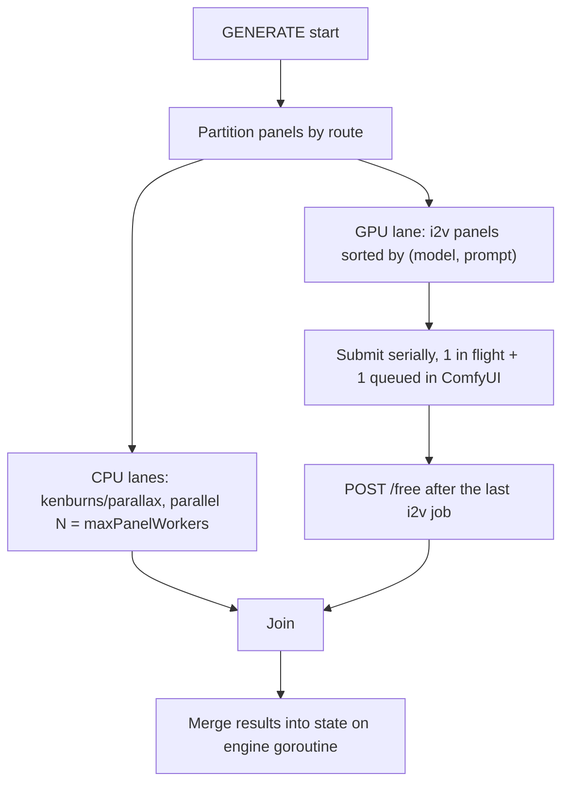
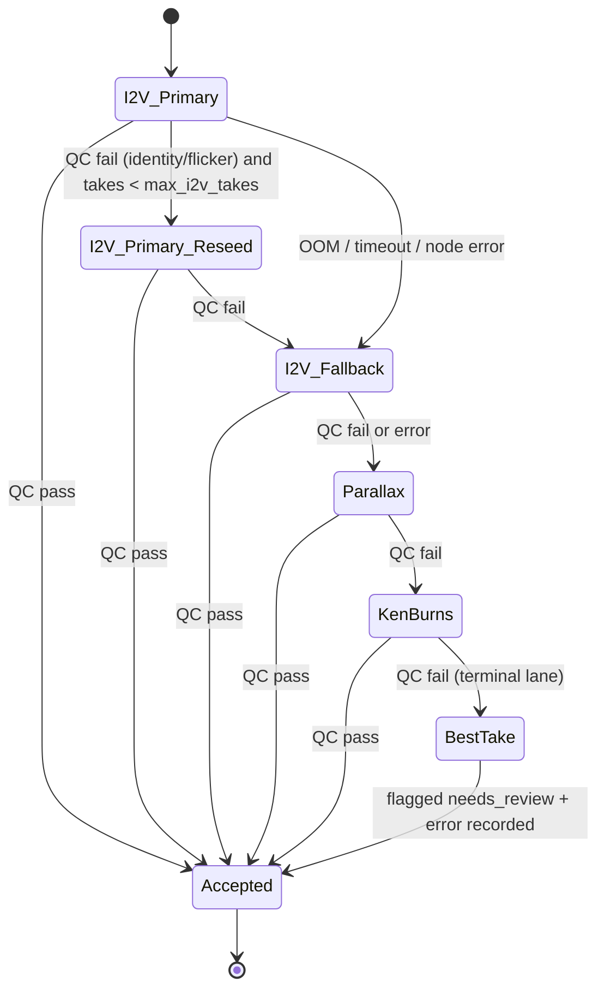
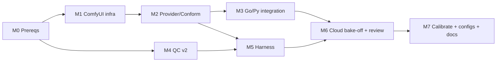

# Phase 3 — Video Bake-off & Calibration: Implementation Plan

> **Project:** Manhwa → Anime (M2A), Hybrid Go + Python · **Phase:** 3 of 6 · **Plan date:** 21 Oct 2026
> **Inputs used:** `Manhwa_to_Anime_Prototype_Proposal.pdf` (v0.2 §7–§9), `report.md` (model review), `optim.md` (Phase 0/1 audit), current code on `main` (`8499e19`), local hardware probe.
> **Locked decisions (from you):** ① **Hybrid hardware**: build and smoke-test on the local 6 GB GPU, then run the real bake-off on a rented 24–48 GB cloud GPU. ② **Candidates**: Wan 2.2 TI2V-5B, Wan 2.2 I2V-A14B, LTX-2.3. HunyuanVideo 1.5 is **optional** because of its licence.

---

## 0. Goal (TL;DR)

Phase 3 makes the `i2v` lane **real, measured and safe to use**. Today it is a label that quietly renders parallax. By the end of this phase:

1. **Real I2V generation**: The pipeline drives ComfyUI (`:8188`) through a real `VideoProvider`, from Go `GENERATE` → worker `/render` → ComfyUI → conform → QC. The state file records `route_used: "i2v"` truthfully.
2. **Evidence-based model choice**: A reproducible bake-off harness scores every candidate on the same panels, seeds and prompts. It measures automatic metrics, latency, peak VRAM, failure rate and a blind human rubric, then names a winner **per tier**.
3. **Calibrated QC gate**: QC thresholds come from human accept/reject labels (ROC/Youden), set **per route**, and stored in config. No more hand-picked `0.85 / 0.15` numbers.
4. **Budget-aware routing**: The router spends a GPU-seconds budget using the latency the bake-off measured, and chooses hero panels by a score instead of a hard-coded `30 / 10` counter.



---

## 1. User Review Required

> [!IMPORTANT]
> **The local GPU is below the proposal's T1 tier.** The probe found an **RTX 4050 Laptop with 6 GB VRAM**, 15 GB RAM and 12 threads. T1 is defined as 12–16 GB. This plan adds a new tier **`t1s` (6–8 GB)**: Wan 2.2 TI2V-5B as a **GGUF Q4/Q3** quant at about **480p portrait**, upscaled to 720×1280. It is meant for development and smoke tests, not for final quality. A14B, LTX-2.3 and Hunyuan are **cloud-only**.

> [!WARNING]
> **The licence register (`configs/models.yaml`) is wrong in ways that matter:**
> - **LTX-2.3** is a ~22B model under the **LTX-2 Community License**, not Apache-2.0. It is free below a $10M annual revenue threshold. Its VRAM figure (12 GB) is also understated.
> - **HunyuanVideo 1.5** (8.3B, Tencent Hunyuan Community License) **does not apply in the EU, UK or South Korea**. That is awkward for a *manhwa* tool. It stays opt-in (`enabled: false` by default) and must never become a default.
> - The `repo_id`s are placeholders (`tencent/hunyuan15`, `lightricks/ltx23`, `example/...`). Phase 3 pins the real repo **plus revision SHA plus file SHA-256**.

> [!WARNING]
> **Disk layout.** The repo lives on an **NTFS (`ntfs3`) partition** with 146 GB free. `/home` is btrfs with **only 19 GB free**. The ComfyUI venv (torch, about 6 GB) should go on `/home`. The model files (≥15 GB local) should go on the NTFS drive through ComfyUI's `extra_model_paths.yaml`. Never put model weights inside the git repo.

> [!CAUTION]
> **Python version trap.** The global interpreter is **Python 3.15**, and PyTorch/ComfyUI wheels will not exist for it yet. ComfyUI must run in its **own Python 3.12 venv** (`mise install python@3.12` or `uv venv -p 3.12`). The M2A worker talks to ComfyUI over HTTP only, so it does **not** need torch for the I2V path. Move `torch` out of the core worker requirements.

---

## 2. Critical Questions (answer before or during M0)

> [!IMPORTANT]
> Each question has a **default assumption**. The plan proceeds with that default unless you answer otherwise. The **Blocks** column shows the milestone that can't finish without an answer. Questions marked 🔴 change scope, cost or legal exposure. 🟠 changes design. 🟡 can be decided during implementation.

### 2.1 Data, people & budget

| # | Sev | Critical question | Why it matters | Default assumption | Blocks |
|---|---|---|---|---|---|
| CQ1 | 🔴 | **Where do the ≥16 real bake-off panels come from?** The current eval set (`data/eval/sample_page_*.png`) is synthetic shapes, and I2V on synthetic shapes tells us nothing. | The whole model choice and QC calibration rest on this panel set. Unrepresentative panels give a confidently wrong winner. | (c) Copyrighted manhwa kept **local-only** in gitignored `data/bakeoff/private/` for internal scoring, plus (a) licensed/CC-BY or (b) self-drawn/commissioned panels for anything committed or shown publicly. | M5, M6 |
| CQ2 | 🔴 | **Is a cloud budget of ~15 GPU-hours (RunPod or Vast.ai, 1× L40S 48 GB or 4090/A6000 24 GB) acceptable? Is there a preferred provider?** | §10.6 estimates 9–21 GPU-h. Without the cloud, A14B, LTX-2.3 and Hunyuan cannot be evaluated at all on a 6 GB GPU. | RunPod, L40S spot, hard cap 15 GPU-h, seed-1 prune step (§10.6 tip) to stay under budget. | M6 |
| CQ3 | 🔴 | **Who are the 3 blind reviewers?** The proposal promises a "3-reviewer blind rubric". | Calibration (E4/E5) needs ~150–250 labelled clips with agreement α ≥ 0.6. One reviewer means thresholds encode one person's taste. | You + 2 others; ~2 h of review each. Fallback: 2 reviewers + adversarial negatives, flagged as weaker evidence in the report. | M6, M7 |
| CQ4 | 🟠 | **What are the intended use and distribution of outputs?** (personal/research vs public release vs commercial) | Decides whether LTX-2.3 (LTX-2 Community, $10M revenue threshold) and HunyuanVideo 1.5 (not valid in EU/UK/**South Korea**) are usable at all, and whether outputs made from copyrighted manhwa can be shown. | Personal/research prototype, used from India; nothing public until a licence review. Hunyuan stays `enabled: false`. | M7 (tier defaults) |

### 2.2 Hardware & environment

| # | Sev | Critical question | Why it matters | Default assumption | Blocks |
|---|---|---|---|---|---|
| CQ5 | 🔴 | **Do you accept that the local box (RTX 4050 Laptop, 6 GB VRAM, 15 GB RAM) is a *dev/smoke* tier only (`t1s`), not the T1 tier from the proposal?** | The proposal's T1 assumes 12–16 GB. On 6 GB, only Wan 2.2 5B as a GGUF Q3/Q4 at ~480p is realistic, at several minutes per clip. Local latency numbers would not represent T1. | Yes: new `t1s` tier for development and E1; all quality and latency decisions come from cloud runs. | M2, M3 |
| CQ6 | 🟠 | **Can ComfyUI live outside the repo (`~/ComfyUI`, Python 3.12 venv on `/home`) with model weights on the NTFS drive (`/run/media/hihry/OS/m2a_models/`)?** | `/home` has only 19 GB free; the global Python is 3.15 (no torch wheels); the NTFS mount has no POSIX permissions or symlinks. Weights must never enter git. | Yes, as described in M1 and pitfalls T14/T15. | M1 |
| CQ7 | 🟡 | **Is installing extra system pieces OK** (Python 3.12 via mise/uv, CUDA-enabled torch in the ComfyUI venv, optional SageAttention build, ~15 GB of downloads)? | SageAttention needs a compiler toolchain and can fail on new drivers; it's optional. | Yes to Python 3.12 + torch; SageAttention attempted, skipped if the build fails. | M1 |

### 2.3 Scope & architecture

| # | Sev | Critical question | Why it matters | Default assumption | Blocks |
|---|---|---|---|---|---|
| CQ8 | 🔴 | **Is the M0 "Phase 0/1 debt" (per-call timeouts, ASSEMBLE hard-fail on I2V frame mismatch, single client + health probe, `models.yaml` fixes, torch-free worker requirements) in Phase 3 scope?** | Without M0, every real I2V call times out at 180 s, and accepted I2V clips are silently re-rendered as parallax. | Yes, M0 is done first, inside Phase 3. | everything |
| CQ9 | 🔴 | **The Job API and Streamlit UI still run the Python `PipelineGraph`** ([api/app.py](file:///run/media/hihry/OS/hihry/Ani/api/app.py#L13) L13, L87, L149), not the Go engine (`optim.md` P0-07 is still open). **Should Phase 3 I2V features be Go-only (API/UI spawn `m2a`), or must the Python orchestrator get them too?** | Implementing the GPU lane, model fallback ladder and budget router twice re-creates the split-brain flaw (F1). | **Go-only.** The API/UI get a minimal change to spawn `m2a run/resume` and read `state.json`. `src/m2a/nodes/generate.py`/`qc.py` raise a clear "use the Go engine for i2v" error. | M3 |
| CQ10 | 🟠 | **Is an async render-job API (`POST /render/jobs`, `GET/DELETE /render/jobs/{id}`) acceptable for I2V, instead of just raising the HTTP timeout?** | Long blocking requests break on proxies and tunnels and make cancelling impossible; a raised timeout plus a retry can double-submit GPU work. | Yes: async for I2V only; CPU lanes stay synchronous. | M3 |
| CQ11 | 🟠 | **Should the duplicate Python provider registry (`src/m2a/providers/video/*`) become thin wrappers over `workers/video/`, or be deleted?** | Two implementations will drift. | Thin wrappers (keeps the `get_video_provider()` API for the bake-off harness). | M2 |
| CQ12 | 🟠 | **Clip container: keep MJPEG `.avi` for clips (what ASSEMBLE decodes today), or switch clips to H.264 `.mp4` now (`optim.md` O6)?** | MJPEG I2V clips are ~10× larger; H.264 changes the assembler's decode path. | Keep `.avi` in Phase 3 (conform outputs whatever ASSEMBLE consumes); H.264 switch tracked separately. | M2 |
| CQ13 | 🟠 | **Panels longer than the model's ~5 s max (post-TTS durations go up to 10 s): use "hold-and-drift" (I2V clip + Ken Burns tail on the last frame), or split the panel into two shots?** | Splitting changes the panel/timeline contract and the subtitle timing; hold-and-drift is local to conform. | Hold-and-drift, with up to 1.25× slow-mo via interpolation first. Shot splitting deferred. | M2 |
| CQ14 | 🟡 | **Is changing the router from the hard-coded `30/10` budget to a score-based, GPU-seconds knapsack (§7 M3) acceptable?** It changes which panels get I2V vs the current behaviour. | CP2 reviewers will see different default routes than today. | Yes; `routing_plan.json` explains every decision, and CP2 overrides still win. | M3 |

### 2.4 Bake-off design & quality bar

| # | Sev | Critical question | Why it matters | Default assumption | Blocks |
|---|---|---|---|---|---|
| CQ15 | 🟠 | **Include speed variants as separate entries** (A14B + Lightning 4-step LoRA; SageAttention/TeaCache)? | They cut latency 5–10× but may cost quality; that trade-off decides the t2 default. Each variant adds ~48 clips. | Included; pruned after the seed-1 pass if clearly worse. | M5, M6 |
| CQ16 | 🟠 | **Are the quality bars right?** Gate precision ≥ 0.85 on "accept", metric AUC ≥ 0.75, reviewer α ≥ 0.6, and the scoring weights in §10.4 (40% human accept rate). | These numbers decide what ships and which model wins. | As written; revisit after the seed-1 pass if no config clears them. | M7 |
| CQ17 | 🟠 | **If I2V does *not* beat parallax for some shot types, is "I2V budget = 0 for that shot type" an acceptable Phase 3 outcome?** | It's a likely result for flat manhwa art. It means less AI video in the final output, but more stable output. | Yes, the decision is driven by evidence (§10.4). | M7 |
| CQ18 | 🟡 | **Optional quality tricks: enable colour-match, static-region compositing, Real-ESRGAN upscaling, and the "speaking" prompt for talking close-ups as bake-off variants?** | Each is cheap but can introduce its own artefacts (halo seams, over-sharpening, mouth morphing). | Colour-match and static compositing as variants; Real-ESRGAN only if Lanczos looks soft on t1s; lip-flap prompt as one variant on 2 close-ups. | M5 |
| CQ19 | 🟡 | **Is the DINOv2-small (ONNX, CPU) + OCR detector dependency set acceptable for QC v2** (~100–300 MB of extra weights in the worker)? | Without them, the identity and text-leakage gates stay the weak proxies from Phase 1. | Yes, as an optional `requirements-metrics.txt` extra; metrics return `-1` (not measured) when it's absent. | M4 |
| CQ20 | 🟡 | **The timeline (~15–19 working days, M0→M7): is there a hard deadline or demo date** that should reorder milestones (e.g. deliver E1 local I2V first, bake-off later)? | Changes whether M4/M5 run in parallel or get cut down. | No hard deadline; order as in §12. | planning |

### 2.5 Concerns already acted on (FYI, no answer needed)

- `configs/models.yaml` licences are wrong (LTX-2.3 is **not** Apache-2.0; Hunyuan has territory exclusions; repo IDs are placeholders). This is fixed in **M0-4**.
- `report.md`/README/proposal claim Phase 3 is "60% ready", but the workflows, providers and bake-off are stubs (§3). Docs are corrected in **M7** with links to measured numbers.
- Seeds, workflow hashes and the ComfyUI commit are recorded per clip, because GPU sampling isn't bit-reproducible across machines (pitfall T9).
- Cloud ComfyUI is reached **only via SSH tunnel**, because ComfyUI has no authentication (pitfall T7).

---

## 3. Where we are: Phase 3 gap analysis (verified in code)

The proposal marks Phase 3 as *"SCAFFOLDED & READY FOR GPU (60%)"*. In practice almost **none of the I2V path exists yet**:

| Area | Proposal claim | Reality on `main` | Evidence |
|---|---|---|---|
| ComfyUI workflows | "wan22, hunyuan15, ltx23 ready" | 36-line **placeholder** JSONs with fake node types (`WanImageToVideo` linked to `CheckpointLoaderSimple`, a `"description": "TODO"`). They are not in ComfyUI API format. | [wan22_i2v.json](file:///run/media/hihry/OS/hihry/Ani/workflows/comfyui/wan22_i2v.json) |
| Video providers | "populated registries" | Every provider is a `TODO` that returns a **nonexistent** `output_wan22_{seed}.mp4`. The registry is never called. | [wan22.py](file:///run/media/hihry/OS/hihry/Ani/src/m2a/providers/video/wan22.py#L19-L40), [hunyuan15.py](file:///run/media/hihry/OS/hihry/Ani/src/m2a/providers/video/hunyuan15.py), [ltx23.py](file:///run/media/hihry/OS/hihry/Ani/src/m2a/providers/video/ltx23.py) |
| Bake-off harness | "ready" | Writes **hard-coded** `0.9 / 0.8` metrics. | [bakeoff.py](file:///run/media/hihry/OS/hihry/Ani/src/m2a/eval/bakeoff.py#L20-L56) |
| `i2v` route | "Wan 2.2 hero panels" | The worker maps `i2v` → parallax (now reported honestly via `route_used`), but the router still spends budget on it. | [pipeline_cli.py](file:///run/media/hihry/OS/hihry/Ani/workers/pipeline_cli.py#L216-L256) |
| Residency manager | "keeps one heavy model in VRAM" | Sets a string and calls `empty_cache()`. It does not know ComfyUI exists. | [server.py](file:///run/media/hihry/OS/hihry/Ani/workers/server.py#L38-L64) |
| QC identity | "identity ≥ 0.85" | A **16-bin colour histogram** cosine. Pan/zoom clips score ~1.0 trivially, and a morphing face with the same palette also passes. | [assembler.py](file:///run/media/hihry/OS/hihry/Ani/workers/assembler.py#L75-L133) |
| QC text leakage | "0 new text" | Hard-coded `new_text_count: 0`. | same, L130 |
| QC flicker | "≤ 0.15" | `std(frame deltas)`. Readings are 40–250× below the threshold, so the gate is effectively off. | same; `optim.md` P1-03 |
| Cost ledger | "GPU seconds per model" | `RecordModelCost` is **never called** outside tests. | [state.go](file:///run/media/hihry/OS/hihry/Ani/internal/model/state.go#L376-L380) |
| HTTP timeout | — | A global `180 s` client timeout. Real I2V clips take 1–10 min, so **every I2V call would fail**. | [worker_client.go](file:///run/media/hihry/OS/hihry/Ani/internal/client/worker_client.go#L65) |
| Assembly reuse | — | An accepted clip is reused only if `|frames − expected| ≤ 2`. Otherwise it is **silently re-rendered as parallax**, which throws away the expensive I2V clip. | [pipeline_cli.py](file:///run/media/hihry/OS/hihry/Ani/workers/pipeline_cli.py#L330-L360) |
| Router | "budget-aware" | Hard-coded `gpuBudget := 30`, 10 units per hero, and `i%2==1` parity routing. | [nodes.go](file:///run/media/hihry/OS/hihry/Ani/internal/pipeline/nodes.go#L329-L377) |

**Already fixed and reusable** (keep it): TTS now runs **before** GENERATE ([engine.go](file:///run/media/hihry/OS/hihry/Ani/internal/pipeline/engine.go#L28-L56)), so clips are rendered at their final duration. `route_used` is propagated back into `p.Route`. QC never forces a pass and walks the fallback chain. `min_motion` / `max_motion` exist in `QCConfig`. HTTP 4xx/5xx no longer triggers a CLI re-run. A bounded `HEAVY_SEMAPHORE` exists. GENERATE runs in parallel with `maxPanelWorkers()`.

---

## 4. Scope & Definition of Done

### In scope
- ComfyUI integration (local + remote), real API-format workflows for **Wan 2.2 TI2V-5B (incl. GGUF)**, **Wan 2.2 I2V-A14B (incl. Lightning variant)** and **LTX-2.3**, plus an optional **HunyuanVideo 1.5** workflow.
- Video post-processing ("conform"): exact frame count, fps, aspect canvas, colour match, encode.
- Go and Python integration: request struct, async rendering for long jobs, GPU lane, model-level fallback, real cost ledger.
- QC metrics v2 (optical-flow motion and warp error, embedding identity, OCR text leakage, style drift) and **per-route calibrated thresholds**.
- Bake-off harness, a blind review UI, a calibration script, tier configs (`t1s` new; `t1`, `t2` updated).

### Out of scope (later phases)
Phoneme lip-sync, per-character LoRA training, multi-chapter batching, VACE / ControlNet conditioning (recorded as a Phase 6 stretch experiment, §8.4).

### Exit criteria (all must hold)

| # | Criterion | Measured by |
|---|---|---|
| E1 | `m2a run --tier t1s --auto-approve` on the bake-off sample produces **≥1 real I2V clip** with `route_used=i2v` and **no OOM** on the local RTX 4050 | E2E smoke test + `state.json` |
| E2 | The same run on cloud `--tier t2` routes 2–4 hero panels to I2V and finishes end to end | cloud run log |
| E3 | Bake-off covers **≥16 panels × 3 seeds × ≥4 model configs (≥192 clips)**. Every failure (OOM, timeout, node error) is recorded, never dropped. | `bakeoff_results.jsonl` |
| E4 | ≥150 clips labelled by 3 blind reviewers; Krippendorff's α ≥ 0.6 on accept/reject | `labels.jsonl` + report |
| E5 | Every QC gate metric used reaches **AUC ≥ 0.75** against human labels. The calibrated gate reaches **precision ≥ 0.85 on "accept"**. | `calibration_report.md` |
| E6 | Synthetic adversarial clips (frozen, shuffled frames, injected text, colour-shifted, face-morphed) are **100% rejected** | pytest |
| E7 | ASSEMBLE never re-renders an accepted I2V clip; a frame mismatch is a **hard error** | Go and pytest tests |
| E8 | Cost ledger records GPU seconds **per model**; `routing_plan.json` shows the budget spent vs available | `state.json` |
| E9 | `configs/models.yaml` has the correct licences plus pinned revisions and SHA-256; the README and proposal status are updated honestly | review |

---

## 5. Target architecture

### 5.1 Deployment view



**Key design choices**

| Decision | Choice | Why |
|---|---|---|
| Where the I2V client lives | `workers/video/` (Python worker), **one implementation**. `src/m2a/providers/video/*` become thin re-exports. | Go stays canonical; avoids the split-brain flaw (F1) coming back. |
| How the worker talks to ComfyUI | Plain HTTP + WebSocket against ComfyUI's native API. No `comfyui-api` dependency. | Fewer moving parts. The same code works locally and through an SSH tunnel to the cloud. |
| Workflow parameterisation | API-format JSON with **tagged node titles** (`M2A_IMAGE`, `M2A_POS`, `M2A_SEED` …) | Node IDs change every time a workflow is re-exported; titles don't. |
| Long jobs | `POST /render` stays synchronous for CPU lanes. **I2V uses `POST /render/jobs` + `GET /render/jobs/{id}`** (async), and Go polls. | Avoids HTTP timeouts and double execution; Go can cancel a job. |
| GPU concurrency | **One GPU lane** (serial, batched by model) running **at the same time as** the CPU lanes | A single GPU; model swaps cost 20–90 s; CPU lanes shouldn't wait on the GPU. |
| VRAM residency | The worker calls ComfyUI `POST /free {"unload_models":true,"free_memory":true}` at the end of the I2V batch and before any other GPU stage | ComfyUI is a separate process, so `torch.cuda.empty_cache()` in the worker does nothing for it. |

### 5.2 I2V render sequence



### 5.3 GENERATE lane scheduling



> [!TIP]
> Keep **exactly one job queued ahead** in ComfyUI. While the GPU samples clip *k*, ComfyUI already holds clip *k+1*'s prompt, so it starts with no idle gap and the encoders are still cached. Don't queue more than that: cancelling on QC or user abort becomes expensive.

### 5.4 Fallback ladder (model level + route level)



Reseeding only helps against **stochastic** failures (flicker, morphing). **Deterministic** failures such as OOM or a missing node skip straight to the fallback model.

### 5.5 Data contract changes (Go ⇄ Python, both sides plus a golden test)

```go
// internal/model/state.go — ClipCandidate (extended, all new fields omitempty for back-compat)
type ClipCandidate struct {
    PanelID      string   `json:"panel_id"`
    Path         string   `json:"path"`
    TakeNumber   int      `json:"take_number"`
    QC           QCScores `json:"qc_scores"`
    Accepted     bool     `json:"accepted"`
    Route        AnimationRoute `json:"route,omitempty"`         // route actually rendered
    DegradedFrom AnimationRoute `json:"degraded_from,omitempty"` // requested route if different
    Model        string   `json:"model,omitempty"`               // e.g. "wan22-ti2v-5b-gguf-q4"
    WorkflowHash string   `json:"workflow_hash,omitempty"`       // sha256 of the template file
    Seed         int64    `json:"seed,omitempty"`
    Prompt       string   `json:"prompt,omitempty"`
    GenSeconds   float64  `json:"gen_seconds,omitempty"`
    PeakVRAMMB   int      `json:"peak_vram_mb,omitempty"`
    CacheHit     bool     `json:"cache_hit,omitempty"`
    QCReasons    []string `json:"qc_reasons,omitempty"`
    NeedsReview  bool     `json:"needs_review,omitempty"`
}

// QCScores — new optional metrics (-1 = not measured)
type QCScores struct {
    IdentitySimilarity float64 `json:"identity_similarity"`
    NewTextCount       int     `json:"new_text_count"`
    FlickerScore       float64 `json:"flicker_score"`
    MotionScore        float64 `json:"motion_score"`
    FirstFrameFidelity float64 `json:"first_frame_fidelity,omitempty"` // SSIM(frame0, source)
    StyleDrift         float64 `json:"style_drift,omitempty"`          // edge-density + palette delta
    WarpError          float64 `json:"warp_error,omitempty"`           // flow-compensated temporal error
    MetricsVersion     int     `json:"metrics_version,omitempty"`      // 2 for Phase 3
    OverallPass        bool    `json:"overall_pass"`
}
```

Mirror these in [state.py](file:///run/media/hihry/OS/hihry/Ani/src/m2a/state.py). Add a **golden contract test**: Go writes `testdata/state_phase3_golden.json`, pytest loads it with `RunState.load`, and the reverse.

> [!NOTE]
> **Seed policy (deterministic resume):** `seed = uint32(sha256(config_hash ‖ panel_id ‖ take))`. A resumed run regenerates the *same* clip, and with the content-hash cache it doesn't regenerate at all.

---

## 6. Model matrix & per-model specs

> [!NOTE]
> These values are starting points from model cards and community reports. **Verify every row against ComfyUI `/object_info` and the pinned model card during M2.** The point of the bake-off is to replace estimates with measurements.

| Config ID | Model | Params | Licence | Native res (portrait) | fps · frames rule | Typical steps / CFG | Tier | ComfyUI path |
|---|---|---|---|---|---|---|---|---|
| `wan22-5b-gguf-q4` | Wan 2.2 TI2V-5B (GGUF Q4_K_M; Q3_K_S on 6 GB) | 5B | Apache-2.0 | 704×1280 (local: **480×864**) | 24 fps · **4k+1** (121 = 5.04 s) | 20–30 / 5.0 | **t1s**, t1 | Native Wan 2.2 nodes + `ComfyUI-GGUF` loader |
| `wan22-5b-fp8` | Wan 2.2 TI2V-5B fp8 | 5B | Apache-2.0 | 704×1280 | 24 · 4k+1 | 30 / 5.0 | t1, t2 | native |
| `wan22-a14b-fp8` | Wan 2.2 I2V-A14B (2 experts: high-noise + low-noise) | 14B×2 (MoE) | Apache-2.0 | 480×832 / 720×1280 | **16 fps** · 4k+1 (81 = 5.06 s) | 20 split 10/10 / 3.5 | t2 | native, two `KSamplerAdvanced` passes |
| `wan22-a14b-lightning` | A14B + LightX2V Lightning 4-step LoRA | 14B×2 | Apache-2.0 (check LoRA card) | 480×832 / 720×1280 | 16 · 4k+1 | **4 split 2/2 / 1.0** | t2 | native + `LoraLoaderModelOnly` |
| `ltx23-fp8` | LTX-2.3 (distilled where available) | ~22B | **LTX-2 Community** | multiples of **32** | 24 · **8k+1** | ~8 (distilled) | t2 | `ComfyUI-LTXVideo` / native |
| `hunyuan15-fp8` *(opt)* | HunyuanVideo 1.5 I2V | 8.3B | **Tencent Community (no EU/UK/KR)** | 480p / 720p | 24 · 4k+1 | 30–50 (step-distilled variants exist) | t2 | native |

**Tier mapping after Phase 3** (to be finalised by the bake-off in M7):

| Tier | Hardware | I2V primary → fallback | I2V budget | Output path |
|---|---|---|---|---|
| `t0` | CPU | none (I2V disabled) | 0 s | KB / parallax only |
| **`t1s`** *(new)* | 6–8 GB (RTX 4050/4060 laptop) | `wan22-5b-gguf-q4` → parallax | ~600 s per run (≈1–2 heroes) | 480p gen → Lanczos (or Real-ESRGAN-anime) up to 720×1280 |
| `t1` | 12–16 GB | `wan22-5b-fp8` → parallax | measured | 704×1280 native |
| `t2` | 24–48 GB | bake-off winner (expected `wan22-a14b-lightning` or `wan22-a14b-fp8`) → `wan22-5b-fp8` → parallax | measured | 720×1280 native |

---

## 7. Proposed changes (by component, in dependency order)

### M0 — Prerequisites: Phase 0/1 debt that **blocks** Phase 3

These are small but non-negotiable. Without them the bake-off numbers would be meaningless or the I2V lane would crash.

| ID | Change | File(s) | Why it blocks Phase 3 |
|---|---|---|---|
| M0-1 | Per-call timeouts: remove the global `Timeout: 180s` and use a `context.WithTimeout` per endpoint (render CPU 10 min, I2V via async polling, assemble `30 s + 3×duration`) | [worker_client.go](file:///run/media/hihry/OS/hihry/Ani/internal/client/worker_client.go#L50-L70) | Every I2V call would time out |
| M0-2 | ASSEMBLE: an accepted clip whose frame count mismatches is a **hard error** for `i2v` (no silent parallax re-render). CPU-lane clips may still re-render. | [pipeline_cli.py](file:///run/media/hihry/OS/hihry/Ani/workers/pipeline_cli.py#L330-L360) | Expensive I2V output thrown away silently |
| M0-3 | Construct `WorkerClient` **once** per engine run (captured in node closures) and add a single `/health` probe that also reports `video_providers` | `nodes.go` (`RegisterDefaultNodes`), `server.py` | The router needs to know whether I2V is actually available |
| M0-4 | Fix the `models.yaml` licences and repo IDs; add `revision` and `sha256` fields; Go `KnownFields(true)` for strict YAML | [models.yaml](file:///run/media/hihry/OS/hihry/Ani/configs/models.yaml), [config.go](file:///run/media/hihry/OS/hihry/Ani/internal/config/config.go) | Licence correctness (E9); config typos silently disabling QC |
| M0-5 | Split the worker requirements: `requirements.txt` (core, no torch) + `requirements-metrics.txt` (opencv-contrib, onnxruntime/torch-cpu for DINOv2/OCR) | `workers/requirements*.txt`, `pyproject.toml` | Python 3.15 has no torch wheels; keeps the worker installable |
| M0-6 | Move `compute_clip_qc_metrics` out of `assembler.py` into `workers/qc_metrics.py` (kept as a thin alias) | [assembler.py](file:///run/media/hihry/OS/hihry/Ani/workers/assembler.py#L75-L133) | M4 rewrites it; isolates it from assembly |

---

### M1 — ComfyUI infrastructure (local + cloud + mock)

#### [NEW] `scripts/comfyui/setup_local.sh`
- Clones ComfyUI at a **pinned commit** into `~/ComfyUI` (btrfs /home), creates a **Python 3.12** venv, installs torch with CUDA, and installs custom nodes at pinned commits: `ComfyUI-GGUF`; `ComfyUI-LTXVideo` (cloud only); optionally `ComfyUI-VideoHelperSuite` (VHS) for video I/O; `ComfyUI-Frame-Interpolation` (RIFE).
- Writes `~/ComfyUI/extra_model_paths.yaml` pointing to `/run/media/hihry/OS/m2a_models/` (NTFS, plenty of space).
- Launch flags for the 6 GB laptop: `--lowvram --reserve-vram 0.6 --preview-method none --disable-auto-launch` (add `--use-sage-attention` if SageAttention installs cleanly), with env `PYTORCH_CUDA_ALLOC_CONF=expandable_segments:True`.

#### [NEW] `scripts/comfyui/download_models.py`
Reads `workflows/comfyui/manifest.yaml` and downloads the files for a tier via `huggingface_hub.hf_hub_download(repo_id, filename, revision=<sha>)`, checks **SHA-256**, and places them in the right `models/<kind>/` folder. Flags: `--tier t1s|t2`, `--dry-run` (prints total GB).

#### [NEW] `workflows/comfyui/manifest.yaml`
```yaml
comfyui: { repo: comfyanonymous/ComfyUI, commit: "<pinned>" }
custom_nodes:
  - { name: ComfyUI-GGUF,          repo: city96/ComfyUI-GGUF,             commit: "<pinned>" }
  - { name: ComfyUI-LTXVideo,      repo: Lightricks/ComfyUI-LTXVideo,     commit: "<pinned>", tiers: [t2] }
  - { name: ComfyUI-Frame-Interpolation, repo: Fannovel16/ComfyUI-Frame-Interpolation, commit: "<pinned>" }
models:
  wan22-5b-gguf-q4:
    tiers: [t1s, t1]
    files:
      - { kind: diffusion_models, repo: "<verified repo>", file: "Wan2.2-TI2V-5B-Q4_K_M.gguf", revision: "<sha>", sha256: "<sha256>" }
      - { kind: text_encoders,    repo: "<verified repo>", file: "umt5-xxl-encoder-Q4_K_M.gguf", revision: "<sha>", sha256: "<sha256>" }  # GGUF encoder keeps RAM < 15 GB
      - { kind: vae,              repo: "Comfy-Org/Wan_2.2_ComfyUI_Repackaged", file: "split_files/vae/wan2.2_vae.safetensors", revision: "<sha>", sha256: "<sha256>" }
    workflow: wan22_ti2v5b_gguf_api.json
  # ... wan22-a14b-fp8, wan22-a14b-lightning, ltx23-fp8, hunyuan15-fp8 (enabled: false)
```

#### [NEW] `scripts/comfyui/cloud/Dockerfile` + `bootstrap.sh`
A reproducible cloud image: CUDA base → ComfyUI at the pinned commit → custom nodes → `download_models.py --tier t2` into a **persistent volume** (so models are downloaded once, not per pod). Access over `ssh -N -L 8188:127.0.0.1:8188 user@pod`. **Never expose 8188 publicly**: ComfyUI has no auth.

#### [NEW] `tests/fakes/fake_comfyui.py`
A FastAPI app that implements the ComfyUI API subset we use: `/prompt`, `/history/{id}`, `/view`, `/upload/image`, `/free`, `/interrupt`, `/object_info`, `/system_stats`, `/queue`, and a `/ws` that emits `progress` and `executing:null`. It "generates" a clip by Ken-Burns-rendering the uploaded image (or, by flag, a frozen / flickery / text-injected clip for QC tests). It also supports **fault injection**: `?fail=oom|node_error|timeout`. This drives CI and local development without a GPU.

---

### M2 — VideoProvider, workflow templates, conform

#### [DELETE → REPLACE] `workflows/comfyui/{wan22,hunyuan15,ltx23}_i2v.json`
Replace them with **real API-format exports** (ComfyUI → *Workflow → Export (API)*):
`wan22_ti2v5b_gguf_api.json`, `wan22_ti2v5b_fp8_api.json`, `wan22_i2v_a14b_api.json`, `wan22_i2v_a14b_lightning_api.json`, `ltx23_i2v_api.json`, `hunyuan15_i2v_api.json`.

Each template **must** title its parameter nodes with these tags (enforced by a test):

| Tag (node `_meta.title`) | Input field(s) injected |
|---|---|
| `M2A_IMAGE` | `image` (uploaded filename) |
| `M2A_POS` / `M2A_NEG` | `text` |
| `M2A_SEED` | `seed` or `noise_seed` |
| `M2A_LATENT` | `width`, `height`, `length` (frames), `batch_size` |
| `M2A_SAMPLER` | `steps`, `cfg` (and `start_at_step`/`end_at_step` for A14B experts) |
| `M2A_OUTPUT` | `filename_prefix`, `fps` |

#### [NEW] `workers/video/workflows.py`
```python
"""Load API-format ComfyUI workflows and inject parameters by tagged node titles."""
import copy, hashlib, json
from functools import lru_cache
from pathlib import Path

REQUIRED_TAGS = {"M2A_IMAGE", "M2A_POS", "M2A_NEG", "M2A_SEED", "M2A_LATENT", "M2A_OUTPUT"}

@lru_cache(maxsize=16)
def load_template(path: str) -> tuple[dict, str]:
    raw = Path(path).read_bytes()
    wf = json.loads(raw)
    titles = {n.get("_meta", {}).get("title") for n in wf.values()}
    missing = REQUIRED_TAGS - titles
    if missing:
        raise ValueError(f"{path}: workflow missing tagged nodes {sorted(missing)}")
    return wf, hashlib.sha256(raw).hexdigest()

def inject(template: dict, params: dict[str, dict]) -> dict:
    """params = {"M2A_SEED": {"seed": 123}, "M2A_LATENT": {"width": 480, ...}, ...}"""
    wf = copy.deepcopy(template)
    by_title = {n.get("_meta", {}).get("title"): n for n in wf.values()}
    for tag, fields in params.items():
        node = by_title.get(tag)
        if node is None:
            continue  # optional tag (e.g. M2A_SAMPLER on distilled graphs)
        for k, v in fields.items():
            if k not in node["inputs"]:
                raise KeyError(f"{tag}: input {k!r} not in {node['class_type']}")
            node["inputs"][k] = v
    return wf
```

#### [NEW] `workers/video/comfy_client.py`
A minimal, robust client:
```python
class ComfyClient:
    def __init__(self, base_url: str, timeout_s: float = 900):
        self.base, self.client_id = base_url.rstrip("/"), uuid.uuid4().hex
        self.http = httpx.Client(timeout=httpx.Timeout(30, read=60))

    def ready(self) -> dict:                       # /system_stats -> VRAM total/free, version
    def has_nodes(self, class_types: set[str]) -> set[str]:   # /object_info -> missing node types
    def upload_image(self, path: Path) -> str:     # multipart /upload/image, subfolder="m2a", overwrite
    def submit(self, workflow: dict) -> str:       # POST /prompt -> prompt_id; raise on node_errors
    def wait(self, prompt_id: str, deadline_s: float, on_progress=None) -> dict:
        """WebSocket /ws?clientId=...; finishes on {'type':'executing','data':{'node':None,'prompt_id':id}}.
        On ws drop: fall back to polling /history/{id} every 2 s. On 'execution_error': raise
        ComfyExecutionError (classify OOM by 'OutOfMemoryError'/'CUDA out of memory' in traceback)."""
    def outputs(self, prompt_id: str) -> list[dict]:   # /history -> files under images/gifs/videos keys
    def download(self, file: dict, dst: Path) -> Path: # /view?filename=&subfolder=&type=output (streamed)
    def free(self, unload_models=True, free_memory=True) -> None:  # POST /free
    def interrupt(self) -> None:                   # POST /interrupt (on cancel/timeout)
```
Error taxonomy (drives the fallback ladder): `ComfyUnavailable` (connect), `ComfyNodeMissing`, `ComfyOOM`, `ComfyTimeout`, `ComfyExecutionError`.

#### [NEW] `workers/video/provider.py` (the one real `VideoProvider`)
```python
@dataclass(frozen=True)
class ModelSpec:                     # loaded from configs/video_models.yaml
    id: str; workflow: str; fps: int; frame_rule: int   # 4 => 4k+1, 8 => 8k+1
    buckets: list[tuple[int, int]]  # allowed (w, h), e.g. [(480,864),(864,480),(640,640)]
    steps: int; cfg: float; max_frames: int; negative: str; est_s_per_frame: float

class ComfyVideoProvider(VideoProvider):
    def generate_clip(self, image, prompt, duration_s, seed, *, out_path, target_fps, target_res) -> GenResult:
        spec = self.spec
        n_gen = frames_for(min(duration_s, spec.max_frames / spec.fps), spec.fps, spec.frame_rule)
        w, h = pick_bucket(Image.open(image).size, spec.buckets)       # aspect-aware
        key = cache_key(image, spec, prompt, seed, n_gen, (w, h))
        if (hit := self.cache.get(key)): return hit
        up = self.comfy.upload_image(prepare_input(image, (w, h)))     # letterbox-free fit, see §8.3
        wf = inject(self.template, {"M2A_IMAGE": {"image": up}, "M2A_POS": {"text": prompt},
                    "M2A_NEG": {"text": spec.negative}, "M2A_SEED": {"seed": seed},
                    "M2A_LATENT": {"width": w, "height": h, "length": n_gen},
                    "M2A_SAMPLER": {"steps": spec.steps, "cfg": spec.cfg},
                    "M2A_OUTPUT": {"filename_prefix": f"m2a/{key[:16]}", "fps": spec.fps}})
        t0 = time.monotonic(); pid = self.comfy.submit(wf)
        self.comfy.wait(pid, deadline_s=self.deadline(n_gen))
        raw = self.comfy.download(self.comfy.outputs(pid)[0], self.tmp / f"{key}.mp4")
        clip = conform(raw, source=image, duration_s=duration_s, fps=target_fps, res=target_res)
        return self.cache.put(key, GenResult(clip, gen_seconds=time.monotonic() - t0, ...))

def frames_for(duration_s: float, fps: int, rule: int) -> int:
    n = max(rule + 1, math.ceil(duration_s * fps))
    return ((n - 1 + rule - 1) // rule) * rule + 1        # round UP to rule*k + 1
```
`src/m2a/providers/video/{wan22,ltx23,hunyuan15}.py` become **3-line subclasses** that select a `ModelSpec`, so the registry and the worker share a single implementation.

#### [NEW] `workers/video/conform.py`: make every I2V clip a drop-in for ASSEMBLE
1. **Decode** with ffmpeg (stream frames; never load the whole clip into PIL).
2. **Temporal conform** to `target_fps` and **exactly** `N = round(duration_s × fps)` frames:
   - 16 → 24 fps (A14B): RIFE ×2 then drop to 24 (preferred), or `ffmpeg minterpolate=mi_mode=mci` (CPU fallback), or `fps=24` duplication (last resort).
   - Generated length < panel duration: (a) up to **1.25×** slow-mo via interpolation; then (b) **hold-and-drift**: freeze the last frame and continue with a gentle Ken Burns tail (0.5–1.5 s), crossfaded over 6 frames. **Never ping-pong** (reverse playback looks broken in anime).
   - Generated length > duration: trim the **tail** (I2V motion is best early, and frame 0 matches the source).
3. **Spatial conform**: if the bucket aspect ≠ 9:16, composite each frame onto the existing `prepare_cinematic_canvas` blurred-fill background, so the P10 behaviour stays identical to the KB lane. Upscale 480p → 720×1280 with Lanczos (t1s) or Real-ESRGAN-anime (optional, GPU).
4. **Colour match** (optional, config-driven): per-frame LAB mean/std transfer toward the clean plate. This removes Wan's typical contrast/saturation drift (§8.3).
5. **Encode** to the clip container the assembler consumes (today MJPEG `.avi`; H.264 `.mp4` once `optim.md` O6 lands). **Assert** frame count == N and resolution == target, or raise.

---

### M3 — Go control plane & worker integration

#### [MODIFY] [config.go](file:///run/media/hihry/OS/hihry/Ani/internal/config/config.go#L48-L76)
```go
type GenerationConfig struct {
    PrimaryModel    string   `yaml:"primary_model"       json:"primary_model"`
    FallbackModels  []string `yaml:"fallback_models"     json:"fallback_models"`
    MaxRetries      int      `yaml:"max_retries"         json:"max_retries"`
    MaxClipDuration float64  `yaml:"max_clip_duration_s" json:"max_clip_duration_s"`
    // Phase 3
    ComfyUIURL      string   `yaml:"comfyui_url"         json:"comfyui_url"`        // http://127.0.0.1:8188
    I2VBudgetS      float64  `yaml:"i2v_budget_s"        json:"i2v_budget_s"`       // GPU seconds per run
    MaxI2VTakes     int      `yaml:"max_i2v_takes"       json:"max_i2v_takes"`      // reseeds before model fallback
    MaxI2VPanels    int      `yaml:"max_i2v_panels"      json:"max_i2v_panels"`     // hard cap
    I2VJobTimeoutS  int      `yaml:"i2v_job_timeout_s"   json:"i2v_job_timeout_s"`
    CalibrationFile string   `yaml:"calibration_file"    json:"calibration_file"`   // configs/calibration/t2.yaml
}

type QCRouteThresholds struct {
    IdentityThreshold float64 `yaml:"identity_threshold" json:"identity_threshold"`
    FlickerThreshold  float64 `yaml:"flicker_threshold"  json:"flicker_threshold"`
    MinMotion         float64 `yaml:"min_motion"         json:"min_motion"`
    MaxMotion         float64 `yaml:"max_motion"         json:"max_motion"`
    MinFirstFrame     float64 `yaml:"min_first_frame"    json:"min_first_frame"`
    MaxStyleDrift     float64 `yaml:"max_style_drift"    json:"max_style_drift"`
}
// QCConfig gains:  PerRoute map[string]QCRouteThresholds `yaml:"per_route"`;  RequireTextCheck bool
```

#### [MODIFY] [evaluator.go](file:///run/media/hihry/OS/hihry/Ani/internal/qc/evaluator.go)
- `EvaluateClip(scores, cfg, route)` merges `cfg.PerRoute[route]` over the global thresholds. **Only metrics that were measured** (≥ 0) are gated; if `RequireTextCheck` is set, `new_text_count == -1` fails.
- `NextFallback(cand, chain)` returns `(route, model)` and walks `primary → reseed(≤MaxI2VTakes) → fallback_models… → parallax → kenburns`.

#### [MODIFY] [worker_client.go](file:///run/media/hihry/OS/hihry/Ani/internal/client/worker_client.go#L313-L360)
Replace the 9-argument `RenderClip` with a request struct, and add an async path:
```go
type RenderRequest struct {
    ImagePath, OutputPath string
    Route  model.AnimationRoute; Shot model.ShotType
    DurationS float64; FPS, Width, Height int
    Model, Prompt, NegativePrompt string   // i2v only
    Seed int64
}
func (c *WorkerClient) RenderClip(ctx context.Context, r RenderRequest) (*RenderResult, error) {
    if r.Route != model.RouteI2V { return c.renderSync(ctx, r) }   // POST /render, 10 min ctx
    id, err := c.submitRenderJob(ctx, r)                           // POST /render/jobs -> 202
    if err != nil { return nil, err }
    return c.pollRenderJob(ctx, id, 2*time.Second, 15*time.Second) // backoff; DELETE job on ctx cancel
}
```
The CLI fallback for I2V runs `pipeline_cli.py render --route i2v ...` synchronously (this is fine because it holds no HTTP connection), with `exec.CommandContext` and the I2V deadline.

#### [MODIFY] [nodes.go](file:///run/media/hihry/OS/hihry/Ani/internal/pipeline/nodes.go) — `RouteNode` (L329-377): score-based, budget-aware routing
```go
// heroScore ranks panels for the scarce I2V budget.
func heroScore(p model.PanelJSON, maskRatio float64) float64 {
    shotW := map[model.ShotType]float64{model.ShotSplash: 1.0, model.ShotCloseUp: 0.9, model.ShotMedium: 0.5, model.ShotWide: 0.2}[p.Shot]
    s := 0.45*shotW + 0.35*p.MotionIntensity
    if len(p.Characters) > 0 { s += 0.15 }
    s -= 0.6 * maskRatio      // heavily inpainted plates -> i2v amplifies the smudge
    if a := aspect(p.BBox); a > 2.2 || a < 0.45 { s -= 1.0 } // outside model buckets
    return s
}
// Greedy knapsack: sort by heroScore desc; take while budget >= est(model, frames) && count < MaxI2VPanels
// est() comes from configs/calibration/<tier>.yaml (bake-off measured s/frame), not a constant.
// allowI2V additionally requires health.VideoProviders[primary] == "ready".
```
Write `routes/routing_plan.json` with `{budget_s, spent_s, per_panel: {score, est_s, route, reason}}`, so CP2 reviewers can see *why* a panel got I2V.

#### [MODIFY] `nodes.go` — `GenerateNode` (L379-468) and `QCNode` (L470-555)
- Split panels into a **GPU lane** (serial; sorted by `model, prompt` to maximise ComfyUI caching) and **CPU lanes** (the existing semaphore), started together; merge results on the engine goroutine.
- Fill the new `ClipCandidate` fields, call `state.RecordModelCost(model, genSeconds)`, and `Save` after **each** I2V clip (expensive work is checkpointed per clip, not per stage).
- QC uses the model-aware fallback, keeps the "never re-render an identical lane" rule, and marks `NeedsReview` plus `RecordError` when shipping a best take.
- After the GPU lane: `wc.FreeGPU(ctx)` → worker → ComfyUI `/free`.

#### [MODIFY] [server.py](file:///run/media/hihry/OS/hihry/Ani/workers/server.py)
- `RenderRequest` gains `model`, `prompt`, `negative_prompt`, `seed`.
- New `POST /render/jobs`, `GET /render/jobs/{id}`, `DELETE /render/jobs/{id}` (→ ComfyUI `/interrupt`), backed by a single-thread `GPU_EXECUTOR` (one GPU lane) plus the existing pool for CPU lanes. **Separate** `GPU_SEMAPHORE(1)` and `CPU_SEMAPHORE(N)`: an I2V wait must not block Ken Burns renders.
- `POST /gpu/free` → `ComfyClient.free()`.
- `/health` adds `video_providers: {model_id: "ready" | "missing_nodes:[..]" | "missing_models" | "unreachable"}`, using `/object_info` and `/system_stats`, cached for 30 s.
- Replace `ModelResidencyManager` with a real `GpuResidency` that knows about **two GPU tenants**: in-process (future Qwen-VL, LaMa) and ComfyUI. Before activating either, it frees the other.

#### [MODIFY] [pipeline_cli.py](file:///run/media/hihry/OS/hihry/Ani/workers/pipeline_cli.py#L216-L256)
`render_single_panel_clip(route="i2v", model=..., prompt=...)` calls the provider. On `ComfyUnavailable`/`ComfyNodeMissing` it returns `route_used="parallax", degraded_from="i2v", degrade_reason=...` (honest). On `ComfyOOM`/`ComfyTimeout` it **raises** a typed error so Go's ladder picks the fallback model.

#### Prompt builder (shared, `workers/video/prompts.py`)
```python
def build_prompt(panel: dict, spec: ModelSpec) -> tuple[str, str]:
    cam = CAMERA_VERBS[panel["shot"]]                    # from CAMERA_MOTION_TAXONOMY, model-tuned
    subj = SUBJECT_MOTION.get(panel.get("emotion"), "subtle breathing, gentle hair sway")
    pos = f"{cam}. {subj}. {panel['motion_prompt']}. {panel['style_anchor']}, consistent character design, stable line art"
    neg = spec.negative + ", text, subtitles, speech bubble, watermark, logo, photorealistic, 3d render, extra limbs, deformed face, morphing"
    return pos[:600], neg
```
**Describe motion, not appearance.** The image already carries the appearance. Restating it ("blue-haired boy") makes the model "repaint" the character and increases identity drift.

---

### M4 — QC metrics v2 (`workers/qc_metrics.py`)

All metrics run on a **sampled** set of frames (16–24 frames, downscaled to 360 px short side) and stay CPU-friendly. Every metric returns `-1` if it could not be computed.

| Metric | Definition | Catches | Cost |
|---|---|---|---|
| `motion_score` | Median Farneback optical-flow magnitude / frame diagonal, scaled to [0,1] | Frozen clips (≈0), chaos (≈1) | ~40 ms/pair |
| `warp_error` (new flicker) | Mean \|frame<sub>t+1</sub> − warp(frame<sub>t</sub>, flow)\| on non-occluded pixels (forward-backward consistency mask) | Real flicker/boiling **independent of camera motion**. The old `std(delta)` punishes legitimate pans. | reuses flow |
| `identity_similarity` | Cosine of **DINOv2-small** (Apache-2.0, ONNX on CPU) CLS embeddings, source vs worst-of-sampled frames; **face-crop** variant when an anime face is detected | Character morphing, outfit/hair changes | ~60 ms/frame CPU |
| `first_frame_fidelity` | SSIM(frame 0, source resized) | Model ignored the conditioning image | trivial |
| `style_drift` | \|Δ Canny edge density\| + Δ palette (k-means 8-colour EMD) vs source, worst frame | "Goes photoreal", line art melting (P6) | ~20 ms/frame |
| `new_text_count` | OCR detector (PaddleOCR det or EasyOCR, CPU) boxes in frames **minus** boxes in the clean plate (IoU < 0.3) | Garbled lettering re-appearing (P7) | ~150 ms/frame → sample 4 frames |

Keep the histogram identity as `palette_similarity` (cheap, still useful for colour drift), but stop using it as "identity".

**Synthetic adversarial set** (`tests/fixtures/qc_adversarial.py`): from one clean plate, generate frozen, shuffled-frame, per-frame random brightness jitter (flicker), text overlay at frame 12, hue rotation (+40°), and "face swap" clips (paste a different character crop). These are **unit tests** that must be rejected (E6) and also serve as **negatives** in calibration.

---

### M5 — Bake-off harness (`src/m2a/eval/bakeoff.py`, full rewrite)

#### [NEW] `configs/bakeoff/phase3.yaml` (manifest)
```yaml
name: phase3-v1
comfyui_url: http://127.0.0.1:8188         # tunnel to cloud pod
panels_glob: data/bakeoff/panels/*.png      # clean plates + sidecar panel JSON (shot, motion_prompt…)
seeds: [11, 23, 47]
duration_s: 4.0
target: { fps: 24, res: [720, 1280] }
configs:                                    # each = model + knobs; speed tricks are separate entries
  - { id: wan22-5b-fp8 }
  - { id: wan22-a14b-fp8 }
  - { id: wan22-a14b-lightning }
  - { id: ltx23-fp8 }
  - { id: hunyuan15-fp8, enabled: false }   # licence opt-in
  - { id: wan22-a14b-fp8, variant: sage+teacache, extra: { sage_attention: true, teacache: 0.2 } }
baselines: [parallax, kenburns]             # always include: the "is I2V even worth it?" control
order: by_model_then_prompt                 # minimise model swaps, maximise encoder cache hits
```

#### Harness behaviour
- **Resumable and idempotent**: each job key = `sha256(panel bytes, config, seed, duration, workflow_hash)`. Results are appended to `bakeoff_results.jsonl`, and existing keys are skipped. A crash or a preempted spot instance loses at most one clip.
- **Per job it records**: status (`ok | oom | timeout | node_error | qc_error`), `gen_seconds`, `queue_seconds`, `peak_vram_mb` (poll `/system_stats` every 1 s during the job and take the max), the full QC v2 vector, output paths, and a **contact sheet** (frames 0, 25%, 50%, 75%, last + source).
- **Warm-up**: the first job per model is tagged `warmup: true` (it includes load time) and is excluded from latency stats but kept for "cold start" reporting.
- **Report** (`bakeoff_report.md` + `bakeoff_summary.csv`): per config, the mean/median/p90 of every metric, s/clip, s/frame, peak VRAM, failure rate, **win-rate vs parallax** from human labels, a per-shot-type breakdown and a Pareto chart (quality vs s/clip).
- **Blind export**: copies clips to `review/<random_id>.mp4` with a hidden `mapping.json`, so reviewers never see model names.

---

### M6 — Blind human review & labels

#### [NEW] `ui/pages/2_Bakeoff_Review.py` (Streamlit multipage)
- Shows the **source plate next to the clip** (looping), in randomised order and blind.
- Collects per clip: `accept` (yes/no: *"would you ship this in the final video?"*); 1–5 for **identity**, **style fidelity**, **motion appeal**, **artifacts**; free-text notes. Every ~10th item is a **pairwise A/B** of the same panel and seed across two configs (more sensitive than absolute scores).
- Writes `labels.jsonl` with `{reviewer, clip_id, ...}`. Includes 10% repeated items to measure intra-rater consistency.
- Extend [rubric.py](file:///run/media/hihry/OS/hihry/Ani/src/m2a/eval/rubric.py) with Krippendorff's α and Bradley-Terry ranking for the pairwise votes.

---

### M7 — Calibration, tier configs, docs

#### [NEW] `src/m2a/eval/calibrate_qc.py`
```python
def calibrate(results: pd.DataFrame, labels: pd.DataFrame, route: str) -> dict:
    df = results[results.route == route].merge(majority_vote(labels), on="clip_id")
    out = {}
    for metric, direction in GATES.items():           # e.g. identity: higher_is_better
        y, s = df.accept.values, df[metric].values * (1 if direction == "hi" else -1)
        fpr, tpr, thr = roc_curve(y, s); auc = roc_auc_score(y, s)
        j = np.argmax(tpr - fpr)                       # Youden J ...
        t = thr[j]
        # ... then tighten until precision(accept) >= 0.85 on the combined gate (E5)
        out[metric] = {"threshold": float(t * (1 if direction == "hi" else -1)), "auc": float(auc)}
    return out   # metrics with AUC < 0.6 are reported and NOT gated
```
- Use **5-fold cross-validation** for the reported precision/recall (don't evaluate on the data used to pick thresholds).
- Output `configs/qc/calibrated_<tier>.yaml` → merged into `qc.per_route` by tier configs, plus `calibration_report.md` with ROC curves and confusion matrices.
- Output `configs/calibration/<tier>.yaml` with **measured `s_per_frame` and `peak_vram_mb` per model config**, which feeds the router's `est()`.

#### [MODIFY] tier configs
- **[NEW]** `configs/tiers/t1s.yaml` (6–8 GB), and update `t1.yaml`/`t2.yaml` with `primary_model`, `fallback_models`, `i2v_budget_s`, `max_i2v_panels`, `calibration_file`, `qc.per_route`.
- **[NEW]** `configs/video_models.yaml`: the `ModelSpec`s from §6.

#### [MODIFY] docs
README Phase 3 status, the proposal §9 table, and `configs/models.yaml`. Every claim links to the bake-off report numbers (lesson from the F1–F14 "resolved" overclaims in `optim.md` §3).

---

## 8. Tricks & optimisations

### 8.1 VRAM (6 GB laptop and cloud)
1. **GGUF quantised diffusion model + GGUF UMT5 encoder.** The UMT5-XXL fp8 encoder alone is about 6.7 GB; GGUF Q4 is about 3 GB and keeps system RAM under 15 GB. Q3_K_S on 6 GB if Q4 OOMs.
2. **`--lowvram` + `--reserve-vram 0.6`**: the laptop display/compositor takes VRAM. Also close hardware-accelerated browsers during runs.
3. **`PYTORCH_CUDA_ALLOC_CONF=expandable_segments:True`** reduces fragmentation OOMs on long runs.
4. **Tiled VAE decode** (`VAEDecodeTiled`) is often where 6 GB cards OOM, *after* sampling succeeded. Always use tiled decode in t1s templates.
5. **Generate at 480p, upscale after.** Sampling cost scales with pixels × frames. 480×864 is about 2.2× cheaper than 704×1280. Lanczos upscaling of flat-colour anime art holds up well.
6. **One GPU tenant at a time.** Call ComfyUI `/free` after the I2V batch. Never run Qwen-VL (UNDERSTAND) at the same time as ComfyUI on t1s. The engine order already guarantees UNDERSTAND finishes long before GENERATE.
7. **A14B two-expert swap.** On 24 GB load fp8 experts sequentially (ComfyUI does this per sampler pass). On 48 GB both can stay resident: set `--highvram` on the cloud pod.

### 8.2 Speed & cost
1. **Batch by model, then by prompt**: model loads take 20–90 s and text encodings are cached by ComfyUI when inputs are unchanged. The taxonomy produces only about 4–8 distinct prompts per run, so sorting by prompt gets free cache hits.
2. **Content-addressed clip cache** (`runs/_cache/clips/<sha>.mp4`): makes resume, CP2 re-approval and bake-off re-runs free. The key includes the plate bytes, model, workflow hash, prompt, seed, frames and resolution.
3. **Lightning / distilled variants** (A14B + LightX2V 4-step, LTX distilled): 5–10× fewer steps. They are **separate bake-off entries**, so their quality cost is measured.
4. **SageAttention / TeaCache / MagCache**: 1.3–2× speedups. Same rule: a separate entry; adopt only if the human win-rate drop is not significant.
5. **Keep one job queued ahead** in ComfyUI (§5.3) so the GPU never idles between clips.
6. **Spot/interruptible cloud instances** are safe *because* the harness is resumable per clip. Use a **persistent volume** for models so a new pod doesn't re-download 60+ GB.
7. **Generate only what's needed**: `frames_for(min(duration, max_clip))` and fill the rest with hold-and-drift. Don't generate 121 frames for a 2.5 s panel.
8. **Run the CPU lanes concurrently with the GPU lane**: wall time ≈ max(GPU lane, CPU lanes) instead of their sum.

### 8.3 Quality
1. **Clean plate in, never the raw panel.** Text in the input is the main cause of garbled lettering (P7). Assert that `CleanPlatePaths[pid]` exists for I2V panels; otherwise route away from I2V.
2. **Aspect buckets instead of crops or letterbox input.** Feeding a blurred-fill letterboxed canvas makes the model *animate the blur*. Generate in the panel's nearest native bucket, then composite onto the canvas **after** generation.
3. **Motion-only prompts + a style anchor + a strong negative** (text, bubbles, photoreal, 3D, morphing). Use the model's **official default negative prompt** (Wan's is in Chinese and works better than English re-phrasings) plus our additions.
4. **Colour-match post-pass** (LAB mean/std per frame to the clean plate) fixes the typical contrast/saturation drift cheaply. Measure it in the bake-off as a variant (`color_match: on/off`).
5. **Static-region compositing** (optional): compute the per-pixel temporal flow magnitude; where it stays below ε across the clip, paste back source pixels (feathered mask). Backgrounds stay pixel-perfect manhwa art and drift drops sharply. This is a cheap substitute for masked I2V.
6. **Trim the tail, not the head**: frame 0 equals the source and I2V quality decays over time, so keep the beginning.
7. **Pseudo lip-flap for talking close-ups** (P11 helper, no phoneme sync): add `"character speaking, mouth moving naturally"` only when the panel has a visible speaker in close-up **and** the bake-off shows it doesn't raise the morph rate. Treat it as a variant.
8. **Route away from bad inputs**: panels with inpaint-mask ratio > ~25%, extreme aspect (> 2.2 or < 0.45), or no characters. I2V on these mostly produces mush.

### 8.4 Stretch experiments (log for Phase 6, don't block Phase 3)
Wan 2.2 VACE / Fun-Control with **depth or line-art conditioning** (strongest lever for identity and style lock), IP-Adapter / reference conditioning, first-last-frame (FLF2V) for panel-to-panel transitions, and RIFE vs FILM interpolation.

---

## 9. Things to take care of (pitfalls)

| # | Pitfall | Mitigation |
|---|---|---|
| T1 | **API vs UI workflow format.** The current JSONs are neither. ComfyUI `/prompt` only accepts **API format** (`{node_id: {class_type, inputs}}`). | Export with *Export (API)*. A test asserts the format and the tags. |
| T2 | **Frame-count rules** (Wan/Hunyuan 4k+1, LTX 8k+1) and **dimension multiples** (Wan 5B: 32; LTX: 32). Violations produce silent off-by-one lengths or errors. | `frames_for()` + `pick_bucket()` unit tests; validate against `/object_info` defaults. |
| T3 | **fps mismatch**: A14B outputs **16 fps**, the timeline is 24. Assembling without conform plays at 1.5× speed or drifts subtitles. | Conform asserts fps and N frames (M2), and ASSEMBLE hard-fails on mismatch (M0-2). |
| T4 | **Duration > model max (~5 s)**: post-TTS panels can be up to 10 s. | Hold-and-drift fill; or split long dialogue panels into two shots (configurable). |
| T5 | **HTTP timeouts and double execution** on 5–10 min jobs. | Async job API + polling; DELETE → `/interrupt` on cancel; never CLI-retry a job that was accepted over HTTP. |
| T6 | **ComfyUI caches outputs.** Re-submitting an identical graph returns instantly *with the old file*, which can fool latency measurements. | The bake-off records `cache_hit` (execution_cached events) and excludes cached runs from timing. |
| T7 | **ComfyUI has no auth.** | Bind to 127.0.0.1; cloud access only via SSH tunnel. |
| T8 | **Output filename collisions** between parallel runs in ComfyUI's `output/`. | `filename_prefix = m2a/<cache_key[:16]>`; download and then delete the remote file. |
| T9 | **Non-determinism**: same seed ≠ bit-identical output across GPUs, drivers or attention kernels. | Store seed + workflow hash + GPU name + ComfyUI commit in the candidate; compare *metrics*, not bytes. |
| T10 | **Licences**: LTX-2 Community, Hunyuan territory exclusions, LoRA licences may differ from base models. | `models.yaml` licence + `allowed_regions`; Hunyuan `enabled:false`; check LoRA cards before adding to t2 defaults. |
| T11 | **Eval-set leakage / overfitting thresholds** to 16 panels. | Hold out 25% of panels for the final report; 5-fold CV for thresholds; never tune prompts on the held-out set. |
| T12 | **Copyrighted manhwa in the repo.** | `data/bakeoff/private/` gitignored; only committed assets with a documented licence. |
| T13 | **Laptop thermals**: long sampling throttles the RTX 4050 and skews latency. | Log GPU clocks/temperature via `nvidia-smi --query-gpu=...` per job; take latency numbers from the cloud only. |
| T14 | **NTFS mount**: no POSIX permissions/symlinks, slower small-file I/O. | Venv on btrfs `/home`; only big read-only weights on NTFS; temp frames in `/tmp` (tmpfs). |
| T15 | **Python 3.15** global interpreter. | Separate 3.12 venv for ComfyUI; worker core deps torch-free (M0-5). |
| T16 | **Go/Python contract drift** with the new fields. | Golden-file test both ways (§5.5); all new fields `omitempty`/optional. |
| T17 | **Histogram "identity" passes morphs.** | Replace with DINOv2 + face crop (M4); keep histogram as `palette_similarity`. |
| T18 | **Bake-off order bias**: the first model per session gets the cold start. | Warm-up job per model, tagged and excluded. |

---

## 10. Bake-off protocol

### 10.1 Panel set (≥16, stratified)
| Shot | Count | Notes |
|---|---|---|
| close_up | 5 | Faces/eyes; include 2 with visible speakers (lip-flap variant) |
| medium | 5 | 1–2 characters, mid motion |
| splash / action | 3 | High motion intensity; effects and aura |
| wide | 3 | Establishing; tests whether I2V beats parallax at all |
| **Hard cases** (+4 optional) | 4 | Extreme aspect, heavy inpaint mask, dark scene, very detailed line art |

Every panel gets a sidecar JSON (shot, motion_prompt, emotion, has_speaker) and its **clean plate** (from the real pipeline's CLEAN_PLATES stage, not hand-cleaned, so the bake-off sees what production sees). 25% are held out (T11).

### 10.2 Matrix
`≥16 panels × 3 seeds × {4–5 I2V configs} + 2 CPU baselines` ≈ **200–260 clips** (cloud), plus a **local t1s smoke** of `wan22-5b-gguf-q4` on 4 panels × 1 seed.

### 10.3 Fixed conditions
Same clean plates, same prompt builder, same duration (4.0 s), same conform/encode settings, the model's **recommended** sampler settings (plus the speed-variant entries), and one ComfyUI commit for the whole run.

### 10.4 Scoring and decision rule
For each config, compute on the **held-out** panels:

```text
Quality Q = 0.40 * human_accept_rate
          + 0.20 * mean_identity_rating/5
          + 0.15 * mean_style_rating/5
          + 0.15 * mean_motion_rating/5
          + 0.10 * (1 - artifact_rate)
Efficiency E = clips_per_GPU_hour (on the tier's reference GPU)
```

**Rule:** per tier, choose the config with the highest **Q** among those with failure rate ≤ 5% and latency ≤ the tier's budget per hero clip. If two configs are within **0.03 Q** (≈ noise, check with a bootstrap CI), pick the higher **E**. The fallback model is the best config in a *different family or size class* (diversity beats a near-duplicate). **I2V is only worth routing at all if its accept rate beats parallax on the same panels** by a significant margin (pairwise Bradley-Terry). Otherwise the router's budget for that shot type goes to 0, and that is a valid, useful result.

### 10.5 Artifacts
`runs/_bakeoff/phase3-v1/{bakeoff_results.jsonl, bakeoff_summary.csv, bakeoff_report.md, contact_sheets/, review/, mapping.json(hidden), labels.jsonl, calibration_report.md}`. Commit only the report, CSV and calibration YAMLs, not the clips.

### 10.6 Cloud cost estimate (verify after the first 10 jobs and adjust)
| Config | Est. s/clip (4 s, 720p-ish, L40S/4090) | Clips | GPU-h |
|---|---|---|---|
| wan22-5b-fp8 | 60–150 | 48 | 0.8–2.0 |
| wan22-a14b-fp8 | 240–600 | 48 | 3.2–8.0 |
| wan22-a14b-lightning | 40–90 | 48 | 0.5–1.2 |
| ltx23-fp8 (distilled) | 30–120 | 48 | 0.4–1.6 |
| sage/teacache variant | ~0.6× of base | 48 | 2–5 |
| **Total** (+20% overhead, warm-ups, retries) | | ~240 | **≈ 9–21 h** |

> [!TIP]
> Run **one seed across all configs first** (≈⅓ of the cost) and do a quick human pass. Drop configs that are clearly losing before spending seeds 2–3 on them. This early stop usually saves 30–40% of the GPU budget.

---

## 11. QC calibration protocol

1. **Label pool**: all bake-off clips (I2V + CPU baselines) + the synthetic adversarial set (auto-labelled reject) → ≥150 human-labelled clips (E4).
2. **Labels**: majority vote of 3 blind reviewers on `accept`; report Krippendorff's α (target ≥ 0.6, else refine the rubric wording and re-label a subset).
3. **Per-route thresholds** (`i2v`, `parallax`, `kenburns`): the CPU lanes trivially have identity ≈ 1, so sharing a threshold with I2V would either never trigger on KB or always fail I2V.
4. **Metric selection**: gate only metrics with AUC ≥ 0.75. Report AUC 0.6–0.75 metrics as "advisory" (logged, not gated). Drop metrics below 0.6.
5. **Operating point**: Youden J per metric, then jointly tighten so the combined gate reaches **precision(accept) ≥ 0.85** at the best achievable recall (5-fold CV). Rejecting a decent clip costs a fallback; shipping a broken one costs viewer trust, so bias toward precision.
6. **Write** `configs/qc/calibrated_<tier>.yaml` (including `metrics_version: 2` and the calibration date and panel-set hash), and **re-calibrate whenever the metric code version changes**. A test asserts the config's `metrics_version` matches the code.

---

## 12. Work plan & milestones

| Milestone | Duration (est.) | Deliverables | Exit gate |
|---|---|---|---|
| **M0** Prereqs | 1–1.5 d | Per-call timeouts, ASSEMBLE hard-fail for I2V, single client + health probe, `models.yaml` fixes, split requirements, `qc_metrics.py` extraction | `go test ./...`, `pytest` green; new tests for M0-1/M0-2 |
| **M1** ComfyUI infra | 1.5–2 d | `setup_local.sh`, `manifest.yaml`, `download_models.py`, cloud Dockerfile, **fake ComfyUI** | Local ComfyUI up on 3.12; `fake_comfyui` passes client contract tests |
| **M2** Provider + workflows + conform | 3 d | Tagged API workflows (5B GGUF first), `workflows.py`, `comfy_client.py`, `provider.py`, `conform.py`, `prompts.py`, `video_models.yaml` | **Local smoke: one real Wan 5B GGUF clip at 480p on the RTX 4050**, conformed to 720×1280 × exact N frames |
| **M3** Go/Python integration | 2–3 d | Config/model/contract changes, async render jobs, GPU lane, model-level fallback, score-based router, cost ledger, `/gpu/free` | `m2a run --tier t1s` end to end with ≥1 I2V clip (E1); golden contract test |
| **M4** QC v2 | 2–3 d | Flow motion/warp error, DINOv2 identity (+face), first-frame SSIM, style drift, OCR text; adversarial fixtures | Adversarial set 100% rejected with provisional thresholds (E6) |
| **M5** Bake-off harness | 2 d | Manifest, resumable runner, VRAM sampling, contact sheets, report, blind export; local 4-panel smoke | Harness reproduces identical keys and skips on re-run; report renders |
| **M6** Cloud bake-off + review | 2–3 d (incl. waiting on reviewers) | Pod bootstrap, seed-1 sweep → prune → seeds 2–3, Streamlit review page, labels | E3, E4 met |
| **M7** Calibration + configs + docs | 1–1.5 d | `calibrate_qc.py`, calibrated YAMLs, `calibration/<tier>.yaml`, tier configs, README/proposal updates | E5, E8, E9 met; E2 cloud E2E run |
| **Total** | **≈ 15–19 working days** | | All of E1–E9 |



**Parallelisable:** M4 (QC metrics) can be built against the CPU-lane clips and the adversarial fixtures while M1–M2 wait on model downloads.

---

## 13. Verification plan

### Automated tests (new)

| Test | Layer | Asserts |
|---|---|---|
| `TestRenderClip_I2VUsesAsyncJob` | Go | I2V → `/render/jobs` + polling; cancel → DELETE |
| `TestWorkerClient_NoGlobalTimeout` | Go | A 5-min fake job completes; ctx deadline respected |
| `TestRouter_BudgetKnapsack` | Go | Respects `i2v_budget_s`, `max_i2v_panels`, aspect/mask penalties; plan JSON has reasons |
| `TestRouter_NoI2VWhenProviderNotReady` | Go | `/health` says missing → zero I2V routes |
| `TestQC_PerRouteThresholds` | Go | KB thresholds ≠ I2V thresholds; unmeasured metrics not gated unless required |
| `TestQC_ModelFallbackLadder` | Go | primary → reseed → fallback model → parallax → KB; OOM skips reseed |
| `TestGenerate_GPULaneSerial` | Go | Never >1 concurrent I2V request (counting fake); CPU lanes overlap |
| `TestCostLedger_RecordsPerModel` | Go | `per_model_seconds[model] > 0` after an I2V clip |
| `test_contract_golden_phase3` | Go⇄Py | New `ClipCandidate`/`QCScores` fields round-trip |
| `test_workflow_templates_tagged` | Py | Every template is API format and has all `REQUIRED_TAGS`; injection raises on unknown inputs |
| `test_frames_for_rules` | Py | 4k+1 / 8k+1 rounding; buckets multiples of 32 |
| `test_comfy_client_against_fake` | Py | upload/submit/ws/history/download/free; ws-drop → polling; OOM classified |
| `test_conform_exact_frames_fps` | Py | 16→24 fps, short→hold-and-drift, long→trim; exact N, exact res |
| `test_assemble_rejects_i2v_mismatch` | Py | Mismatched I2V clip → error, not a parallax re-render (E7) |
| `test_qc_adversarial_rejected` | Py | frozen, shuffled, flicker, text, hue, face-swap → all fail (E6) |
| `test_bakeoff_resume_idempotent` | Py | Re-run skips done keys; a crash mid-job leaves a consistent jsonl |
| `test_calibration_youden` | Py | On synthetic separable data, recovers the known threshold; AUC < 0.6 not gated |

```bash
# Go
go vet ./... && go test ./... -race -count=1
# Python (fake ComfyUI is started by a pytest fixture)
pytest -q tests/ -m "not gpu"
# Opt-in GPU smoke (local RTX 4050, real ComfyUI on :8188)
M2A_COMFYUI_URL=http://127.0.0.1:8188 pytest -q tests/test_i2v_smoke.py -m gpu
# End-to-end local
go build -o m2a ./cmd/m2a && ./m2a run --pages data/bakeoff/sample/page_1.png,data/bakeoff/sample/page_2.png \
  --tier t1s --lang ko --auto-approve --output runs
# Bake-off (cloud via tunnel)
ssh -N -L 8188:127.0.0.1:8188 <pod> &
python -m m2a.eval.bakeoff --manifest configs/bakeoff/phase3.yaml --out runs/_bakeoff/phase3-v1
python -m m2a.eval.calibrate_qc --results runs/_bakeoff/phase3-v1 --tier t2 --out configs/qc/calibrated_t2.yaml
```

### Manual verification
1. Watch 3 I2V clips from the E2E run next to their source panels. Check for no text, no letterbox animation and correct duration, and that subtitles line up after the crossfades.
2. Open `routes/routing_plan.json` and confirm that the chosen heroes match intuition and the budget arithmetic.
3. In `state.json` check `route_used`, `degraded_from`, `model`, `seed`, `gen_seconds` and `cost_ledger.per_model_seconds`.
4. Read `bakeoff_report.md` and `calibration_report.md`. Do the winners and thresholds pass a sanity check against the contact sheets?
5. Kill the worker mid-I2V, then run `m2a resume`. The finished clips should come from the cache and the run should continue.

---

## 14. Risk register

| Risk | Likelihood | Impact | Mitigation |
|---|---|---|---|
| Wan 5B GGUF still OOMs on 6 GB | Med | Blocks E1 | Q3_K_S, 416×736 bucket, tiled VAE, fewer frames (49), `--novram` as a last resort; E1 may accept 2.5 s clips |
| I2V doesn't beat parallax for manhwa style | Med | Changes routing | A valid outcome: router budget → 0 for those shots; Phase 6 VACE/line-art conditioning experiment |
| Identity metric has low AUC | Med | QC weaker | Face-crop variant; pairwise human labels; keep as advisory and rely on style drift + first-frame fidelity |
| Cloud budget overrun | Low-Med | Cost | Seed-1 prune (§10.6 tip), spot instances + resumable harness, hard cap in manifest |
| Model/node churn breaks templates | Med | Rework | Pinned ComfyUI + node commits; tag-based injection; `/object_info` validation at startup |
| Licence problems (LTX, Hunyuan, LoRAs) | Low-Med | Legal | Register with licence + region; Hunyuan off by default; review before any public release |
| Too few reviewers / low agreement | Med | Weak calibration | Clear rubric examples, pairwise votes, 10% repeats; fall back to 2 reviewers + adversarial negatives |

---

## Appendix A — ComfyUI API cheat sheet

| Call | Use |
|---|---|
| `POST /prompt {"prompt": wf, "client_id": id}` | Queue a workflow → `prompt_id`, `node_errors` |
| `WS /ws?clientId=id` | `status`, `progress {value,max}`, `executing {node}` (`node=null` ⇒ done), `execution_cached`, `execution_error` |
| `GET /history/{prompt_id}` | Outputs per node: `images`/`gifs`/`videos` → `{filename, subfolder, type}` |
| `GET /view?filename=&subfolder=&type=output` | Download a result (stream it) |
| `POST /upload/image` (multipart `image`, `subfolder`, `overwrite`) | Send the clean plate |
| `POST /free {"unload_models": true, "free_memory": true}` | Release VRAM after the GPU lane |
| `POST /interrupt` | Cancel the running job |
| `GET /object_info[/NodeClass]` | Validate the required node types and inputs exist |
| `GET /system_stats` | VRAM total/free (peak sampling), versions |
| `GET /queue`, `POST /queue {"delete":[ids]}` | Inspect or prune pending jobs |

## Appendix B — File tree delta after Phase 3

```text
configs/
  video_models.yaml                 [NEW]  ModelSpecs (§6)
  bakeoff/phase3.yaml               [NEW]  bake-off manifest
  calibration/{t1s,t1,t2}.yaml      [NEW]  measured s/frame, peak VRAM (router input)
  qc/calibrated_{t1s,t1,t2}.yaml    [NEW]  per-route thresholds
  tiers/t1s.yaml                    [NEW]  6–8 GB tier
  models.yaml, tiers/t1.yaml, tiers/t2.yaml, default.yaml   [MODIFY]
workflows/comfyui/
  manifest.yaml                     [NEW]  pinned ComfyUI, nodes, model files + sha256
  wan22_ti2v5b_gguf_api.json, wan22_ti2v5b_fp8_api.json, wan22_i2v_a14b_api.json,
  wan22_i2v_a14b_lightning_api.json, ltx23_i2v_api.json, hunyuan15_i2v_api.json   [NEW]
  wan22_i2v.json, hunyuan15_i2v.json, ltx23_i2v.json                              [DELETE]
scripts/comfyui/
  setup_local.sh, download_models.py, cloud/Dockerfile, cloud/bootstrap.sh        [NEW]
workers/
  video/{__init__,comfy_client,workflows,provider,conform,prompts,cache}.py       [NEW]
  qc_metrics.py                     [NEW]  QC v2
  server.py, pipeline_cli.py, assembler.py, requirements*.txt                     [MODIFY]
internal/
  config/config.go, model/state.go, client/worker_client.go,
  qc/evaluator.go, pipeline/nodes.go                                              [MODIFY]
src/m2a/
  providers/video/{wan22,ltx23,hunyuan15}.py   [MODIFY → thin wrappers over workers/video]
  eval/bakeoff.py [REWRITE], eval/calibrate_qc.py [NEW], eval/rubric.py [MODIFY], state.py [MODIFY]
ui/pages/2_Bakeoff_Review.py        [NEW]
tests/
  fakes/fake_comfyui.py, fixtures/qc_adversarial.py, test_video_provider.py,
  test_conform.py, test_qc_v2.py, test_bakeoff.py, test_i2v_smoke.py (gpu)        [NEW]
  internal/**/_test.go additions                                                   [NEW]
data/bakeoff/                        [NEW]  panels/ (licensed), private/ (gitignored)
```

## Appendix C — Local quick-start (t1s, after M1–M3)

```bash
# 1. ComfyUI (py3.12 venv on /home, models on NTFS)
bash scripts/comfyui/setup_local.sh
python scripts/comfyui/download_models.py --tier t1s
PYTORCH_CUDA_ALLOC_CONF=expandable_segments:True \
  ~/ComfyUI/.venv/bin/python ~/ComfyUI/main.py --listen 127.0.0.1 --port 8188 --lowvram --reserve-vram 0.6 &
# 2. Worker
python -m uvicorn workers.server:app --host 127.0.0.1 --port 8100 &
curl -s localhost:8100/health | jq .video_providers     # expect wan22-5b-gguf-q4: "ready"
# 3. Pipeline
go build -o m2a ./cmd/m2a
./m2a run --pages <p1>,<p2> --tier t1s --lang ko --auto-approve --output runs
```
