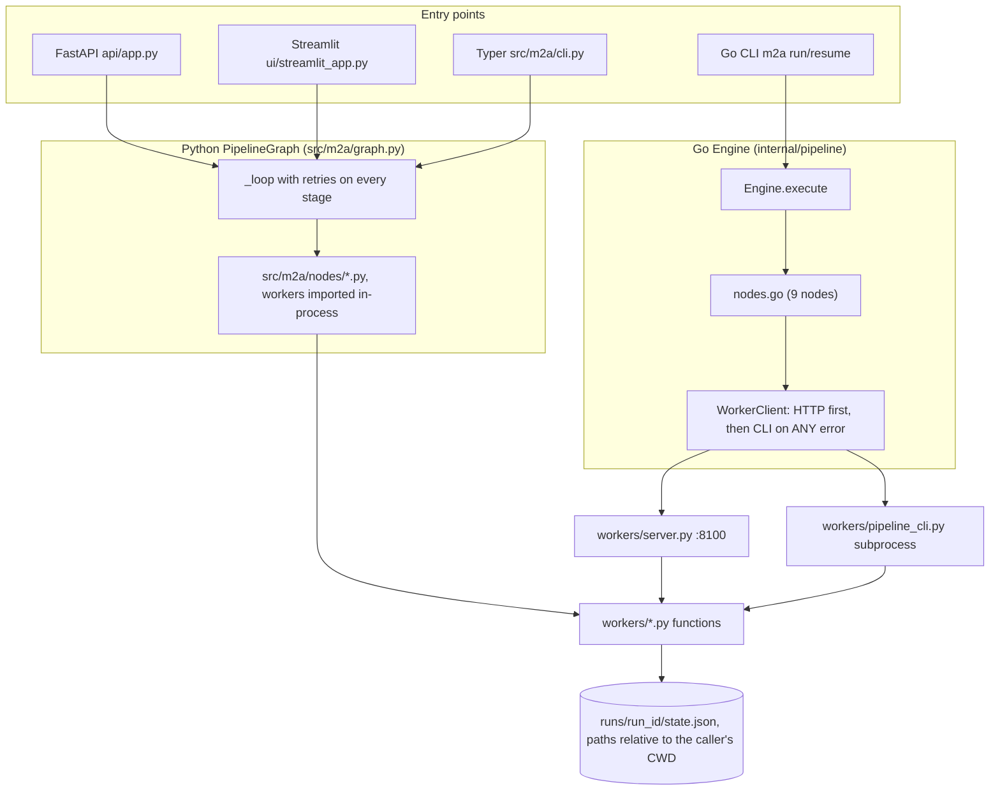
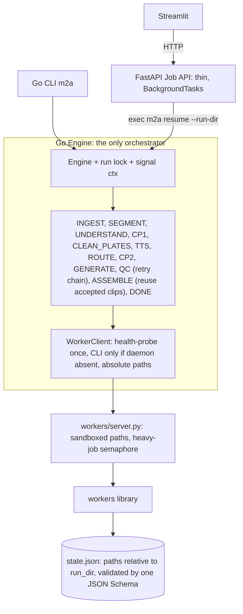
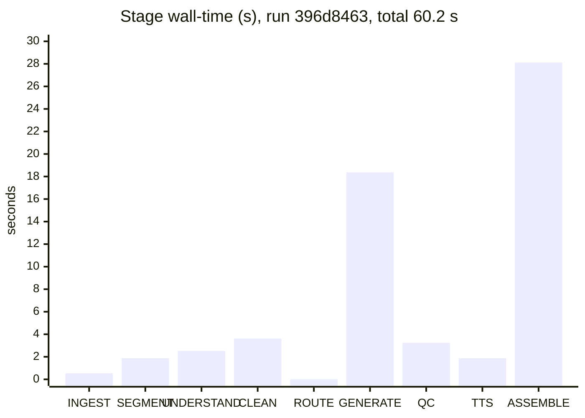

The review is in [context_report.md](file:///run/media/hihry/OS/hihry/Ani/context_report.md). I didn't edit any other repo file: the diff against `main` is still the same 37 files (+3,399 / −1,565). Every fix in the report is a proposal with the file, line numbers, the reason, and suggested code.

Several things I reported as fixed last turn were wrong or only partly true, and the report lists each one. The biggest: the eval set has no side-by-side panels, the QC gate can't reject anything, and ASSEMBLE still re-renders every panel instead of using the checked clips. `README.md`, `ARCHITECTURE_EXCALIDRAW_MERMAID.md`, `report.md` and the PDF should be corrected before anyone relies on them.

**Most serious findings (each reproduced on the existing run `runs/396d8463…`):**

1. **The QC gate is bypassed.** A failed clip gets one fallback render that is forced to "pass" (`nodes.go` L401-420), and failed renders get made-up scores. In the run, `panel_001` failed identity at 0.832, and its fallback scored the same 0.832 and shipped anyway.
2. **The QC checks themselves can't fail.** `motion_score` is clamped to a minimum of 0.05, inside the 0.02–0.98 window it's checked against (`assembler.py` L95). All 11 clips report exactly 0.05, and a completely frozen test clip passes. Flicker readings are about 100× below their threshold, and the text-leak count is always 0.
3. **Ground-truth leakage.** The "understanding" step copies dialogue and characters from `data/eval/ground_truth.json` into any input, matched only by panel order (`pipeline_cli.py` L86-152). A real manhwa would get the sample dialogue, and one Python test only passes because of this.
4. **ASSEMBLE redoes all the rendering** and ignores the clips that passed QC. It takes 28.1 s of the 60.2 s run; reusing the accepted clips would save about 30% of total time.
5. **Subtitles and audio drift out of sync.** The video is 25.46 s but the subtitles run to 28.12 s, because crossfades shorten the video and the timing ignores that. Audio lines are joined end to end with no timing, so one panel without dialogue shifts every later line.
6. **Go can write runs that Python can't open.** Go lets a panel's duration grow without limit and accepts any `--lang`; Python caps duration at 10 s and allows only ko/ja/en. I reproduced the load failure, so the API and UI break on runs with long dialogue.

**Other notable issues:**
- **Two orchestrators:** the CLI runs the Go engine, while the API and UI run the Python one, and they assign different routes to the same input.
- **Duplicate work in the worker client:** any HTTP error, including a timeout, makes the Go client run the same job again through the Python CLI, so two renders can write the same file.
- **API blocks itself:** the job API runs the whole pipeline inside its request handler, and its background poller can pick up the same run at the same time.
- **Fake data on bad input:** a missing input page produces dummy panels and invented dialogue, and the run still finishes as DONE.
- **No run lock:** nothing stops the CLI, API and UI from writing the same `state.json` at once.

**Performance (measured):**

| Change | Before | After |
|---|---|---|
| Reuse accepted clips in ASSEMBLE | 60.2 s run | about 18 s saved (≈30%) |
| Stream frames to ffmpeg instead of holding the video in memory | ~1.7 GB RAM | under 150 MB (estimate) |
| Vectorized slicer (same panel boxes on all 5 test images) | 4.89 s | 2.04 s |
| Ken Burns sub-pixel `resize(box=)`, also removes jitter | 1.36 s per 72 frames | 1.02 s |

Running the per-panel renders in parallel and keeping one warm Python worker should save more; those are estimates, not measured.

The report ends with a prioritized Phase 0 / Phase 1 checklist and a test-gap table. Two examples: the sample eval images are git-ignored, so 4 tests fail on a fresh clone, and the Go/Python compatibility test passes without checking anything when `runs/` is absent.
assembler.py` L30-50, L384-426; `workers/pipeline_cli.py` L276-313 | `timeline.json`: video **25.46 s**, SRT ends at **28.12 s**. The last cue runs 2.66 s past the end of the video. |
| 6 | 🔴 Critical | **The Go and Python data contracts disagree.** Go's TTSNode sets `duration_s` with no upper limit, and Go accepts any `--lang`. Python limits `duration_s ≤ 10` and `lang ∈ {ko,ja,en}`. A long-dialogue run therefore **cannot be opened by the API or UI.** | `internal/pipeline/nodes.go` L467-469; `src/m2a/state.py` L32, L70 | Reproduced: `duration_s = 12.4` raises `ValidationError` in `RunState.load`. |
| 7 | 🟠 High | **There are still two orchestrators.** The CLI uses the Go engine. The API and UI use the Python `PipelineGraph`. Their routing rules, retry policy and FAILED-resume behaviour differ, so the same input routes differently depending on the entry point. | `nodes.go` L262 vs `src/m2a/nodes/route.py` L39; `src/m2a/graph.py` L88, L113-119 | Code comparison. |
| 8 | 🟠 High | **The worker client re-runs jobs on any HTTP error.** A 500 error or a 120 s timeout falls back to the CLI, which runs the same render or assemble again (double cost and two writers on one output). Relative paths are resolved against the server's working directory. CLI stderr is thrown away. | `internal/client/worker_client.go` L44-46, L106-122, L139-148 and every method | Code reading. |
| 9 | 🟠 High | **The API blocks its event loop.** `async def submit_job` runs the whole pipeline inline. A race also exists: `api/worker.py` polls `runs/` and can pick up the same run the API is already executing. | `api/app.py` L59-78, L121-134; `api/worker.py` L41-51 | Code reading. |
| 10 | 🟠 High | **Test fixtures leak into production nodes.** A missing page silently skips INGEST. SEGMENT then invents three dummy panels and UNDERSTAND invents the line *"Where... is this place?"*. A bad input still finishes as "DONE". | `nodes.go` L28-53, L97-113, L184-192 | Code reading. |

**Recommended order of work:** fix the gate (1, 2) and the leak (3) first so that test results can be trusted. Then remove the duplicate render and the drift (4, 5), which also makes the run about 30 % faster. Then unify the contract and the orchestrator (6, 7).

---

## 2. Architecture as built vs. recommended

### 2.1 As built (this branch)



**Structural problems**

| ID | Problem | Effect |
|---|---|---|
| A1 | **Two orchestrators** (Go `Engine` and Python `PipelineGraph`) with separately written node logic | The result depends on which entry point is used. Every fix has to be made twice. F1 (split brain) is only half fixed. |
| A2 | **Stage order:** TTS runs *after* GENERATE and QC, but TTS changes `duration_s` | Clips are rendered at the wrong length, so ASSEMBLE has to re-render. This is the root cause of finding #4. |
| A3 | **ASSEMBLE re-renders from source images** instead of using the accepted clips | The QC result does not apply to the delivered video. Rendering is done twice. |
| A4 | **Paths in `state.json` are relative to the working directory of whoever wrote them** (e.g. `runs/<id>/clean_plates/x.png`) | A worker, API or UI started from another directory silently falls back to the panel crop, so speech bubbles end up baked into the video. |
| A5 | **The contract is written twice by hand** (Go structs and Pydantic) with different limits | Runs produced by Go can be unreadable in Python (finding #6). |
| A6 | **The worker transport cannot tell "server down" from "job failed"** | Expensive jobs run twice. Real errors are hidden by the CLI retry. |
| A7 | **Nothing prevents two writers on one run** (no lock) | CLI resume, the API, the poller and the UI can all write `state.json` at the same time. Updates are lost. |
| A8 | **`ConfigHash`/`ContentHash` are computed but never read** | The "content-hash caching" described in the README and PDF does not exist. Every resume repeats all work. |

### 2.2 Recommended target (still Phase 0/1 scope)



Main ideas: **one orchestrator (Go)**, **TTS before rendering** so durations are final, **ASSEMBLE only composites** the accepted clips, **one schema** checked on both sides, and **paths relative to the run directory**.

---

## 3. Corrections to the previous review and docs

Several statements in the updated `README.md`, `ARCHITECTURE_EXCALIDRAW_MERMAID.md`, `report.md` and the regenerated PDF are wrong or overstated. They should be corrected before anyone relies on them:

| Claim in the docs | Actual state | Where to fix |
|---|---|---|
| "All 9 panels, **including side-by-side panels 3 & 4** and wide panel 7" (`ARCHITECTURE_EXCALIDRAW_MERMAID.md` §8) | The eval set (`data/eval/ground_truth.json`) has **no side-by-side panels**. All 9 are full-width. Side-by-side splitting is only covered by one synthetic unit test. | Doc §8, PDF §9 |
| "**F2 resolved**: AssembleNode consumes state.json" | Partly true. It reads `state.json`, but **re-renders** every panel and ignores `clip_candidates` (finding #4). | PDF §5 F2 |
| "**F8 resolved**: no phantom paths" | Partly true. `CleanPlatesNode` (L233), `GenerateNode` (L322-346) and `TTSNode` (L451-465) still record paths or scores when the worker call fails. | PDF §5 F8 |
| "**F11**: ConfigHash syncs resolution" | False. The hash is computed in `NewRunState` (state.go L154-165) **before** `main.go` L120-122 overrides the resolution, and the hash never includes it. | PDF §5 F11 |
| "QC degrades **I2V → Parallax → Ken Burns**" | Only **one** fallback step runs, and it is force-accepted. There is no retry loop. `MaxRetries` and `FallbackModels` are never read in Go. | PDF §8, README |
| "`ModelResidencyManager` keeps one heavy model in VRAM / prevents OOM" | It only records a string (`server.py` L35-51). Nothing is loaded or unloaded, and there is no lock. | README, PDF §4.1 |
| "Hero panels → I2V (Wan 2.2 / ComfyUI)" | `route == "i2v"` silently renders **parallax** but reports `route_used: "i2v"` (`pipeline_cli.py` L179-185, L202). | README, PDF §4.2 |
| "Qwen3-VL understanding" | Nothing calls a VLM. Output is a geometry heuristic plus GT injection (finding #3). | README, PDF §4.2 |
| "content-hash caching" | Not implemented (A8). | README, PDF §6 P12 |
| Python `content_hash()` "matching Go ContentHash" (`src/m2a/state.py` L251-258) | It can never match. Python uses `sort_keys` and its own time and number formatting; Go uses struct field order. | Docstring |

---

## 4. Phase 0 findings

Phase 0 covers configuration, the state and data contract, the Go engine and nodes, the worker transport, the job API/UI scaffolding, and eval and test infrastructure.

Each item lists **File:Line**, **Problem**, **Why it matters**, and **Proposed change**.

---

### P0-01 🔴 QC gate bypass: invented scores and forced acceptance

**File:** [`internal/pipeline/nodes.go`](file:///run/media/hihry/OS/hihry/Ani/internal/pipeline/nodes.go#L323-L336) L323-336 (GenerateNode); [L393-422](file:///run/media/hihry/OS/hihry/Ani/internal/pipeline/nodes.go#L393-L422) (QCNode)

**Problem**
- `GenerateNode` starts every panel with `qcScores := {Identity: 0.92, Flicker: 0.08, Motion: 0.85, OverallPass: true}`. If `RenderClip` fails, those invented scores are saved and the panel is marked `Accepted` with a clip path that does not exist.
- `QCNode` renders **one** fallback, then sets `fbScores.OverallPass = true` (L411) and `Accepted: true` (L420) whatever the result. On render failure it uses invented fallback scores (L401-407). The failure reasons from `EvaluateClip` are discarded (`passed, _ :=` at L384).

**Why it matters:** The QC gate is the main protection in the design. Right now no clip can be rejected. In the reviewed run, `panel_001` failed (identity 0.8321), its fallback scored the same 0.8321, and it shipped.

**Proposed change** (replaces QCNode L378-423 and removes the invented defaults in GenerateNode L323-336):

```go
// nodes.go — GenerateNode: never invent scores
res, err := wc.RenderClip(ctx, srcPath, clipPath, p.Route, p.Shot, p.DurationS, fps, resW, resH)
if err != nil {
    state.RecordError(fmt.Sprintf("generate %s (%s): %v", p.PanelID, p.Route, err))
    state.ClipCandidates[p.PanelID] = nil // QC will drive the fallback chain
    continue
}
state.ClipCandidates[p.PanelID] = []model.ClipCandidate{{
    PanelID: p.PanelID, Path: filepath.ToSlash(res.ClipPath), TakeNumber: 1, QC: res.QCScores,
}}
```

```go
// nodes.go — QCNode: real retry chain, honest acceptance
maxRetries := 2
if cfg != nil && cfg.Generation.MaxRetries >= 0 {
    maxRetries = cfg.Generation.MaxRetries
}
for i := range state.Panels {
    p := &state.Panels[i]
    cands := state.ClipCandidates[p.PanelID]
    accepted := false
    for j := range cands {
        passed, reasons := qc.EvaluateClip(cands[j].QC, qcCfg)
        cands[j].QC.OverallPass, cands[j].Accepted = passed, passed
        if !passed {
            state.RecordError(fmt.Sprintf("qc %s take %d: %s", p.PanelID, cands[j].TakeNumber, strings.Join(reasons, "; ")))
        }
        accepted = accepted || passed
    }
    route := p.Route
    for attempt := 0; !accepted && attempt < maxRetries && route != model.RouteKenBurns; attempt++ {
        route = qc.NextFallbackRoute(route)
        take := len(cands) + 1
        out := filepath.Join(runDir, "clips", fmt.Sprintf("%s_take%02d_%s.avi", p.PanelID, take, route))
        res, err := wc.RenderClip(ctx, srcFor(state, runDir, p.PanelID), out, route, p.Shot, p.DurationS, fps, resW, resH)
        if err != nil {
            state.RecordError(fmt.Sprintf("qc fallback %s -> %s: %v", p.PanelID, route, err))
            continue
        }
        passed, reasons := qc.EvaluateClip(res.QCScores, qcCfg)
        res.QCScores.OverallPass = passed
        cands = append(cands, model.ClipCandidate{PanelID: p.PanelID, Path: filepath.ToSlash(res.ClipPath),
            TakeNumber: take, QC: res.QCScores, Accepted: passed})
        if passed {
            p.Route, accepted = route, true
        } else {
            state.RecordError(fmt.Sprintf("qc %s take %d (%s): %s", p.PanelID, take, route, strings.Join(reasons, "; ")))
        }
    }
    if !accepted {
        best := bestTakeIndex(cands) // highest IdentitySimilarity among existing files
        if best < 0 {
            return fmt.Errorf("qc %s: no renderable take", p.PanelID)
        }
        cands[best].Accepted, cands[best].Degraded = true, true // ship, but say so
        state.RecordError(fmt.Sprintf("qc %s: no take passed; shipping degraded take %d", p.PanelID, cands[best].TakeNumber))
    }
    state.ClipCandidates[p.PanelID] = cands
}
```

> Add `Degraded bool \`json:"degraded,omitempty"\`` to `model.ClipCandidate` (`internal/model/state.go` L45-51) and `degraded: bool = False` to `ClipCandidate` in `src/m2a/state.py` L107-114.

---

### P0-02 🔴 QCNode renders fallbacks at the wrong resolution

**File:** [`internal/pipeline/nodes.go`](file:///run/media/hihry/OS/hihry/Ani/internal/pipeline/nodes.go#L372-L376) L372-376

**Problem:** `resW, resH := 720, 1280` is never overwritten from `cfg.Composition.Resolution`, unlike GenerateNode (L310-313). If a tier is set to 1080×1920, fallback clips come out at 720×1280 and get mixed into the timeline.

**Proposed change:** compute FPS and resolution once in a helper and use it in every node:

```go
func renderParams(cfg *config.PipelineConfig) (fps, w, h int) {
    fps, w, h = 24, 720, 1280
    if cfg != nil {
        if cfg.Composition.FPS > 0 { fps = cfg.Composition.FPS }
        if r := cfg.Composition.Resolution; r[0] > 0 && r[1] > 0 { w, h = r[0], r[1] }
    }
    return
}
```

---

### P0-03 🔴 Test scaffolding inside production nodes

**File:** [`nodes.go`](file:///run/media/hihry/OS/hihry/Ani/internal/pipeline/nodes.go#L28-L53) L28-53 (Ingest), [L97-113](file:///run/media/hihry/OS/hihry/Ani/internal/pipeline/nodes.go#L97-L113) (Segment dummy panels), [L184-192](file:///run/media/hihry/OS/hihry/Ani/internal/pipeline/nodes.go#L184-L192) (fake dialogue), L44 (`copyFile` error ignored)

**Problem:** If any source page is missing, IngestNode returns `nil` without stitching. SegmentNode then invents three hard-coded panels and UnderstandNode invents a dialogue line. A run with a typo in `--pages` finishes as **DONE** with made-up content.

**Why it matters:** This breaks the "fail loudly" principle and hides input errors. The fallbacks only exist so that `engine_test.go` passes without images.

**Proposed change:**

```go
// IngestNode
for _, p := range state.Config.SourcePages {
    if _, err := os.Stat(p); err != nil {
        return fmt.Errorf("ingest: source page %q: %w", p, err)
    }
}
for idx, src := range state.Config.SourcePages {
    dst := filepath.Join(pagesDir, fmt.Sprintf("page_%03d%s", idx+1, extOrPNG(src)))
    if err := copyFile(src, dst); err != nil {
        return fmt.Errorf("ingest: copy %q: %w", src, err)
    }
}
// SegmentNode: delete L97-113 and replace with
return fmt.Errorf("segment: stitched strip missing at %s (did INGEST run?)", stitchedPath)
// UnderstandNode: delete L184-192
```

In `internal/pipeline/engine_test.go`, register stub nodes (`e.RegisterNode(model.StageSegment, fakeSegment)`) instead of relying on these production fallbacks. Also validate pages up front in `cmd/m2a/main.go` L100-110 so the error appears before a run directory is created.

---

### P0-04 🔴 The Go/Python contract can produce state Python cannot load

**File:** [`nodes.go`](file:///run/media/hihry/OS/hihry/Ani/internal/pipeline/nodes.go#L467-L469) L467-469; [`src/m2a/state.py`](file:///run/media/hihry/OS/hihry/Ani/src/m2a/state.py#L70) L70 (`le=10.0`), L32 (`lang` Literal); [`cmd/m2a/main.go`](file:///run/media/hihry/OS/hihry/Ani/cmd/m2a/main.go#L87) L87 (`--lang` not validated)

**Problem:** TTSNode sets `p.DurationS = speech + 0.3` with no cap. Three 8-second lines give about 25 s. Python's `PanelJSON` rejects anything over 10 s, and also rejects a `lang` outside `ko/ja/en`. Reproduced:

```
duration_s=12.4 -> ValidationError: panels.0.duration_s  Input should be less than or equal to 10
lang="zh"       -> ValidationError: panels.0.dialogue.0.lang
```

The API (`GET /jobs/{id}`) and the UI then return HTTP 500 for that run. Go never validates `PanelJSON`, including after a human edits it at a checkpoint.

**Proposed change:**
1. Treat **one JSON Schema** (`data/eval/ground_truth_schema.json` or a new `schemas/panel.schema.json`) as the source of truth and generate or validate both sides from it.
2. Add `Validate()` in Go and call it on resume from a checkpoint and before every `Save` in debug builds:

```go
// internal/model/panel.go
var validLangs = map[string]bool{"ko": true, "ja": true, "en": true}

func (p *PanelJSON) Validate() error {
    if p.DurationS < 0.5 || p.DurationS > MaxPanelDurationS {
        return fmt.Errorf("%s: duration_s %.2f outside [0.5,%.0f]", p.PanelID, p.DurationS, MaxPanelDurationS)
    }
    if p.MotionIntensity < 0 || p.MotionIntensity > 1 {
        return fmt.Errorf("%s: motion_intensity %.2f outside [0,1]", p.PanelID, p.MotionIntensity)
    }
    switch p.Shot { case ShotCloseUp, ShotMedium, ShotWide, ShotSplash: default:
        return fmt.Errorf("%s: invalid shot %q", p.PanelID, p.Shot) }
    switch p.Route { case RouteI2V, RouteParallax, RouteKenBurns: default:
        return fmt.Errorf("%s: invalid route %q", p.PanelID, p.Route) }
    for _, d := range p.Dialogue {
        if !validLangs[d.Lang] { return fmt.Errorf("%s: invalid dialogue lang %q", p.PanelID, d.Lang) }
    }
    return nil
}
```

3. In TTSNode, clamp and record a warning. A later phase can split long dialogue into hold shots:

```go
if want := panelSpeechDur + 0.3; want > p.DurationS {
    p.DurationS = math.Min(want, model.MaxPanelDurationS)
    if want > model.MaxPanelDurationS {
        state.RecordError(fmt.Sprintf("tts %s: dialogue %.1fs exceeds panel max %.0fs; clamped", p.PanelID, want, model.MaxPanelDurationS))
    }
}
```

4. In `main.go`, reject `--lang` values outside `ko|ja|en` and `--tier` values outside `t0|t1|t2`. `--tier` is concatenated into a file path at L113.

---

### P0-05 🔴 Stage order: TTS must come before rendering

**File:** [`internal/pipeline/engine.go`](file:///run/media/hihry/OS/hihry/Ani/internal/pipeline/engine.go#L38-L51) L38-51; [`src/m2a/graph.py`](file:///run/media/hihry/OS/hihry/Ani/src/m2a/graph.py#L44-L56) L44-56; `api/app.py` L19-33 (`STAGE_PROGRESS`)

**Problem:** TTS changes `duration_s` after the clips have already been rendered and QC'd. ASSEMBLE therefore has to re-render (P1-01), and the QC'd clips are wasted.

**Proposed change:** reorder the stages. TTS only needs the dialogue approved at CP1.

```go
order: []model.PipelineStage{
    model.StageIngest, model.StageSegment, model.StageUnderstand, model.StageCheckpoint1,
    model.StageCleanPlates, model.StageTTS, model.StageRoute, model.StageCheckpoint2,
    model.StageGenerate, model.StageQC, model.StageAssemble, model.StageDone,
},
```

Make the same change in `graph.py` transitions and `STAGE_PROGRESS`. Runs already paused at CP2 are unaffected because TTS will already be done.

---

### P0-06 🟠 Worker transport: double execution, relative paths, lost errors

**File:** [`internal/client/worker_client.go`](file:///run/media/hihry/OS/hihry/Ani/internal/client/worker_client.go)
- L44-46: one 120 s timeout for every endpoint
- L51-63: CLI script located relative to the current directory
- L82-84: HTTP error body discarded
- L91-104: `resolvePythonBin` runs `LookPath` on every call and ignores venvs
- L106-122: `cmd.Output()` discards stderr, so errors read only "exit status 1"
- L139-148 and every method: falls back to the CLI on **any** HTTP error
- L180-184: `method` dropped on the CLI path
- L137: `target_width` hard-coded to 800

**Why it matters:**
1. A render that takes more than 120 s times out on HTTP. The server keeps rendering, and the CLI starts a second render of the **same output file**.
2. A 500 caused by a real bug is hidden: the CLI runs it again, usually fails the same way, and only "exit status 1" is reported.
3. The FastAPI server resolves `runs/<id>/…` against its own working directory.

**Proposed change:**

```go
type WorkerClient struct {
    baseURL    string
    httpClient *http.Client // no global Timeout; rely on ctx deadlines per call
    cliScript  string       // absolute, resolved from executable dir or M2A_WORKER_CLI
    pythonBin  string       // resolved once; honours $M2A_PYTHON, then .venv/bin/python, then PATH
    probeOnce  sync.Once
    httpUp     bool
}

func (c *WorkerClient) useHTTP(ctx context.Context) bool {
    c.probeOnce.Do(func() {
        pctx, cancel := context.WithTimeout(ctx, 750*time.Millisecond)
        defer cancel()
        req, _ := http.NewRequestWithContext(pctx, http.MethodGet, c.baseURL+"/health", nil)
        if resp, err := c.httpClient.Do(req); err == nil {
            resp.Body.Close()
            c.httpUp = resp.StatusCode == http.StatusOK
        }
    })
    return c.httpUp
}

func (c *WorkerClient) call(ctx context.Context, endpoint string, payload any, cliArgs []string, out any) error {
    if c.useHTTP(ctx) {
        return c.postJSON(ctx, endpoint, payload, out) // NO silent CLI re-run on server errors
    }
    return c.runCLI(ctx, cliArgs, out)
}

func (c *WorkerClient) postJSON(ctx context.Context, endpoint string, payload any, out any) error {
    // ... build request ...
    if resp.StatusCode < 200 || resp.StatusCode >= 300 {
        b, _ := io.ReadAll(io.LimitReader(resp.Body, 4096))
        return fmt.Errorf("worker %s: HTTP %d: %s", endpoint, resp.StatusCode, bytes.TrimSpace(b))
    }
    return json.NewDecoder(resp.Body).Decode(out)
}

func (c *WorkerClient) runCLI(ctx context.Context, args []string, out any) error {
    cmd := exec.CommandContext(ctx, c.pythonBin, append([]string{c.cliScript}, args...)...)
    var stderr bytes.Buffer
    cmd.Stderr = &stderr
    stdout, err := cmd.Output()
    if err != nil {
        return fmt.Errorf("worker cli %s: %w: %s", args[0], err, tail(stderr.String(), 2000))
    }
    // ... decode last JSON line ...
}
```

- Convert every path to absolute before sending (`filepath.Abs`), or better, send paths relative to `run_dir` together with `run_dir`.
- Pass `--method` and `--target-width` on the CLI path. `workers/pipeline_cli.py` L347-362 and L465-471 need matching arguments.
- Create **one** `WorkerClient` per run and pass it to the nodes (P0-12) instead of calling `client.NewWorkerClient(cfg)` 9 times (L48, 70, 131, 215, 303, 371, 443, 501).

---

### P0-07 🟠 Two orchestrators (F1 only half fixed)

**File:** `api/app.py` L77-78, L131-134; `ui/streamlit_app.py` L47-49, L65-67; `src/m2a/cli.py`; [`src/m2a/graph.py`](file:///run/media/hihry/OS/hihry/Ani/src/m2a/graph.py) L88, L113-119; `src/m2a/nodes/route.py` L39 vs `nodes.go` L262

**Differences that exist today**

| Behaviour | Go Engine | Python PipelineGraph |
|---|---|---|
| Route for a non-hero `medium` panel with intensity 0.3 at an even index | `parallax` (L262: any `medium`) | `kenburns` (route.py L39 requires intensity ≥ 0.35 or an odd index) |
| Stage retries | none (fallback handlers only) | `generation.max_retries + 1` on **every** stage, including INGEST (graph.py L88). Handlers modify state before raising, so a retry starts from corrupted state. |
| Resume a FAILED run | retries the failed stage | does nothing (`_loop` exits immediately, L122) |
| Default for auto-approve | `false` | `true` in `src/m2a/cli.py` L23 |
| Config object | copied per run | mutated (`self.config.general.run_dir = …`, L40) |

**Proposed change:** make Go the **only** orchestrator. The API and UI should call the Go binary, and `src/m2a/graph.py` should be deprecated, keeping `src/m2a` only as a typed library for the API and UI:

```python
# api/app.py
M2A_BIN = os.environ.get("M2A_BIN", str(Path(__file__).resolve().parents[1] / "m2a.exe"))

def _run_engine(run_dir: Path, auto_approve: bool) -> None:
    cmd = [M2A_BIN, "resume", "--run-dir", str(run_dir)] + (["--auto-approve"] if auto_approve else [])
    with open(run_dir / "engine.log", "ab") as log:
        subprocess.run(cmd, stdout=log, stderr=subprocess.STDOUT, check=False)
```

`m2a resume` on a fresh `INGEST` state already runs from stage 0 (engine.go L159-165), so this works without new Go code.

---

### P0-08 🟠 The Job API blocks the event loop; checkpoint and cancel are unsafe

**File:** [`api/app.py`](file:///run/media/hihry/OS/hihry/Ani/api/app.py#L58-L88) L58-88, L120-144, L166-177, L65, L72; [`api/worker.py`](file:///run/media/hihry/OS/hihry/Ani/api/worker.py#L39-L51) L39-51

**Problems**
1. `async def submit_job` calls `graph.run(state)` synchronously (L78). The whole server freezes for the length of the pipeline, including `/health` and status polling.
2. `PUT /checkpoint` (L120-129) does not check that the run is actually at CP1 or CP2. A PUT during GENERATE replaces the panels while the run is still executing.
3. `DELETE` (L166-177) only marks the state FAILED. The running process continues and overwrites that state on its next save.
4. `job_id` is not validated before `RUNS_DIR / job_id` (L72, L94, L113, L123, L150, L169).
5. `config_hash="job_api_run"` (L65) is a constant, which defeats any caching.
6. **Race:** the API saves state at INGEST with an empty `stage_history` (L74), then runs it inline. `api/worker.py` L46 picks up exactly such runs (`INGEST and not stage_history`), so the same run can be processed twice at once.
7. The worker poller re-parses **every** `state.json` once per second (L41), which is O(number of runs).

**Proposed change:**

```python
from fastapi import BackgroundTasks
import uuid

def _job_dir(job_id: str) -> Path:
    try:
        uuid.UUID(job_id)
    except ValueError:
        raise HTTPException(400, "invalid job id")
    return RUNS_DIR / job_id

@app.post("/jobs", response_model=JobStatusResponse, status_code=202)
def submit_job(request: JobSubmitRequest, background: BackgroundTasks) -> JobStatusResponse:
    ...
    state.save(run_dir)
    background.add_task(_run_engine, run_dir, request.auto_approve)   # see P0-07
    return JobStatusResponse(job_id=job_id, status="queued", current_stage="INGEST", progress=0.0)

@app.put("/jobs/{job_id}/checkpoint", response_model=JobStatusResponse)
def update_checkpoint(job_id: str, req: CheckpointUpdateRequest, background: BackgroundTasks):
    run_dir = _job_dir(job_id)
    state = RunState.load(run_dir)
    if state.current_stage not in (PipelineStage.CHECKPOINT_1, PipelineStage.CHECKPOINT_2):
        raise HTTPException(409, f"run is at {state.current_stage.value}, not at a checkpoint")
    if {p.panel_id for p in req.panels} != {p.panel_id for p in state.panels}:
        raise HTTPException(422, "panel_id set must not change at a checkpoint")
    ...
```

Remove the polling worker, or have it consume an explicit `queued` marker file written with `O_EXCL`. Implement cancel by recording the engine PID and sending SIGTERM, which works together with P0-10.

---

### P0-09 🟠 No run lock; state.json saves are not durable

**File:** [`internal/model/state.go`](file:///run/media/hihry/OS/hihry/Ani/internal/model/state.go#L199-L228) L199-228; `src/m2a/state.py` L234-241

**Problems**
- Several processes can write the same run (CLI, API, poller, UI).
- `Save` never calls `fsync` before `rename`, so a power loss can leave an empty or partial `state.json`.
- The fallback at L219-224 **deletes** `state.json` before retrying the rename. That opens a window where no state file exists, and the fallback is unnecessary because Go's `os.Rename` on Windows already uses `MoveFileEx(REPLACE_EXISTING)`.

**Proposed change:**

```go
func (s *RunState) Save(runDir string) error {
    if err := os.MkdirAll(runDir, 0o755); err != nil { return err }
    s.NormalizePaths()
    data, err := json.MarshalIndent(s, "", "  ")
    if err != nil { return fmt.Errorf("marshal run state: %w", err) }
    f, err := os.CreateTemp(runDir, "state-*.json.tmp")
    if err != nil { return err }
    tmp := f.Name()
    if _, err = f.Write(data); err == nil { err = f.Sync() }
    if cerr := f.Close(); err == nil { err = cerr }
    if err == nil { err = os.Rename(tmp, filepath.Join(runDir, "state.json")) }
    if err != nil { _ = os.Remove(tmp); return fmt.Errorf("save state: %w", err) }
    return nil
}

// internal/model/lock.go
func AcquireRunLock(runDir string) (func(), error) {
    p := filepath.Join(runDir, ".lock")
    f, err := os.OpenFile(p, os.O_CREATE|os.O_EXCL|os.O_WRONLY, 0o644)
    if errors.Is(err, fs.ErrExist) {
        return nil, fmt.Errorf("run %s is in use (lock %s)", runDir, p)
    } else if err != nil {
        return nil, err
    }
    fmt.Fprintf(f, "%d\n", os.Getpid())
    f.Close()
    return func() { _ = os.Remove(p) }, nil
}
```

Call `AcquireRunLock` at the top of `runPipeline` and `resumePipeline` (main.go L142, L196). Python writers (UI/API) should check the same lock. A later improvement is `flock` with a stale-PID check.

---

### P0-10 🟠 No signal handling: Ctrl-C leaves state "in progress" and orphans workers

**File:** [`cmd/m2a/main.go`](file:///run/media/hihry/OS/hihry/Ani/cmd/m2a/main.go#L146) L146, L200

**Problem:** `context.Background()` is never cancelled. SIGINT kills the process before `Engine.execute` can record the cancellation (engine.go L172-176 never runs).

**Proposed change:**

```go
ctx, stop := signal.NotifyContext(context.Background(), os.Interrupt, syscall.SIGTERM)
defer stop()
return engine.Run(ctx, state, cfg) // exec.CommandContext children are killed on cancel
```

---

### P0-11 🟠 `resume` silently falls back to hard-coded defaults

**File:** [`cmd/m2a/main.go`](file:///run/media/hihry/OS/hihry/Ani/cmd/m2a/main.go#L175-L189) L175-189

**Problem:** If the config files cannot be loaded (for example because `resume` was run from another directory), the run continues with a built-in config. That config uses `wan22-ti2v-5b` even for a T0 run and 720×1280 even if the run was created at another resolution. `state.Config.OutputResolution` is ignored.

**Proposed change:** return the error, and always restore the resolution from the state:

```go
cfg, err := config.Load(defaultConfigPath, tierConfigPath)
if err != nil {
    return fmt.Errorf("load config for resume (use --config): %w", err)
}
cfg.Composition.Resolution = state.Config.OutputResolution
```

---

### P0-12 🟠 `General.RunDir` means two different things

**File:** [`nodes.go`](file:///run/media/hihry/OS/hihry/Ani/internal/pipeline/nodes.go#L529-L537) L529-537; `configs/default.yaml` L5 (`run_dir: "./runs"`); `main.go` L124, L189; `src/m2a/graph.py` L40

**Problem:** In YAML, `run_dir` is the **root that holds all runs**. The nodes treat it as **this run's directory**. It only works because `main.go` overwrites the value. Any other caller that loads the config without overwriting it (tests, the API, future tools) writes every run's panels into `./runs/panels/…`, and the runs overwrite each other.

**Proposed change:** rename the YAML key to `runs_root`, and give nodes an explicit environment instead of overloading the config:

```go
type NodeEnv struct {
    RunDir string                // absolute
    Cfg    *config.PipelineConfig
    Worker *client.WorkerClient  // shared, one per run (P0-06)
}
type NodeFunc func(ctx context.Context, state *model.RunState, env *NodeEnv) error
```

`Engine` already has `runDir` (engine.go L23), so it can build the `NodeEnv` once.

---

### P0-13 🟡 ConfigHash: computed too early, depends on the path, reads whole files

**File:** [`internal/model/state.go`](file:///run/media/hihry/OS/hihry/Ani/internal/model/state.go#L154-L165) L154-165, L172; `main.go` L119-122

**Problems**
- The hash includes the **path string**, so the same pages in another folder produce a different hash.
- It uses `os.ReadFile` to load each whole image into memory.
- It ignores resolution, effective config and schema version.
- It is computed before the resolution override.
- A missing file is silently skipped.
- Nothing ever reads the hash (A8).

**Proposed change:**

```go
func ComputeConfigHash(pages []string, lang, tier string, cfgYAML []byte) (string, error) {
    h := sha256.New()
    for _, p := range pages {
        f, err := os.Open(p)
        if err != nil { return "", fmt.Errorf("hash %q: %w", p, err) }
        fh := sha256.New()
        _, err = io.Copy(fh, f) // streaming; constant memory
        f.Close()
        if err != nil { return "", err }
        h.Write(fh.Sum(nil))
    }
    fmt.Fprintf(h, "|lang=%s|tier=%s|schema=%d|", lang, tier, SchemaVersion)
    h.Write(cfgYAML) // yaml.Marshal(effective cfg), includes resolution/fps/thresholds
    return hex.EncodeToString(h.Sum(nil)), nil
}
```

Call it in `main.go` **after** the config is final. Then use it, together with each stage's input hash, to skip stages whose outputs already exist (see §6).

---

### P0-14 🟡 Config values that are loaded but never used, and weak validation

**File:** [`internal/config/config.go`](file:///run/media/hihry/OS/hihry/Ani/internal/config/config.go#L114-L141) L114-141; `nodes.go` L249-250

**Problems**
- `Generation.MaxRetries`, `Generation.FallbackModels` and `Generation.MaxClipDuration` are never read by any Go node.
- The GPU budget (`30`, cost `10`) and the hero intensity threshold (`0.55`) are hard-coded.
- `Validate` does not check that QC thresholds are in [0,1], that `MaxRetries ≥ 0`, or that the worker port is in range.
- `configs/tiers/t2.yaml` does not set the 1080×1920 resolution that the README and PDF promise for T2.

**Proposed change:** add `routing: {gpu_budget, i2v_cost, hero_intensity}` to `default.yaml` and read it in `RouteNode`. Extend `Validate`:

```go
if c.QC.IdentityThreshold < 0 || c.QC.IdentityThreshold > 1 { return fmt.Errorf("qc.identity_threshold must be in [0,1]") }
if c.QC.FlickerThreshold <= 0 || c.QC.FlickerThreshold > 1 { return fmt.Errorf("qc.flicker_threshold must be in (0,1]") }
if c.Generation.MaxRetries < 0 { return fmt.Errorf("generation.max_retries must be >= 0") }
if c.Worker.Port < 0 || c.Worker.Port > 65535 { return fmt.Errorf("worker.port out of range") }
```

---

### P0-15 🟡 Smaller node issues: dead code and swallowed errors

| File:Line | Issue | Fix |
|---|---|---|
| `nodes.go` L83-88 | SegmentNode sets a route by `idx%2` and `DurationS = 2.5`. RouteNode overwrites the route, so the code is dead and the duration is hard-coded. | Delete the route assignment. Read the default duration from config. |
| `nodes.go` L138-139 | `Understand` errors are dropped silently. | Call `state.RecordError(...)` for each failed panel. Fail the stage if every panel fails. |
| `nodes.go` L231-233 | `Inpaint` error ignored, and `CleanPlatePaths` records a file that may not exist. | Record the path only if `fileExists(cleanPath)`, otherwise call `RecordError`. |
| `nodes.go` L262 | `|| i%2 == 1` routes **wide** shots to parallax depending on position. | Route on shot and intensity only. Alternate camera motion through the taxonomy instead. |
| `nodes.go` L444, L451-457 | TTS uses `stitched.png` existence as a proxy for "real run". On failure it records a 2.0 s track whose file does not exist. | Always call the worker. On error, call `RecordError` and skip the track. |
| `nodes.go` L450, L453 | The voice is taken from `d.SpeakerID`. The CharacterBible's `VoiceProfile.VoiceID` is never used. | Look up `state.CharacterBible.Characters[d.SpeakerID].Voice.VoiceID`. |
| `nodes.go` L487 | `state.Save` error ignored before handing off to the Python assembler. | Return the error. Python would otherwise read stale state. |
| `engine.go` L229-231 and L264-269 | Two saves per stage. Harmless but doubles writes. | Save once after `AdvanceTo`. |
| `engine.go` L108-132 | Resume from CP1/CP2 does not validate the edited panels. | Call `p.Validate()` for every panel (P0-04) before advancing. |
| `main.go` L269, L275 | Map iteration order makes `inspect` output non-deterministic. | Sort the keys before printing. |

---

### P0-16 🟡 Worker server: fake residency manager, no concurrency limit, unrestricted paths

**File:** [`workers/server.py`](file:///run/media/hihry/OS/hihry/Ani/workers/server.py#L35-L51) L35-51, L193-206, L227, L243, L275, plus every endpoint's path handling

**Problems**
- `ModelResidencyManager.activate` only stores a name. Nothing is loaded or unloaded, and there is no lock.
- Endpoints are synchronous `def`, so FastAPI runs them in a thread pool of about 40 workers. Concurrent renders compete for CPU, and two I2V requests would both "activate".
- `/segment` ignores `req.method` but echoes it back as `method_used` (L243).
- `/inpaint` always returns `success=True` (L275).
- `/health` imports torch on every call (L196-201).
- Any client can read or write **any filesystem path** given in `image_path` or `output_path`.

**Proposed change:**

```python
import threading, os, functools
_HEAVY = threading.BoundedSemaphore(1)                  # GPU-class jobs: one at a time
_CPU = threading.BoundedSemaphore(max(1, (os.cpu_count() or 2) // 2))
ALLOWED_ROOTS = [Path(p).resolve() for p in os.environ.get("M2A_ALLOWED_ROOTS", "runs:data").split(":")]

def _safe(p: str) -> Path:
    q = Path(p).resolve()
    if not any(q.is_relative_to(r) for r in ALLOWED_ROOTS):
        raise HTTPException(403, f"path outside allowed roots: {q}")
    return q

@functools.lru_cache(maxsize=1)
def _gpu_available() -> bool:
    try:
        import torch
        return bool(torch.cuda.is_available())
    except ImportError:
        return False

@app.post("/render", response_model=RenderResponse)
def render_panel(req: RenderRequest) -> RenderResponse:
    sem = _HEAVY if req.route == "i2v" else _CPU
    with sem:
        try:
            res = render_single_panel_clip(image_path=_safe(req.image_path), output_path=_safe(req.output_path), ...)
        except FileNotFoundError as e:
            raise HTTPException(404, str(e))
        except Exception as e:  # surface the real error to Go; Go must NOT CLI-retry (P0-06)
            logger.exception("render failed")
            raise HTTPException(500, f"{type(e).__name__}: {e}")
    return RenderResponse(**res)
```

Either make `ModelResidencyManager` real (hold model handles, `torch.cuda.empty_cache()` on switch, protect with a lock) or rename it to `ModelUsageTracker` and remove the OOM claims from the docs.

---

### P0-17 🔴 Ground-truth oracle in production understanding (affects eval integrity)

**File:** [`workers/pipeline_cli.py`](file:///run/media/hihry/OS/hihry/Ani/workers/pipeline_cli.py#L86-L152) L86-152; `tests/test_pipeline.py` L125-131

**Problem:** For every panel of every input, the function opens `data/eval/ground_truth.json` (path relative to the working directory, re-read for each panel) and, if a GT entry has the same `reading_order`, copies its dialogue, speakers, characters, action and shot type. The bare `except Exception: pass` (L151-152) hides parse errors. A real 12-panel manhwa would receive the synthetic eval dialogue on panels 1–9.

**Why it matters:** Every downstream result (CP1 review, TTS, subtitles, clean-plate masks from GT bboxes) looks correct on the eval set and is wrong on real inputs. This invalidates any understanding metric.

**Proposed change:** make the oracle opt-in only, match by page and bbox IoU instead of reading order, and label the result:

```python
@functools.lru_cache(maxsize=4)
def _load_oracle(path: str) -> dict:
    return json.loads(Path(path).read_text(encoding="utf-8"))

def analyze_panel_semantics(panel_image_path, panel_id, language="ko", reading_order=None,
                            oracle_gt_path: Optional[Path] = None, panel_bbox: Optional[dict] = None):
    ...
    oracle = oracle_gt_path or os.environ.get("M2A_ORACLE_GT")      # explicit opt-in (eval/demo only)
    if oracle and panel_bbox:
        gt = _load_oracle(str(oracle))
        match = max(gt.get("panels", []), key=lambda gp: _iou(gp["bbox"], panel_bbox), default=None)
        if match and _iou(match["bbox"], panel_bbox) >= 0.5:
            ...  # copy fields
            result["source"] = "oracle_gt"
    result.setdefault("source", "heuristic")
    return result
```

Change the test to set `M2A_ORACLE_GT` explicitly, and add a negative test: a random non-eval image must return `dialogue == []`.

---

### P0-18 🟡 Packaging, dependencies, Makefile, repo hygiene

| File:Line | Issue | Fix |
|---|---|---|
| `workers/requirements.txt` L7 | `torch>=2.0` (~2 GB) is installed but only used by `/health`. `pyyaml` is missing even though `src/m2a/config.py` needs it. | Move torch to an optional `gpu` extra. Add `pyyaml`. |
| `pyproject.toml` L3, L6-20 | Version is `0.1.0` while the code says `0.2.0`. `redis`, `ffmpeg-python` and `rich` are unused. `workers/` is not a packaged module, yet `src/m2a/nodes/*.py` import `workers.*`, so `pip install .` breaks. | Add `[tool.setuptools.packages.find] where=["src","."] include=["m2a*","workers*"]`, or move `workers` under `src/`. Drop unused dependencies. |
| `Makefile` L5 | Builds `m2a.exe` on Linux. | Use `BIN ?= m2a$(if $(filter Windows_NT,$(OS)),.exe,)`. |
| `Makefile` L8 | `run` uses `sample.png`, which does not exist. | Use `data/eval/sample_page_{1,2,3}.png --tier t0 --auto-approve`. |
| `Makefile` L21 | `uvicorn --reload` restarts the worker (and drops any loaded models) whenever a `.py` file changes. | Use `--reload` only in a `worker-dev` target. |
| `Makefile` | No `pytest`, `eval` or `samples` targets. | Add `test-py: pytest -q`, `eval: python workers/eval_segmentation.py`, `samples: python data/eval/generate_sample_pages.py`. |
| repo root | `codebase.txt` (5,374 lines) and `generate_providers.py` are **committed** scratch artefacts. | Remove them from git and add them to `.gitignore`. |

---

## 5. Phase 1 findings

Phase 1 covers ingest, the slicer, Ken Burns, parallax, QC metrics, the assembler, subtitles and audio.

---

### P1-01 🔴 ASSEMBLE ignores accepted clips and re-renders everything

**File:** [`workers/pipeline_cli.py`](file:///run/media/hihry/OS/hihry/Ani/workers/pipeline_cli.py#L243-L289) L243-289

**Problem:** For every panel, ASSEMBLE re-runs Ken Burns or parallax from the source image. `clip_candidates` is never read.

**Why it matters:** The QC'd clips are discarded, so the quality guarantee does not apply to what ships. It also costs about 18 s of duplicated rendering per 9-panel run (31 % of the total).

**Proposed change:** after the reorder in P0-05, clips already have their final duration. Load the accepted take and re-render only if it is missing or the wrong length:

```python
try:
    import cv2
except ImportError:
    cv2 = None

def _accepted_take(state: dict, pid: str) -> Optional[dict]:
    cands = state.get("clip_candidates", {}).get(pid) or []
    return next((c for c in reversed(cands) if c.get("accepted")), None)

def _load_clip_frames(path: Path) -> List[Image.Image]:
    if cv2 is None or not path.is_file():
        return []
    cap = cv2.VideoCapture(str(path))
    frames = []
    while True:
        ok, bgr = cap.read()
        if not ok:
            break
        frames.append(Image.fromarray(cv2.cvtColor(bgr, cv2.COLOR_BGR2RGB)))
    cap.release()
    return frames

# inside the panel loop, before rendering:
take = _accepted_take(state, pid)
frames = _load_clip_frames(_resolve(run_dir, take["path"])) if take else []
expected = max(1, int(round(duration_s * fps)))
if len(frames) != expected or (frames and frames[0].size != tuple(target_res)):
    frames = <existing render code>   # fallback only
```

Raise the clip encoder's quality (`encode_mjpeg_avi(..., quality=95)`, assembler L275) to limit generation loss, or switch the intermediate format to lossless FFV1 or PNG sequences.

---

### P1-02 🔴 QC metrics: dead gates, frozen clips pass, thresholds in two places

**File:** [`workers/assembler.py`](file:///run/media/hihry/OS/hihry/Ani/workers/assembler.py#L53-L111) L53-111 (L95 clamp, L107 constant, L100-104 thresholds); [`internal/qc/evaluator.go`](file:///run/media/hihry/OS/hihry/Ani/internal/qc/evaluator.go#L33) L33

**Measured on real clips (3 s @ 24 fps, 720×1280)**

| Clip | raw `mean_delta*18` | reported `motion_score` | raw flicker (std) |
|---|---|---|---|
| Ken Burns (4 panels) | 0.039 – 0.108 | 0.05 – 0.108 | 0.0013 – 0.0045 |
| Parallax (4 panels) | 0.017 – 0.031 | **0.05** (clamped) | 0.0006 – 0.0013 |
| **Frozen / static clip** | **0.0000** | **0.05 → PASS** | 0.0 |

**Problems**
- The clamp floor (0.05) sits **inside** the sanity window [0.02, 0.98], so the motion check can never fail.
- Flicker values are about 100× below the 0.15 threshold, so the flicker check is dead too.
- `new_text_count` is the constant 0.
- "Identity" is a 16-bin colour-histogram cosine. It measures palette, not identity.
- The thresholds are duplicated in Python (L100-104) and Go (`config.QC`).

**Proposed change** (Phase 1 calibration; real identity and OCR models belong to Phase 2/3):

```python
def compute_clip_qc_metrics(source_image_path: Path, frames: List[Image.Image]) -> Dict[str, Any]:
    ...
    mean_delta = float(np.mean(deltas)) if deltas else 0.0
    motion_score = round(float(np.clip(mean_delta * 18.0, 0.0, 1.0)), 4)   # no artificial floor
    flicker_score = round(float(np.std(deltas)), 5)
    return {
        "identity_similarity": identity_similarity,   # rename to palette_similarity in Phase 2
        "new_text_count": -1,                          # -1 = "not measured"; never claim 0
        "flicker_score": flicker_score,
        "motion_score": motion_score,
        # no overall_pass here: Go's qc.EvaluateClip is the single decision point
    }
```

```go
// internal/qc/evaluator.go: per-route motion windows from config (example calibration)
//   kenburns: [0.01, 0.40]   parallax: [0.005, 0.30]   i2v: [0.02, 0.60]
// flicker_threshold: 0.02 (observed 0.0006–0.0045 on healthy clips)
// new_text_count < 0 => skip check, but add "text_check_not_measured" to reasons-as-warnings
if scores.MotionScore < win.Min || scores.MotionScore > win.Max { ... }
```

Add a regression test that feeds a static clip (`[frame0]*72`) and asserts the QC **fails**.

---

### P1-03 🔴 Timeline drift: crossfade overlap is ignored by SRT and audio

**File:** [`workers/assembler.py`](file:///run/media/hihry/OS/hihry/Ani/workers/assembler.py#L30-L50) L30-50, L440-446; [`workers/pipeline_cli.py`](file:///run/media/hihry/OS/hihry/Ani/workers/pipeline_cli.py#L276-L301) L276-301

**Problem:** Each crossfade overlaps `T` frames, so the final length is `Σn_i − (N−1)·T`. `current_sec` (L301) and the SRT use `Σduration_i`. In the reviewed run (N=9, T=8, fps=24) the video is **25.46 s**, while the SRT runs to **28.12 s**: a drift of `8·8/24 = 2.67 s`, growing by 0.33 s per panel.

**Proposed change:** compute start times **with** the overlap and use them for SRT, audio and `timeline.json`:

```python
T = min(8, max(2, fps // 3))
starts_f, cursor = [], 0
for i, n in enumerate(frame_counts):           # frame_counts[i] = len(frames of panel i)
    starts_f.append(cursor)
    cursor += n - (T if i < len(frame_counts) - 1 and n >= T else 0)
total_frames = cursor
start_s = [f / fps for f in starts_f]
end_s = [(starts_f[i] + frame_counts[i]) / fps for i in range(len(frame_counts))]
```

---

### P1-04 🔴 Audio placed without timing; sample rate and channels ignored

**File:** [`workers/assembler.py`](file:///run/media/hihry/OS/hihry/Ani/workers/assembler.py#L384-L426) L384-426; `pipeline_cli.py` L313

**Problem:** WAVs are concatenated in order with 0.25 s gaps, starting at t=0, with no link to the panel each line belongs to. In the run, `panel_005` has no dialogue, so panel 6's line plays during panel 5. `wf.getframerate()` and `getnchannels()` are never checked, so a 44.1 kHz or stereo file from a real TTS model would play at the wrong speed or pitch.

**Proposed change:** mix by timeline position:

```python
def mix_tracks_on_timeline(placements: List[Tuple[Path, float]], total_s: float,
                           out_path: Path, sr: int = 24000) -> Optional[Path]:
    buf = np.zeros(int(round(total_s * sr)) + 1, dtype=np.float32)
    for path, start in placements:
        with wave.open(str(path), "rb") as wf:
            ch, sw, fr = wf.getnchannels(), wf.getsampwidth(), wf.getframerate()
            if sw != 2:
                raise ValueError(f"{path}: only 16-bit PCM supported (got {8*sw}-bit)")
            x = np.frombuffer(wf.readframes(wf.getnframes()), dtype=np.int16).astype(np.float32)
        if ch > 1:
            x = x.reshape(-1, ch).mean(axis=1)
        if fr != sr:
            n = int(round(len(x) * sr / fr))
            x = np.interp(np.linspace(0, len(x) - 1, n), np.arange(len(x)), x)
        s = int(round(start * sr))
        if s < len(buf):
            e = min(len(buf), s + len(x))
            buf[s:e] += x[: e - s]
    peak = float(np.abs(buf).max()) if buf.size else 0.0
    if peak > 32767:
        buf *= 32767.0 / peak
    ...  # write int16 mono WAV
```

In `assemble_from_run_state`, line *k* of panel *i* starts at `start_s[i] + Σ(previous line durations + 0.25)`. Use the same offsets for the SRT (P1-05).

---

### P1-05 🟠 SRT bugs: invalid timestamps and overlapping cues

**File:** [`workers/pipeline_cli.py`](file:///run/media/hihry/OS/hihry/Ani/workers/pipeline_cli.py#L236-L241) L236-241, L276-287

**Problems**
1. `ms = round((sec - int(sec)) * 1000)` can equal 1000. Reproduced: `1.9996 s` gives `00:00:01,1000`, which is not valid SRT.
2. Every line of a panel gets the **same** `[start, start+duration]` window, so multiple lines overlap.
3. `burn_subtitle_on_frames` (assembler L240-266) joins all lines into one string capped at 68 characters for the whole panel, so the burned subtitles and the SRT disagree.

**Proposed change:**

```python
def _fmt_srt_time(sec: float) -> str:
    total_ms = max(0, int(round(sec * 1000)))
    h, rem = divmod(total_ms, 3_600_000)
    m, rem = divmod(rem, 60_000)
    s, ms = divmod(rem, 1000)
    return f"{h:02d}:{m:02d}:{s:02d},{ms:03d}"
```

Give each line its own window `[line_start, line_start + audio_duration]` from P1-04, and burn subtitles per frame range rather than per panel.

---

### P1-06 🟠 Wrong file named `final_anime.mp4` when ffmpeg is missing or fails

**File:** [`workers/assembler.py`](file:///run/media/hihry/OS/hihry/Ani/workers/assembler.py#L497-L503) L502; [`workers/pipeline_cli.py`](file:///run/media/hihry/OS/hihry/Ani/workers/pipeline_cli.py#L325-L330) L325-330; assembler L491 (`stderr=DEVNULL`)

**Problem:** Without an MP4, `mp4_path` is set to the **AVI** path. The copy loop then writes the AVI bytes to `output/final_anime.mp4`. The ffmpeg error is discarded, so nobody knows why.

**Proposed change:**

```python
# assembler.py
proc = subprocess.run(cmd, stdout=subprocess.DEVNULL, stderr=subprocess.PIPE)
if proc.returncode != 0:
    logger.warning("ffmpeg failed (%s): %s", proc.returncode, proc.stderr.decode(errors="replace")[-1500:])
...
"mp4_path": str(mp4_path.as_posix()) if has_mp4 else None,

# pipeline_cli.py: copy only real artefacts; use shutil, not read_bytes()
for key, name in (("avi_path", "final_anime.avi"), ("webp_path", "final_anime.webp"), ("mp4_path", "final_anime.mp4")):
    src = base_res.get(key)
    if src and Path(src).is_file():
        shutil.copyfile(src, out_dir / name)
```

Better still, write directly into `output/` and stop producing the duplicate `baseline.*` files (21 MB AVI ×2 in the reviewed run) on the state-driven path.

---

### P1-07 🟠 Slicer: Python per-line loops, memory use, bucketed sort

**File:** [`workers/slicer.py`](file:///run/media/hihry/OS/hihry/Ani/workers/slicer.py#L112-L168) L113 (float32 copy of the full strip), L117-119, L132-139, L151-153 (Python loops calling `np.std`), L168 (sort key)

**Problems**
- **Performance:** about 5 s for an 800×20,000 strip, which scales linearly with chapter length.
- **Memory:** the float32 copy of an 800×60,000 strip is about 576 MB.
- **Ordering bug:** `y // 50` buckets can split side-by-side panels that straddle a bucket boundary (y=49 and y=51 fall in different buckets, so x order is lost). The band index from step 3 is already known and is the correct grouping key.

**Proposed change** (validated: produces **identical bboxes** on all eval pages, the run strip and a 28-panel 800×20k strip; benchmark in Appendix A):

```python
def _gutter_mask(a: np.ndarray, axis: int, var_t: float, bright_t: float, dark_t: float) -> np.ndarray:
    """a: float32 HxWx3. axis=1 -> per-row mask (len H); axis=0 -> per-column mask (len W)."""
    n = a.shape[axis]
    s1 = a.sum(axis=axis)
    s2 = (a * a).sum(axis=axis)
    mu = s1 / n
    std = np.sqrt(np.maximum(s2 / n - mu * mu, 0.0)).mean(axis=-1)
    mean = mu.mean(axis=-1)
    return (std < var_t) & ((mean > bright_t) | (mean < dark_t))

def detect_panels_gutter(image_path, min_panel_height=150, min_panel_width=200,
                         min_gutter_height=15, min_gutter_width=15, reading_order_y_tolerance=50):
    a = np.asarray(Image.open(image_path).convert("RGB"), dtype=np.float32)
    h, w, _ = a.shape
    rows = _gutter_mask(a, 1, 12.0, 240.0, 10.0)
    boxes = []
    for band_idx, (y1, y2) in enumerate(_find_contiguous_content_spans(rows, min_gutter_height, min_panel_height)):
        band = a[y1:y2]
        cols = _gutter_mask(band, 0, 10.0, 245.0, 10.0)
        for x1, x2 in _find_contiguous_content_spans(cols, min_gutter_width, min_panel_width):
            act = np.flatnonzero(~_gutter_mask(band[:, x1:x2], 1, 12.0, 240.0, 10.0))
            ry1, ry2 = (y1 + int(act[0]), y1 + int(act[-1]) + 1) if act.size else (y1, y2)
            if x2 - x1 >= min_panel_width and ry2 - ry1 >= min_panel_height:
                boxes.append((band_idx, x1, {"x": int(x1), "y": int(ry1), "w": int(x2 - x1), "h": int(ry2 - ry1)}))
    boxes.sort(key=lambda t: (t[0], t[1]))         # band, then left-to-right (fixes the bucket bug)
    ...
```

For very long strips, process in overlapping row chunks (for example 4,096 rows with a 64-row overlap) so memory stays constant.

---

### P1-08 🟠 Slicer assumes white or black gutters and only one level of splitting

**File:** [`workers/slicer.py`](file:///run/media/hihry/OS/hihry/Ani/workers/slicer.py#L16-L27) L25 (absolute brightness thresholds), L147-164 (single-level split)

**Problems**
- Many webtoons use grey, pastel or gradient gutters. With thresholds of `>240` or `<10`, no gutter is found and the whole strip becomes one panel.
- Layouts such as "one tall panel on the left, two stacked on the right" need recursive XY-cuts.
- The eval set contains **no** side-by-side, nested, borderless or coloured-gutter cases, so F1 = 1.0 says nothing about these.

**Proposed change:** estimate the background colour from the strip margins and treat a line as a gutter if it is uniform **and** close to that colour. Then recurse:

```python
def estimate_background(a: np.ndarray, margin: int = 8) -> np.ndarray:
    border = np.concatenate([a[:, :margin].reshape(-1, 3), a[:, -margin:].reshape(-1, 3)])
    q = (border // 8).astype(np.int32)
    keys = (q[:, 0] << 10) | (q[:, 1] << 5) | q[:, 2]
    mode = np.bincount(keys).argmax()
    return border[keys == mode].mean(axis=0)

# gutter line  <=>  per-channel std < var_t  AND  ||mean_rgb - bg|| < 18
# then: xy_cut(region, depth): split rows -> for each band split cols -> for each col recurse rows (depth <= 3)
```

Add at least 5 real (licensed or public-domain) colour webtoon pages, with these layouts, to `data/eval` (see §7).

---

### P1-09 🟠 Ken Burns: tall panels lose content; integer crop causes jitter

**File:** [`workers/render_kenburns.py`](file:///run/media/hihry/OS/hihry/Ani/workers/render_kenburns.py#L45-L52) L45-52; [L136-148](file:///run/media/hihry/OS/hihry/Ani/workers/render_kenburns.py#L136-L148)

**Problems**
1. **P10 mirror case.** Panels taller than about 1.39 (h/w) are cover-cropped to 9:16. Typical webtoon panels at 800×3,000 lose about **52 % of their height**. F6 fixed wide panels only.
2. The crop box is rounded to whole pixels every frame, then resized. During slow zooms and pans this produces 1-pixel "stair-step" shimmer, and the extra crop copy costs time.
3. `view_h = scaled_h / zoom` only keeps the right aspect because the canvas is exactly 9:16. Once tall canvases are allowed (fix 1), it must be derived from `view_w`.

**Proposed change:**

```python
# prepare_cinematic_canvas: keep full height for very tall panels (vertical scroll lane)
if src_aspect > dst_aspect * 1.35:
    scale = canvas_w / float(src_w)
    return img.resize((canvas_w, max(canvas_h, int(round(src_h * scale)))), Image.Resampling.LANCZOS)

# generate_kenburns_frames: aspect-locked viewport + sub-pixel sampling (no crop copy)
view_w = scaled_w / current_zoom
view_h = view_w * dst_h / dst_w
if scaled_h > view_h * 1.05 and motion_type in ("pan_down", "scroll"):   # tall canvas: scroll top -> bottom
    view_cy = view_h / 2 + (scaled_h - view_h) * eased_t
left = max(0.0, min(scaled_w - view_w, view_cx - view_w / 2.0))
top = max(0.0, min(scaled_h - view_h, view_cy - view_h / 2.0))
frame = scaled_img.resize((dst_w, dst_h), Image.Resampling.BILINEAR,
                          box=(left, top, left + view_w, top + view_h))
```

Measured: `resize(box=float)` is **25 % faster** than `crop+resize` (1.02 s vs 1.36 s per 72 frames at 720×1280) and removes the jitter.

---

### P1-10 🟠 The `i2v` route silently renders parallax but reports `i2v`

**File:** [`workers/pipeline_cli.py`](file:///run/media/hihry/OS/hihry/Ani/workers/pipeline_cli.py#L179-L202) L179-185, L202; L260-266 (same in assemble)

**Problem:** In the reviewed run, `panel_003/005/007` are recorded as `route: "i2v"` but were rendered as parallax. The ledger, CP2 review and QC all believe I2V ran.

**Proposed change:**

```python
route_used = route
if route == "i2v":
    route_used = "parallax"            # until a ComfyUI/diffusers provider is wired (Phase 3)
    logger.warning("i2v provider not available; degraded %s to parallax", image_path.name)
...
return {..., "route_used": route_used, "degraded_from": route if route_used != route else None}
```

In Go `GenerateNode`, set `p.Route = model.AnimationRoute(res.RouteUsed)` when the two differ, and call `RecordError`.

---

### P1-11 🟡 Inpainting heuristic erases bright artwork

**File:** [`workers/assembler.py`](file:///run/media/hihry/OS/hihry/Ani/workers/assembler.py#L134-L153) L134-153

**Problem:** Any bright region (≥244) covering 1.5–35 % of the panel is inpainted with Telea. That includes skies, white shirts and light effects. Telea on large masks smears the image and is slow (cost grows with mask area).

**Proposed change:** for Phase 1, inpaint **only** explicit bboxes, or require bubble evidence: ellipse fit with solidity > 0.85 **and** dark text strokes inside the contour.

```python
cnt_area = cv2.contourArea(cnt)
hull_area = cv2.contourArea(cv2.convexHull(cnt)) or 1.0
roi = gray[ry:ry+rh, rx:rx+rw]
dark_ratio = float((roi < 90).mean())
if cnt_area / hull_area > 0.85 and 0.01 < dark_ratio < 0.35:   # bubble-shaped and contains lettering
    ...mask...
```

Also stop passing `quality=95` to PNG saves (assembler L169, slicer L201, ingest L64). PNG ignores it, which is misleading.

---

### P1-12 🟡 Ingest robustness

**File:** [`workers/ingest.py`](file:///run/media/hihry/OS/hihry/Ani/workers/ingest.py#L31) L31, L56-64, L91-96; `pipeline_cli.py` L347-351

**Problems**
- No EXIF orientation handling (`ImageOps.exif_transpose`).
- `convert("RGB")` on RGBA turns transparent pixels into whatever RGB is underneath (often black). That creates false dark "gutters" or merged panels.
- Pillow's `MAX_IMAGE_PIXELS` (about 89 MP warning, 179 MP error) is reached by a 60+ page chapter (800×250k = 200 MP), and the slicer then fails to reopen `stitched.png`.
- `page_offsets` is computed and then discarded, so panels cannot be mapped back to source pages (needed for GT matching in P0-17 and for UI overlays).
- The CLI ignores `target_width`.

**Proposed change:**

```python
from PIL import ImageOps
img = ImageOps.exif_transpose(Image.open(p))
if img.mode in ("RGBA", "LA", "P"):
    img = img.convert("RGBA")
    bg = Image.new("RGBA", img.size, (255, 255, 255, 255))
    img = Image.alpha_composite(bg, img).convert("RGB")
else:
    img = img.convert("RGB")
...
# persist metadata next to the strip
(output_path.with_suffix(".json")).write_text(json.dumps({"page_offsets": page_offsets, ...}, indent=2))
```

For long chapters, stitch and segment in per-page windows (or chunks) instead of one giant bitmap. If a giant strip is kept, set `Image.MAX_IMAGE_PIXELS` deliberately with a comment.

---

### P1-13 🟡 Subtitle rendering: no CJK font, unreadably small, redrawn on every frame

**File:** [`workers/assembler.py`](file:///run/media/hihry/OS/hihry/Ani/workers/assembler.py#L232-L268) L232-268

**Problems**
- `draw.text` with no font uses Pillow's default font, which is tiny and has **no Hangul or Kana glyphs**, so Korean and Japanese text (the primary languages) renders as boxes.
- The rounded box and text are redrawn on a copy of every frame.

**Proposed change:**

```python
FONT_PATH = os.environ.get("M2A_SUB_FONT", "/usr/share/fonts/noto-cjk/NotoSansCJK-Regular.ttc")

@functools.lru_cache(maxsize=8)
def _font(size: int):
    return ImageFont.truetype(FONT_PATH, size)

def _subtitle_overlay(size, text) -> Image.Image:            # render once (RGBA)
    ov = Image.new("RGBA", size, (0, 0, 0, 0))
    d = ImageDraw.Draw(ov)
    font = _font(max(22, size[0] // 26))
    ...wrap text with d.textlength(); draw box + text with stroke_width=2...
    return ov

overlay = _subtitle_overlay(frames[0].size, text)
out = [Image.alpha_composite(f.convert("RGBA"), overlay).convert("RGB") for f in frames]
```

---

### P1-14 🟡 WebP plays at the wrong speed; quadratic crossfade concatenation

**File:** [`workers/assembler.py`](file:///run/media/hihry/OS/hihry/Ani/workers/assembler.py#L458-L467) L459-465; L440-446

**Problems**
- `step = fps // 12` combined with a fixed `duration = 1000/12` is only correct when fps is a multiple of 12. At 15 fps, step = 1 and the WebP plays 25 % slow.
- `full_timeline = crossfade(full_timeline, next)` rebuilds the whole list for every panel, which is O(N²) in list copies.

**Proposed change:**

```python
step = max(1, round(fps / 12))
duration_ms = int(round(1000 * step / fps))
```

The crossfade should be folded into the streaming writer (§6.2), which removes the list rebuilding entirely.

---

## 6. Performance optimization plan (measured)

### 6.1 Where the time goes today (reviewed run, 9 panels, T1, CPU)



### 6.2 Optimizations, ranked by impact

| # | Optimization | Files / lines | Measured or estimated gain |
|---|---|---|---|
| O1 | **Reuse accepted clips in ASSEMBLE** (P1-01) after the **TTS-first reorder** (P0-05) | `pipeline_cli.py` L243-289; `engine.go` L38-51 | Removes about **18 s of 60 s (−30 %)**. ASSEMBLE becomes decode + composite + encode. |
| O2 | **Stream frames to ffmpeg** instead of holding the whole timeline in RAM, encoding MJPEG, then re-encoding to H.264 | `assembler.py` L271-381, L429-503; `pipeline_cli.py` L230-322 | RAM: **about 1.7 GB → under 150 MB** (25.5 s × 24 fps × 2.76 MB per frame held today). Removes one full JPEG encode/decode pass and one lossy generation. |
| O3 | **Make AVI and WebP optional** (`composition.output_format` already exists, `default.yaml` L32) | `assembler.py` L455-467 | Animated WebP of 300+ frames at 720×1280 takes seconds and 2.5 MB. Skipping it and the 21 MB AVI saves time and about 47 MB of disk per run (×2 with `baseline.*` copies). |
| O4 | **Vectorized slicer** (P1-07) | `slicer.py` L112-168 | **4.89 s → 2.04 s** (800×20k strip), **1.38 s → 0.53 s** (run strip), **0.46 s → 0.17 s** per eval page. Identical output. |
| O5 | **Parallel GENERATE** for CPU routes (Ken Burns/parallax are independent per panel) using a bounded `errgroup`. Keep I2V serialized by the server semaphore (P0-16). | `nodes.go` L316-347; `server.py` | About `min(N_panels, cores/2)`× on GENERATE (for example about 4× on 8 cores, so 18 s → about 5 s). |
| O6 | **Ken Burns `resize(box=float)`** (P1-09) | `render_kenburns.py` L147-148 | **−25 %** per frame (1.36 s → 1.02 s per 72 frames) and no sub-pixel jitter. |
| O7 | **One WorkerClient per run with a cached health probe; auto-start the worker daemon** | `worker_client.go`; `nodes.go` (9× `NewWorkerClient`) | The Python cold start is only 0.24 s, but each CLI call also re-imports and re-decodes images. A run makes about 35 calls (9 understand + 9 inpaint + 9 render + 8 TTS), so about **8–10 s** is saved by keeping one warm process. |
| O8 | **Batch endpoints** (`/render_batch`, `/tts_batch`) so the worker decodes each clean plate once and Go makes one call per stage | `server.py`, `pipeline_cli.py`, `worker_client.go` | Fewer round trips. Enables in-process `ProcessPoolExecutor` parallelism. |
| O9 | **Stage-level cache** keyed by `sha256(stage inputs + config subset)` (A8, P0-13). Skip a stage if `outputs.manifest.json` matches. | `engine.go` execute loop | A re-run after a CP2 route edit only re-renders the changed panels instead of all of them. |
| O10 | **Subtitle overlay rendered once**, then alpha-composited (P1-13) | `assembler.py` L248-267 | Per-frame drawing becomes one composite. Small but free. |
| O11 | **Avoid double image decodes**: `/segment` decodes the strip in `detect_panels_gutter` and again in `crop_and_save_panels` | `server.py` L227-229; `slicer.py` L112, L191 | About −40 % of SEGMENT I/O on large strips. Pass the `Image` or array object. |
| O12 | **Copy with `shutil.copyfile` instead of `read_bytes()`** (or stop duplicating outputs) | `pipeline_cli.py` L329 | Avoids holding the 21 MB AVI in memory twice. |

> [!NOTE]
> Lowering the PNG compression level for intermediates was tested and gave **no measurable gain** (2.39 s vs 2.30 s on an 800×20k strip). It is not recommended.

### 6.3 Streaming writer: drop-in for `assemble_timeline` (O2)

```python
class FFmpegWriter:
    """Pipes RGB frames straight into libx264. One encode, constant memory."""
    def __init__(self, path: Path, w: int, h: int, fps: int, audio: Optional[Path] = None,
                 crf: int = 20, preset: str = "veryfast"):
        exe = shutil.which("ffmpeg")
        if not exe:
            raise RuntimeError("ffmpeg not found in PATH")
        cmd = [exe, "-y", "-loglevel", "error", "-f", "rawvideo", "-pix_fmt", "rgb24",
               "-s", f"{w}x{h}", "-r", str(fps), "-i", "-"]
        if audio:
            cmd += ["-i", str(audio), "-c:a", "aac", "-b:a", "160k", "-shortest"]
        cmd += ["-c:v", "libx264", "-preset", preset, "-crf", str(crf),
                "-pix_fmt", "yuv420p", "-movflags", "+faststart", str(path)]
        self.proc = subprocess.Popen(cmd, stdin=subprocess.PIPE, stderr=subprocess.PIPE)

    def write(self, frame: Image.Image) -> None:
        self.proc.stdin.write(frame.convert("RGB").tobytes())

    def close(self) -> None:
        self.proc.stdin.close()
        err = self.proc.stderr.read()
        if self.proc.wait() != 0:
            raise RuntimeError(f"ffmpeg failed: {err.decode(errors='replace')[-2000:]}")


def stream_timeline(clip_iter, writer: FFmpegWriter, T: int) -> int:
    """clip_iter yields one clip (list of frames) at a time; only ~1 clip is resident."""
    held: List[Image.Image] = []
    written = 0
    for frames in clip_iter:
        if held and len(held) == T and len(frames) >= T:
            for k in range(T):
                writer.write(Image.blend(held[k], frames[k], (k + 1) / (T + 1)))
            written += T
            frames = frames[T:]
        else:
            for f in held:
                writer.write(f)
            written += len(held)
        body, held = (frames[:-T], frames[-T:]) if len(frames) > T else ([], list(frames))
        for f in body:
            writer.write(f)
        written += len(body)
    for f in held:
        writer.write(f)
    return written + len(held)
```

Because P1-03 gives the exact timeline length **before** rendering, the aligned audio track (P1-04) can be built first and passed to `FFmpegWriter(audio=...)`, so audio and video are muxed in the same single pass.

### 6.4 Parallel GENERATE (O5)

```go
// requires golang.org/x/sync/errgroup
g, gctx := errgroup.WithContext(ctx)
g.SetLimit(max(1, runtime.NumCPU()/2))
results := make([]*client.RenderResult, len(state.Panels))
errs := make([]error, len(state.Panels))
for i := range state.Panels {
    i, p := i, state.Panels[i] // copy: no shared mutation inside goroutines
    g.Go(func() error {
        out := filepath.Join(clipsDir, fmt.Sprintf("%s_take01_%s.avi", p.PanelID, p.Route))
        results[i], errs[i] = env.Worker.RenderClip(gctx, srcFor(state, env.RunDir, p.PanelID), out,
            p.Route, p.Shot, p.DurationS, fps, resW, resH)
        return nil // per-panel failures are handled by QC, not by aborting the group
    })
}
_ = g.Wait()
for i, p := range state.Panels { // single-threaded state mutation
    if errs[i] != nil { state.RecordError(fmt.Sprintf("generate %s: %v", p.PanelID, errs[i])); continue }
    state.ClipCandidates[p.PanelID] = []model.ClipCandidate{{PanelID: p.PanelID,
        Path: filepath.ToSlash(results[i].ClipPath), TakeNumber: 1, QC: results[i].QCScores}}
}
```

---

## 7. Test and evaluation gaps

| ID | File:Line | Gap | Proposed fix |
|---|---|---|---|
| T1 | `.gitignore` L27-29; `tests/test_pipeline.py` L32, L67, L82, L119 | `data/eval/*.png` is **git-ignored**, so a fresh clone fails 4 tests until `generate_sample_pages.py` is run by hand. | Add `tests/conftest.py` with a session fixture that generates the pages if missing, or commit the 3 small PNGs (add a `!data/eval/sample_page_*.png` exception). |
| T2 | `tests/test_pipeline.py` L93-101 | The Go↔Python interop test **does nothing** without the ignored `runs/396d…` directory, so it always "passes". | Build a fixture `state.json` with the Go binary (`go run ./cmd/m2a run … --auto-approve` into `tmp_path`), or check in a golden `tests/fixtures/go_state.json`. Add the >10 s duration and `lang=zh` cases (P0-04). |
| T3 | `tests/test_pipeline.py` L125-131 | The test depends on the GT leak (P0-17). | Set `M2A_ORACLE_GT` explicitly. Add a negative test on a non-eval image. |
| T4 | `workers/eval_segmentation.py` L64-68 | Eval runs **per page**, but production segments the **stitched strip**, so page-boundary behaviour is never measured. | Add a `--stitched` mode: stitch the GT pages, offset GT bboxes by `page_offsets` (P1-12), evaluate on the strip. |
| T5 | `workers/eval_segmentation.py` | No **reading-order** metric (problem P2 in the proposal). | Report Kendall-τ between detected and GT `reading_order` for matched pairs. |
| T6 | `workers/eval_segmentation.py` L74-90 | Greedy, detection-first matching can under-count with overlapping boxes. | Use Hungarian matching (`scipy.optimize.linear_sum_assignment` on −IoU), or sort pairs by IoU globally. |
| T7 | `data/eval/ground_truth.json` | 9 synthetic full-width panels only: no side-by-side, nested, borderless or coloured-gutter cases. F1 = 1.0 is not evidence of real-world performance. | Add at least 5 real colour webtoon pages (licensed or public domain) with those layouts. Keep the synthetic set as a smoke test. |
| T8 | `internal/pipeline/engine_test.go` | Engine tests depend on the production dummy-panel fallbacks (P0-03). | Register fake nodes. Add a test where a stage fails and the run ends in `FAILED` with the error recorded. |
| T9 | — | No QC regression tests. | Static clip → must fail. Identity-failing clip → fallback chain → `degraded=true` (P0-01, P1-02). |
| T10 | — | No A/V sync test. | Assert `srt_last_end ≤ video_duration + 1 frame` and that each line's audio onset is within ±1 frame of its panel start (P1-03, P1-04). |

---

## 8. Prioritized action checklist

### Phase 0: do first (correctness and integrity)
- [ ] **P0-01** Real QC retry chain; no invented scores; `Degraded` flag (`nodes.go` L323-336, L378-423; `state.go` L45-51; `state.py` L107-114)
- [ ] **P0-17** Make the GT oracle opt-in; match by IoU; negative test (`pipeline_cli.py` L86-152; tests L125-131)
- [ ] **P0-03** Remove production fallbacks; fail on missing pages (`nodes.go` L28-53, L97-113, L184-192; `main.go` L100-110)
- [ ] **P0-04** One JSON Schema; `PanelJSON.Validate()`; clamp TTS durations; validate `--lang` and `--tier` (`panel.go`, `nodes.go` L467-469, `main.go` L86-87)
- [ ] **P0-05** Reorder stages so TTS runs before ROUTE and GENERATE (`engine.go` L38-51; `graph.py` L44-56; `app.py` L19-33)
- [ ] **P0-02** Fix the fallback resolution (`nodes.go` L372-376)

### Phase 0: robustness and architecture
- [ ] **P0-06** WorkerClient: probe once, no CLI re-run on HTTP errors, capture stderr, absolute paths, forward `method` and `target_width`
- [ ] **P0-07** Make Go the only orchestrator; API and UI call `m2a resume`; deprecate `src/m2a/graph.py`
- [ ] **P0-08** API: `BackgroundTasks`, checkpoint stage check, UUID validation, remove the polling race
- [ ] **P0-09** Run lock and `fsync`'d atomic save; remove the delete-then-rename fallback
- [ ] **P0-10 / P0-11** Signal-aware context; resume fails loudly instead of using defaults
- [ ] **P0-12 / P0-13 / P0-14** `NodeEnv` instead of overloading `General.RunDir`; streaming config hash computed after config is final; use the config values that are currently ignored
- [ ] **P0-16** Server path sandbox, semaphores, real error codes, honest residency manager
- [ ] **P0-18** Fix requirements, packaging, Makefile and committed scratch files

### Phase 1: output correctness
- [ ] **P1-01** ASSEMBLE reuses accepted clips
- [ ] **P1-02** Recalibrate QC metrics; static clip must fail; one decision point (Go)
- [ ] **P1-03 / P1-04 / P1-05** Overlap-aware timeline; timeline-aligned audio mixing with sample-rate and channel handling; valid, per-line SRT
- [ ] **P1-06** Never label an AVI as MP4; surface ffmpeg errors
- [ ] **P1-10** Report the true `route_used` for I2V degradation

### Phase 1: quality and performance
- [ ] **P1-07** Vectorized slicer and band-index sort (validated identical, 2.4–2.9× faster)
- [ ] **P1-08** Background-colour gutters and recursive XY-cut; real eval pages
- [ ] **P1-09** Tall-panel scroll lane and sub-pixel `resize(box=)` Ken Burns
- [ ] **P1-11 / P1-12 / P1-13 / P1-14** Safer inpainting, robust ingest (EXIF, alpha, offsets), CJK subtitles, WebP timing
- [ ] **O2 / O3 / O5 / O7–O9** Streaming ffmpeg writer, optional AVI/WebP, parallel GENERATE, warm worker, batching, stage cache

---

## 9. What is already good

- **A clean Go engine skeleton.** Explicit stage order, checkpoint pauses, resume from a checkpoint or FAILED, a per-stage cost ledger, and closing `EndedAt` on DONE.
- **The worker library is a single source.** Go (HTTP or CLI) and Python both call the same `workers/*.py` functions, so most CV logic is not duplicated any more.
- **The P10 wide-panel fix is right.** Blurred-fill letterboxing keeps 100 % of horizontal artwork, and the viewport zoom maths is fixed.
- **Parallax ghosting is reduced** by filling the occluded background area.
- **Atomic temp-file-and-rename saves** on both sides, and forward-slash path normalization.
- **Fast, green test suites.** `go test ./...` and `pytest` both pass and run quickly, which makes the fixes above cheap to verify.

---

## Appendix A: How the evidence was produced

All commands were read-only with respect to the repository. Scratch scripts live outside the repo in the conversation's artifact directory.

| Evidence | How |
|---|---|
| Diff vs `main` | `git diff main --stat` → 37 files, +3,399 / −1,565; untracked `internal/client/`, `internal/qc/`, `tests/` |
| Stage timings, QC scores, routes | `runs/396d8463-…/state.json` → `cost_ledger.per_stage_seconds`, `clip_candidates` (all `motion_score = 0.05`; `panel_001` accepted at identity 0.8321) |
| A/V drift | `output/timeline.json` (`total_duration_s = 25.458`, Σ entries = 28.12) and `output/subtitles.srt` (last cue ends at 00:00:28,120) |
| Schema break | Loaded a copy of the run state with `duration_s = 12.4` and with `lang = "zh"` → `pydantic.ValidationError` in both cases |
| SRT timestamp bug | `_fmt_srt_time(1.9996)` → `00:00:01,1000` |
| QC calibration | Rendered Ken Burns, parallax and a frozen clip from the run's clean plates; computed the raw motion and flicker statistics used by `compute_clip_qc_metrics` (table in P1-02) |
| Slicer speed-up and equivalence | `scratch/bench_slicer_vectorized.py`: original vs vectorized on 3 eval pages, the run strip, and a synthetic 800×20,000 strip. **Identical bboxes in all 5 cases**; 2.4–2.9× faster |
| Ken Burns sampling | 72 frames at 720×1280: `crop+resize` 1.355 s vs `resize(box=…)` 1.020 s |
| Python cold start | `python -c "import numpy, cv2, PIL; import workers.pipeline_cli"` → 0.24 s |
| PNG compress level | default 2.39 s vs `compress_level=1` 2.30 s (no gain, not recommended) |
