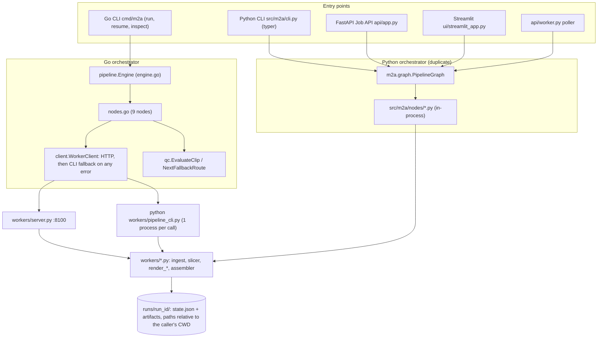
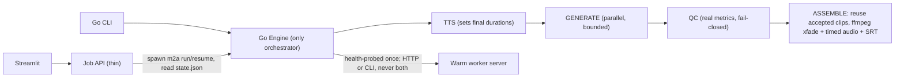

# Context Report: Phase 0 & Phase 1 Review (`review/Phase0ndPhase1` vs `main`)

**Scope:** `git diff main`: 37 modified files (+3,399 / −1,565) plus untracked `internal/client/`, `internal/qc/`, `tests/`.
**Rule followed:** No repository file was edited. Every fix below is a proposal with the file, line numbers, the reason, and suggested code.
**How the evidence was collected:** I read every source file. Go tests (`go vet`, `go test ./...`) and `pytest` were run read-only. All other experiments ran in a throwaway copy (`/tmp/ani_review`) so that `runs/` in the workspace was not touched. The scripts are saved in [scratch/](file:///home/hihry/.gemini/antigravity-cli/brain/02ad212b-3fd3-4c6e-99ef-0fdc023ad1e7/scratch/).

---

## 0. Executive summary

The branch is a real step up from `main`. `main` had stubbed middle nodes, a `baseline` subprocess that threw away `state.json`, mock worker endpoints, and mismatched Go/Python schemas. Now all 9 stages call real worker code, the Go engine checkpoints atomically, and both test suites pass (Go: 5 packages ok; Python: 10 passed).

However, **the pipeline can still report success when it hasn't succeeded**, and the main cost is in the wrong place:

| # | Severity | Finding (reproduced) | Where |
|---|---|---|---|
| 1 | 🔴 | **A missing input page still ends in `DONE` with exit code 0.** INGEST silently skips, SEGMENT injects 3 hard-coded dummy panels, GENERATE invents QC scores (0.92/0.08/0.85, pass), and no video is produced. | `nodes.go` L28-53, L97-114, L323-336 |
| 2 | 🔴 | **The QC gate cannot reject anything.** `motion_score` is clamped to ≥0.05 inside the 0.02–0.98 window, so a **completely frozen clip passes** (`identity=1.0, motion=0.05, pass=True`). `new_text_count` is always 0. Failed clips get a fallback that is *forced* to pass. | `assembler.py` L95, L107; `nodes.go` L401-420 |
| 3 | 🔴 | **Ground-truth leakage.** UNDERSTAND copies dialogue and characters from `data/eval/ground_truth.json`, matched only by panel index. A random-noise image gets *"The gate opened... after three years."* spoken by Jin. A Python test only passes because of this. | `pipeline_cli.py` L86-152 |
| 4 | 🔴 | **ASSEMBLE re-renders every panel** and ignores the QC-accepted clips: 28.8 s of a 60.7 s run (47%), with **2.83 GB peak RSS for a 25 s video**. Memory grows linearly with episode length. | `pipeline_cli.py` L243-301; `assembler.py` L429-467 |
| 5 | 🔴 | **Subtitles and audio drift out of sync.** The video is 25.46 s but the SRT ends at 28.12 s, because crossfade overlap is ignored. Audio lines are concatenated end to end with no timing. The SRT can emit an invalid `00:00:01,1000`. | `pipeline_cli.py` L236-301; `assembler.py` L384-426 |
| 6 | 🔴 | **Go can write `state.json` that Python cannot load.** Go TTS has no duration cap and `--lang` accepts anything; Python enforces `duration_s ≤ 10` and `lang ∈ {ko,ja,en}`. Both load failures were reproduced, so the API and UI break on such runs. | `nodes.go` L467-469, `main.go` L87; `state.py` L32, L70 |
| 7 | 🟠 | **Stage order is wrong.** TTS (which changes `duration_s`) runs *after* GENERATE and QC, so every clip has the wrong length. This is the root cause of #4. | `engine.go` L38-51; `graph.py` L44-56 |
| 8 | 🟠 | **Two orchestrators** (Go `Engine` and Python `PipelineGraph`) with separately written node logic. They route the same panel differently, retry differently, cap durations differently, and choose different fallback lanes. | `nodes.go` vs `src/m2a/nodes/*` |

> [!IMPORTANT]
> `report.md` §8 and `README.md` describe F1–F14 as **"resolved"**. Several of those claims are false or only partly true (see §3). The workspace `context_report.md` also starts with a pasted chat response ("The review is in [context_report.md]…") instead of a title. Fix these docs before anyone relies on them.

---

## 1. What changed vs `main` (summary of the diff)

| Area | `main` | This branch |
|---|---|---|
| Go nodes (`internal/pipeline/nodes.go`) | Middle stages stubbed; ASSEMBLE shelled out to `pipeline_cli.py baseline`, ignoring `state.json` | All 9 stages call `WorkerClient`; ASSEMBLE reads `state.json` (`assemble_from_run_state`) |
| Go ↔ worker transport | Raw `exec.Command("python", …)` | New `internal/client/worker_client.go`: HTTP `:8100` first, then CLI fallback |
| QC | none | New `internal/qc/evaluator.go` + fallback route degrade |
| Worker server | Mock panels and understanding | Real endpoints, plus a `ModelResidencyManager` that only logs (it manages nothing) |
| State contract | `output_resolution: str`, no `stage_history`, backslash paths | Aligned schemas, `NormalizePaths()`, atomic temp+rename save |
| Slicer | 5 px bleed, merged side-by-side panels | 2D row/column gutter slicing, Y-band reading order |
| Rendering | Center-crop of wide panels, over-zoom | Blurred-fill letterbox canvas, corrected zoom math, parallax occlusion fill |
| Python package | Paid-API defaults, broken fields | YAML-driven config, nodes delegate to `workers/` |
| API/UI | In-memory | Backed by `runs/<id>/state.json` |
| Tests | — | `tests/test_pipeline.py`, Go tests for client, qc, engine |

---

## 2. Architecture and workflow (as built)



**Stage order (both orchestrators):**
`INGEST → SEGMENT → UNDERSTAND → CP1 → CLEAN_PLATES → ROUTE → CP2 → GENERATE → QC → TTS → ASSEMBLE → DONE`

### 2.1 Structural problems

| ID | Problem | Effect |
|---|---|---|
| A1 | Two orchestrators with separately written node logic | The output depends on the entry point. Go route (`nodes.go` L262) ≠ Python route (`route.py` L39). Go falls back i2v→parallax→kenburns; Python always falls back to kenburns. Go has no duration cap; Python caps at 10 s. |
| A2 | TTS after GENERATE/QC | Clips are rendered at the pre-TTS length (e.g. panel_001: rendered at 2.5 s, final 3.56 s), so ASSEMBLE must re-render everything. |
| A3 | Transport fallback on *any* error | HTTP 500s and timeouts re-run the same work through the CLI. If ASSEMBLE takes more than 120 s, the server keeps working while the CLI starts a second assembly into the same files. |
| A4 | Paths relative to CWD everywhere (`runs/…`, `workers/pipeline_cli.py`, `data/eval/…`) | The server, CLI and Go must all share the same CWD. Otherwise clean plates silently fall back to text-laden panel crops (`pipeline_cli.py` L251-253). |
| A5 | Test scaffolding in production nodes (dummy panels, dummy dialogue, fabricated QC) | Failures look like successes (finding #1). |

### 2.2 Recommended target (still Phase 0/1 scope)



---

## 3. Claims vs reality (`report.md` §8 / README)

| Claim | Reality |
|---|---|
| F2: "AssembleNode consumes clean plates, routes, durations…" | Partly true. It reads state, but **re-renders every panel** and ignores the accepted clips and QC (`pipeline_cli.py` L243-301). |
| F5: "F1 = 1.0000, IoU = 0.9968" | The eval set (`ground_truth.json`) has **no side-by-side panels** (all 9 panels are single-column). The eval runs **per page**, but the pipeline segments the **stitched strip**. The 2D slicing is only tested by one synthetic unit test. |
| F8: "generating and verifying real files on disk" | When a render fails, the nodes record **fabricated** scores and paths (`nodes.go` L323-336; `generate.py` L44-51). |
| F9: "Nodes now propagate execution errors" | Only when all pages exist. A missing page skips the error path completely (finding #1). CleanPlates ignores errors (`nodes.go` L231), and so do UNDERSTAND, RENDER and TTS. |
| F11: "ConfigHash hashes source content" | Go only. The Python CLI hashes paths (`cli.py` L30-34), the API writes the literal `"job_api_run"` (`app.py` L65), and **no** path hashes the effective YAML config. |
| F13: "Populated provider registries" | All providers are `TODO` stubs (e.g. `wan22.py` L23-36 returns a fake path), and **no node calls the registry**. `"melotts"` maps to `KokoroProvider`. `bakeoff.py` writes hard-coded metrics (0.90/0.80). |
| README: "QC evaluates Identity, Flicker, Text Leakage, Motion" | Text leakage is hard-coded to 0 and the motion gate is dead (finding #2). |
| `ModelResidencyManager` "enforces single-heavy-model residency" | It only sets a string and logs (`server.py` L35-51). |

---

## 4. Measured baseline (this review)

Run: Go CLI, `--tier t1 --auto-approve`, 3 sample pages → 9 panels, CPU only, worker server **not** running (so the CLI fallback is used).

| Stage | Seconds | % |
|---|---:|---:|
| INGEST | 0.53 | 0.9 |
| SEGMENT | 1.84 | 3.0 |
| UNDERSTAND | 2.43 | 4.0 |
| CLEAN_PLATES | 3.38 | 5.6 |
| ROUTE | 0.00 | 0 |
| GENERATE | 18.71 | 30.8 |
| QC (2 fallback re-renders) | 3.18 | 5.2 |
| TTS | 1.87 | 3.1 |
| **ASSEMBLE** | **28.80** | **47.4** |
| **Total** | **60.74** | |

| Micro-benchmark | Result |
|---|---|
| ASSEMBLE in-process (current) | 27.8 s, **peak RSS 2,829 MB** |
| Streaming ASSEMBLE prototype (`exp4.py`): same re-render, frames piped to ffmpeg | **19.3 s, peak RSS 924 MB** (bounded per panel, not per episode) |
| Reusing accepted clips + ffmpeg `xfade` (`exp4`-style; no subtitle burn or audio) | **2.1 s** (≈13× faster than the current ASSEMBLE) |
| Python CLI cold start (`pipeline_cli.py --help`) | 0.25–0.32 s × ~40 spawns per 9-panel run ≈ **10–13 s overhead** |
| Slicer: vectorized vs per-row loops (`exp3.py`) on an 800×6300 strip | 1.38 s → 0.65 s (**2.1×**), **bit-identical boxes** |
| QC fallback for `kenburns → kenburns` | Re-renders an identical clip (both files are exactly 1,800,158 bytes) |
| Cost ledger | `total_gpu_seconds: 0`, `per_model_seconds: {}`. Go never calls `RecordModelCost`; Python records whole-node wall time as "GPU" seconds. |

---

## 5. Phase 0 findings (orchestration, contract, integrity)

### P0-01 🔴 Missing inputs produce a "successful" run with dummy content
**Files:** [nodes.go](file:///run/media/hihry/OS/hihry/Ani/internal/pipeline/nodes.go#L28-L53) L28-53, L97-114, L184-192, L444-458; [segment.py](file:///run/media/hihry/OS/hihry/Ani/src/m2a/nodes/segment.py#L45-L50) L45-50; [ingest.py (node)](file:///run/media/hihry/OS/hihry/Ani/src/m2a/nodes/ingest.py#L26-L36) L26-36

**Why:** If any page is missing, `allExist=false` and INGEST quietly returns nil. SEGMENT then injects 3 hard-coded panels ("Hero awakens…"), UNDERSTAND injects "Where... is this place?", TTS records a WAV path that doesn't exist, and the engine logs *"Pipeline completed successfully"* with exit code 0. I reproduced this with `--pages sample_page_1.png,does_not_exist.png`. The Python ingest node instead drops missing pages silently and renumbers the rest. `copyFile` errors are discarded (L44).

**Fix (Go):**
```go
// internal/pipeline/nodes.go — IngestNode (replace L28-53)
if len(state.Config.SourcePages) == 0 {
    return errors.New("ingest: no source pages")
}
for _, p := range state.Config.SourcePages {
    if _, err := os.Stat(p); err != nil {
        return fmt.Errorf("ingest: source page %q: %w", p, err)
    }
}
for idx, src := range state.Config.SourcePages {
    ext := filepath.Ext(src)
    if ext == "" { ext = ".png" }
    dst := filepath.Join(pagesDir, fmt.Sprintf("page_%03d%s", idx+1, ext))
    if err := copyFile(src, dst); err != nil {
        return fmt.Errorf("ingest: copy %q: %w", src, err)
    }
}
stitchedPath := filepath.Join(runDir, "stitched.png")
if _, err := wc.Ingest(ctx, state.Config.SourcePages, stitchedPath); err != nil {
    return fmt.Errorf("ingest stitch pages: %w", err)
}
return nil
```
```go
// SegmentNode (replace L68-114): fail instead of fabricating panels
stitchedPath := filepath.Join(runDir, "stitched.png")
if !fileExists(stitchedPath) {
    return fmt.Errorf("segment: %s missing (INGEST did not complete)", stitchedPath)
}
res, err := wc.Segment(ctx, stitchedPath, panelsDir, cfg.Perception.Detector)
if err != nil { return fmt.Errorf("segment panels: %w", err) }
if len(res.Panels) == 0 { return errors.New("segment: detector returned 0 panels") }
```
Delete the dummy dialogue block in UnderstandNode (L184-192) and the `hasRealPanels` fake-duration branch in TTSNode (L444-458). Put the dummy fixtures in `engine_test.go`, which already registers its own fake nodes. Apply the same change to Python `segment.py` L45-50 (raise) and `ingest.py` L27 (raise on any missing page).

---

### P0-02 🔴 QC gate bypass: invented scores, forced acceptance, identical re-renders
**Files:** [nodes.go](file:///run/media/hihry/OS/hihry/Ani/internal/pipeline/nodes.go#L316-L347) L316-347 (GENERATE), L362-422 (QC); [generate.py](file:///run/media/hihry/OS/hihry/Ani/src/m2a/nodes/generate.py#L44-L51) L44-51; [qc.py](file:///run/media/hihry/OS/hihry/Ani/src/m2a/nodes/qc.py#L45-L79) L45-79

**Why:**
1. GENERATE starts with fake passing scores (L323-329) and keeps them if `RenderClip` errors (L332-335). A failed render is therefore *accepted*, with a path to a file that doesn't exist.
2. QC forces `OverallPass = true` and `Accepted: true` on the fallback (L411, L420), whatever it scores. In the run, panel_001's fallback scored 0.832 identity (below the 0.85 threshold) and shipped anyway.
3. `NextFallbackRoute(kenburns) == kenburns`, so a failed Ken Burns clip is re-rendered **identically** (wasted time, same score).
4. `resW, resH` are hard-coded to 720×1280 (L373) and never read from `cfg`. On any non-default resolution, fallbacks are rendered at the wrong size.
5. QC is not idempotent: if QC is re-run on resume, a forced-pass candidate can be re-evaluated, fail, and get another fallback appended.

**Fix:**
```go
// shared helper (new) — use in GENERATE, QC, ASSEMBLE instead of 3 copies
func renderParams(cfg *config.PipelineConfig) (fps, w, h int) {
    fps, w, h = 24, 720, 1280
    if cfg != nil {
        if cfg.Composition.FPS > 0 { fps = cfg.Composition.FPS }
        if r := cfg.Composition.Resolution; r[0] > 0 && r[1] > 0 { w, h = r[0], r[1] }
    }
    return
}
```
```go
// GenerateNode loop body (replace L322-346)
rendered, err := wc.RenderClip(ctx, srcPath, clipPath, p.Route, p.Shot, p.DurationS, fps, resW, resH)
if err != nil {
    return fmt.Errorf("generate %s (%s): %w", p.PanelID, p.Route, err)
}
passed, reasons := qc.EvaluateClip(rendered.QCScores, qcCfg)
rendered.QCScores.OverallPass = passed
state.ClipCandidates[p.PanelID] = []model.ClipCandidate{{
    PanelID: p.PanelID, Path: filepath.ToSlash(rendered.ClipPath), TakeNumber: 1,
    QC: rendered.QCScores, Accepted: passed,
}}
if !passed { slog.Warn("QC failed", "panel", p.PanelID, "reasons", reasons) }
```
```go
// QCNode (replace L393-422): walk the fallback chain, never force a pass
for take := len(candidates) + 1; !hasAccepted; take++ {
    next := qc.NextFallbackRoute(p.Route)
    if next == p.Route || take > cfg.Generation.MaxRetries+1 {
        best := bestByIdentity(state.ClipCandidates[p.PanelID])
        state.ClipCandidates[p.PanelID][best].Accepted = true // best effort, flagged
        state.RecordError(fmt.Sprintf("panel %s: QC failed on final lane %s; shipping best take %d (needs review)",
            p.PanelID, p.Route, best+1))
        break
    }
    p.Route = next
    fbPath := filepath.Join(runDir, "clips", fmt.Sprintf("%s_take%02d_%s.avi", p.PanelID, take, next))
    r, err := wc.RenderClip(ctx, srcPath, fbPath, next, p.Shot, p.DurationS, fps, resW, resH)
    if err != nil { return fmt.Errorf("qc fallback %s: %w", p.PanelID, err) }
    passed, _ := qc.EvaluateClip(r.QCScores, qcCfg)
    r.QCScores.OverallPass = passed
    state.ClipCandidates[p.PanelID] = append(state.ClipCandidates[p.PanelID], model.ClipCandidate{
        PanelID: p.PanelID, Path: filepath.ToSlash(r.ClipPath), TakeNumber: take, QC: r.QCScores, Accepted: passed})
    hasAccepted = passed
}
```
For idempotency, skip candidates that are already `Accepted` when QC re-runs. Mirror the change in `qc.py` L45-79 and `generate.py` L44-51 (raise instead of fabricating).

---

### P0-03 🔴 Ground-truth oracle inside production understanding
**Files:** [pipeline_cli.py](file:///run/media/hihry/OS/hihry/Ani/workers/pipeline_cli.py#L86-L152) L86-152; [tests/test_pipeline.py](file:///run/media/hihry/OS/hihry/Ani/tests/test_pipeline.py#L125-L131) L125-131

**Why:** Any panel at reading order *N* gets the dialogue, speakers, shot and action of GT panel *N* (relative path, CWD-dependent). This was reproduced on random noise. It contaminates every downstream metric (inpaint boxes, TTS, subtitles) and inflates the Phase 1 demo. The dialogue bboxes are offset against the **GT panel origin** (L104-116), not the detected crop, so the inpaint masks land in the wrong place whenever segmentation differs from GT. `except Exception: pass` (L151-152) hides parse errors. The JSON is also re-read for every panel.

**Fix:** Remove L86-152. If an oracle is useful for upper-bound experiments, make it explicit and visible:
```python
# workers/pipeline_cli.py — analyze_panel_semantics
ORACLE_PATH = os.environ.get("M2A_EVAL_ORACLE")  # unset in production
...
if ORACLE_PATH:
    dialogue, characters, sfx, shot, action = _oracle_lookup(Path(ORACLE_PATH), reading_order, w, h)
    source = "oracle"
else:
    source = "heuristic"   # until Qwen3-VL/OCR provider is wired
return {..., "source": source}
```
Update `test_worker_fastapi_endpoints` (L131) so it asserts the **schema**, not `len(dialogue) >= 1`.

---

### P0-04 🔴 Go/Python contract can produce state that Python cannot load
**Files:** [nodes.go](file:///run/media/hihry/OS/hihry/Ani/internal/pipeline/nodes.go#L467-L469) L467-469; [main.go](file:///run/media/hihry/OS/hihry/Ani/cmd/m2a/main.go#L86-L87) L86-87; [state.py](file:///run/media/hihry/OS/hihry/Ani/src/m2a/state.py#L32) L32, L70; [panel.go](file:///run/media/hihry/OS/hihry/Ani/internal/model/panel.go#L69) L69

**Why:** Both failures were reproduced: `duration_s=12.3` gives `Input should be less than or equal to 10`, and `lang="zh"` gives `Input should be 'ko', 'ja' or 'en'`. Long dialogue panels or a non-ko/ja/en `--lang` therefore make `GET /jobs/{id}`, the UI and Python resume crash. `ContentHash` claims to "match Go" but cannot: Python uses `sort_keys=True` and ISO strings with `+00:00`, while Go uses struct order and RFC3339Nano.

**Fix:**
```go
// internal/model/panel.go — single source of truth for bounds
const (MinPanelDuration = 0.5; MaxPanelDuration = 10.0)
func ClampDuration(d float64) float64 { return math.Max(MinPanelDuration, math.Min(MaxPanelDuration, d)) }
func (p PanelJSON) Validate() error {
    if p.DurationS < MinPanelDuration || p.DurationS > MaxPanelDuration { return fmt.Errorf("panel %s: duration_s %.2f out of [0.5,10]", p.PanelID, p.DurationS) }
    if p.MotionIntensity < 0 || p.MotionIntensity > 1 { return fmt.Errorf("panel %s: motion_intensity out of [0,1]", p.PanelID) }
    switch p.Route { case RouteI2V, RouteParallax, RouteKenBurns: default: return fmt.Errorf("panel %s: bad route %q", p.PanelID, p.Route) }
    for _, d := range p.Dialogue { switch d.Lang { case "ko", "ja", "en": default: return fmt.Errorf("panel %s: bad lang %q", p.PanelID, d.Lang) } }
    return nil
}
```
```go
// nodes.go TTSNode L467-469
if panelSpeechDur > 0 {
    p.DurationS = model.ClampDuration(math.Max(p.DurationS, panelSpeechDur+0.3))
}
```
```go
// cmd/m2a/main.go after fs.Parse (L92-94)
switch *langFlag { case "ko", "ja", "en": default: return fmt.Errorf("unsupported --lang %q (ko|ja|en)", *langFlag) }
switch *tierFlag { case "t0", "t1", "t2": default: return fmt.Errorf("unsupported --tier %q", *tierFlag) }
```
Call `Validate()` on every panel inside `RunState.Save`, so an invalid state fails the stage in Go instead of crashing Python later. Add a **cross-language contract test**: Go writes `testdata/state_golden.json` and pytest loads it with `RunState.load`. Remove the "matching Go" claim from `content_hash` (state.py L251-258), or define a canonical JSON for both sides.

---

### P0-05 🟠 Stage order: TTS must run before rendering
**Files:** [engine.go](file:///run/media/hihry/OS/hihry/Ani/internal/pipeline/engine.go#L38-L51) L38-51; [graph.py](file:///run/media/hihry/OS/hihry/Ani/src/m2a/graph.py#L44-L56) L44-56; [api/app.py](file:///run/media/hihry/OS/hihry/Ani/api/app.py#L19-L33) L19-33 (progress table)

**Why:** TTS lengthens `duration_s` (7 of 9 panels changed in the run), so the GENERATE and QC clips are stale. That forces the full re-render in ASSEMBLE (P1-01). TTS only needs the CP1-approved dialogue, so it can run right after ROUTE.

**Fix:**
```go
order: []model.PipelineStage{
    model.StageIngest, model.StageSegment, model.StageUnderstand, model.StageCheckpoint1,
    model.StageCleanPlates, model.StageRoute, model.StageTTS, model.StageCheckpoint2,
    model.StageGenerate, model.StageQC, model.StageAssemble, model.StageDone,
},
```
Mirror this in `graph.py` transitions (`ROUTE→TTS→CHECKPOINT_2`, `QC→ASSEMBLE`) and in `STAGE_PROGRESS`. As a bonus, CP2 reviewers then see the final durations.

---

### P0-06 🟠 Worker transport: double execution, lost errors, CWD coupling
**Files:** [worker_client.go](file:///run/media/hihry/OS/hihry/Ani/internal/client/worker_client.go#L42-L122) L42-122 and every method's fallback (L139-151, 176-188, 212-226, 243-257, 292-310, 336-351, 374-388)

**Why:**
- Any HTTP error, including a 500 from a deterministic bug or the 120 s client timeout (L45), triggers a CLI re-run. Failures cost twice the time, and a long ASSEMBLE runs **twice concurrently** into the same output files.
- The HTTP error body is dropped (L82-84), and the CLI's stderr is dropped (`cmd.Output()`, L109-111). Users only see `exit status 1`.
- The CLI segment fallback ignores `method` (L180-184).
- `resolveCLIScript` (L51-63) and every path are relative to the CWD. `resolvePythonBin` prefers `python` over `python3`/venv (L91-104).
- A new client is constructed in every node (9×), and there is no health probe.

**Fix:**
```go
type WorkerClient struct {
    baseURL   string
    http      *http.Client // no global Timeout; use per-call ctx deadlines
    cliScript string       // absolute, resolved from executable dir or M2A_WORKER_CLI
    python    string       // from M2A_PYTHON, else python3
    once      sync.Once
    httpOK    bool
}

func (c *WorkerClient) useHTTP(ctx context.Context) bool {
    c.once.Do(func() {
        pctx, cancel := context.WithTimeout(ctx, 2*time.Second); defer cancel()
        req, _ := http.NewRequestWithContext(pctx, http.MethodGet, c.baseURL+"/health", nil)
        if resp, err := c.http.Do(req); err == nil { c.httpOK = resp.StatusCode == http.StatusOK; resp.Body.Close() }
    })
    return c.httpOK
}

// One transport per run: never re-execute work that the server may already be doing.
func (c *WorkerClient) call(ctx context.Context, timeout time.Duration, ep string, payload, out any, cli []string) error {
    ctx, cancel := context.WithTimeout(ctx, timeout); defer cancel()
    if c.useHTTP(ctx) { return c.postJSON(ctx, ep, payload, out) }
    return c.runCLI(ctx, cli, out)
}

// postJSON: surface the server's error detail
if resp.StatusCode/100 != 2 {
    b, _ := io.ReadAll(io.LimitReader(resp.Body, 4096))
    return fmt.Errorf("worker %s: HTTP %d: %s", endpoint, resp.StatusCode, bytes.TrimSpace(b))
}

// runCLI: keep stderr
var stderr bytes.Buffer
cmd.Stderr = &stderr
output, err := cmd.Output()
if err != nil { return fmt.Errorf("worker CLI %s: %w\n%s", args[0], err, lastN(stderr.String(), 2000)) }
```
Construct the client **once** in `RegisterDefaultNodes` (capture it in closures) and make `runDir` absolute in `main.go` L123 (`runDir, _ = filepath.Abs(runDir)`). Use timeouts like render 10 min, assemble `30s + 3×duration`.

---

### P0-07 🟠 Two orchestrators (split brain only half fixed)
**Files:** [api/app.py](file:///run/media/hihry/OS/hihry/Ani/api/app.py#L76-L78) L76-78, L131-134; [ui/streamlit_app.py](file:///run/media/hihry/OS/hihry/Ani/ui/streamlit_app.py#L47-L49) L47-49, L65-67; [api/worker.py](file:///run/media/hihry/OS/hihry/Ani/api/worker.py#L25-L32) L25-32; `src/m2a/nodes/*.py`

**Why:** The Go CLI runs `Engine`, while the API, UI and poller run `PipelineGraph`. Every fix has to be made twice, and they have already diverged (route rules, fallback lane, duration cap, `--auto-approve` default: Go `false`, Python CLI `True` at `cli.py` L23).

**Fix:** Make Go canonical. The API, UI and poller should launch it and only read and write `state.json`:
```python
# api/app.py — replace in-process graph.run(...)
M2A_BIN = os.environ.get("M2A_BIN", "./m2a")
def _spawn(args: list[str], run_dir: Path) -> None:
    log = open(run_dir / "engine.log", "ab")
    subprocess.Popen([M2A_BIN, *args], stdout=log, stderr=subprocess.STDOUT, start_new_session=True)
# submit:  _spawn(["run", "--pages", ",".join(pages), "--tier", tier, "--lang", lang, "--output", str(RUNS_DIR), "--run-id", job_id], run_dir)
# resume:  _spawn(["resume", "--run-dir", str(run_dir)], run_dir)
```
This requires a `--run-id` flag in `main.go` so the API knows the directory up front. Then reduce `src/m2a/nodes/*` to tests, or delete it. Until then, at least add a shared parity test that runs both orchestrators on the sample pages and diffs `panels[*].route/duration_s`.

---

### P0-08 🟠 Job API blocks the event loop; checkpoint and cancel are unsafe
**Files:** [api/app.py](file:///run/media/hihry/OS/hihry/Ani/api/app.py#L58-L177) L58-79, L120-134, L166-177

**Why:**
- `async def` handlers call the blocking `graph.run()` (about 60 s per run), which freezes **all** requests, including `/health`.
- `PUT /checkpoint` doesn't check that the run is actually at CP1/CP2. It replaces all panels and resumes, even on `DONE` or while a run is in progress.
- `DELETE` writes `FAILED`, but the running graph's next save overwrites it.
- `job_id` is not validated (path component).
- `config` overrides from the request body are merged unchecked.
- `RUNS_DIR` is CWD-relative.

**Fix:**
```python
JOB_ID_RE = re.compile(r"^[0-9a-f-]{36}$")
def _run_dir(job_id: str) -> Path:
    if not JOB_ID_RE.match(job_id): raise HTTPException(400, "invalid job id")
    return RUNS_DIR.resolve() / job_id

@app.put("/jobs/{job_id}/checkpoint")
def update_checkpoint(job_id: str, req: CheckpointUpdateRequest, bg: BackgroundTasks):  # plain def
    run_dir = _run_dir(job_id)
    state = RunState.load(run_dir)
    if state.current_stage not in (PipelineStage.CHECKPOINT_1, PipelineStage.CHECKPOINT_2):
        raise HTTPException(409, f"run is at {state.current_stage.value}, not a checkpoint")
    if [p.panel_id for p in req.panels] != [p.panel_id for p in state.panels]:
        raise HTTPException(422, "panel ids/order must not change")
    ...
    if req.resume_after_save: bg.add_task(_spawn, ["resume", "--run-dir", str(run_dir)], run_dir)
```
Implement cancel as a `runs/<id>/CANCEL` marker that the engine checks between stages and between panels, or send a signal to the spawned process group.

---

### P0-09 🟠 Poller race: the same run can be processed twice
**Files:** [api/worker.py](file:///run/media/hihry/OS/hihry/Ani/api/worker.py#L39-L51) L39-51; [api/app.py](file:///run/media/hihry/OS/hihry/Ani/api/app.py#L73-L78) L73-78; [state.go](file:///run/media/hihry/OS/hihry/Ani/internal/model/state.go#L199-L228) / [state.py](file:///run/media/hihry/OS/hihry/Ani/src/m2a/state.py#L234-L241)

**Why:** The API saves a state with `stage_history=[]` and then runs INGEST synchronously. `stage_history` stays empty until INGEST finishes, so the poller's condition (`INGEST and not stage_history`, L46) matches **the run currently executing** and starts a second copy. Nothing locks a run, and the poller re-parses every `state.json` every second (O(runs) per second). Neither save is fsync'd.

**Fix:** Claim a run with an exclusive lock file, used by Go, the API and the poller:
```python
def try_claim(run_dir: Path) -> bool:
    try:
        fd = os.open(run_dir / ".lock", os.O_CREAT | os.O_EXCL | os.O_WRONLY)
        os.write(fd, str(os.getpid()).encode()); os.close(fd); return True
    except FileExistsError:
        return False
```
Use an explicit `runs/<id>/QUEUED` marker instead of the `stage_history` heuristic. Make saves durable:
```go
// state.go Save (replace L208-225)
f, err := os.CreateTemp(runDir, "state-*.json.tmp"); if err != nil { return err }
if _, err = f.Write(data); err == nil { err = f.Sync() }
if cerr := f.Close(); err == nil { err = cerr }
if err != nil { os.Remove(f.Name()); return fmt.Errorf("write state: %w", err) }
return os.Rename(f.Name(), targetPath)
```
```python
# state.py save (L240-241)
with open(tmp_file, "w", encoding="utf-8") as fh:
    fh.write(self.model_dump_json(indent=2)); fh.flush(); os.fsync(fh.fileno())
os.replace(tmp_file, state_file)
```

---

### P0-10 🟠 Python `resume` of a FAILED run does nothing; retries are wrong
**Files:** [graph.py](file:///run/media/hihry/OS/hihry/Ani/src/m2a/graph.py#L82-L119) L82-105, L113-119

**Why:** `_loop` exits immediately on `FAILED`, so `m2a resume`, the UI and `api/worker.py` cannot recover a failed run (Go can). Every stage, including deterministic CV and ASSEMBLE, is retried `generation.max_retries + 1` times: 1× on t0, 4× on t2, so a failed ASSEMBLE costs about 4×28 s. The retries reuse a **partially mutated** state, and each attempt appends duplicate errors (the node records an error and then the graph records another).

**Fix:**
```python
RETRYABLE = {PipelineStage.GENERATE, PipelineStage.TTS}

def resume(self, state: RunState) -> RunState:
    if state.current_stage == PipelineStage.FAILED:
        retry = next((t.stage for t in reversed(state.stage_history)
                      if t.stage not in (PipelineStage.FAILED, PipelineStage.DONE)), PipelineStage.INGEST)
        state.advance_to(retry)
    elif state.current_stage in (PipelineStage.CHECKPOINT_1, PipelineStage.CHECKPOINT_2):
        state.advance_to(self.transitions[state.current_stage])
    self._save_checkpoint(state)
    return self._loop(state)

def _execute_stage(self, stage, state):
    attempts = (self.config.generation.max_retries + 1) if stage in RETRYABLE else 1
    for attempt in range(attempts):
        snapshot = state.model_copy(deep=True)   # retry from a clean state
        try:
            ...
        except Exception as e:
            state = snapshot
            ...
```
Remove `state.record_error(...)` from the node `except` blocks (they re-raise anyway).

---

### P0-11 🟡 No signal handling; `resume` silently falls back to hard-coded defaults
**Files:** [main.go](file:///run/media/hihry/OS/hihry/Ani/cmd/m2a/main.go#L146) L146, L175-188, L200

**Why:** With `context.Background()`, Ctrl-C/SIGTERM can't cancel cleanly, the stage stays "in progress", and Python children are orphaned. If `configs/` isn't found (wrong CWD), `resume` quietly uses an inline config whose values differ from `default.yaml`, for example `TTSPrimary: "melotts"` on a t0 run.

**Fix:**
```go
ctx, stop := signal.NotifyContext(context.Background(), os.Interrupt, syscall.SIGTERM)
defer stop()
return engine.Run(ctx, state, cfg)   // and engine.Resume(ctx, ...)
```
```go
// resume: fail loudly instead of inventing config
cfg, err := config.Load(defaultConfigPath, tierConfigPath)
if err != nil { return fmt.Errorf("load config for resume (use --config): %w", err) }
```
Also store the effective config in `runs/<id>/config.snapshot.yaml` at `run` time and prefer it on resume, so a resumed run uses identical settings.

---

### P0-12 🟡 `General.RunDir` means two things
**Files:** [default.yaml](file:///run/media/hihry/OS/hihry/Ani/configs/default.yaml#L5) L5 (`./runs` = root); [nodes.go](file:///run/media/hihry/OS/hihry/Ani/internal/pipeline/nodes.go#L529-L537) L529-537 (treated as *this run's* dir); [main.go](file:///run/media/hihry/OS/hihry/Ani/cmd/m2a/main.go#L124) L124; [graph.py](file:///run/media/hihry/OS/hihry/Ani/src/m2a/graph.py#L40) L40

**Why:** Any code path that loads the YAML without the override writes artifacts directly into `./runs/` (shared by all runs). Mutating the config at run time also makes `cfg` stateful.

**Fix:** Rename the YAML key to `runs_root`. Pass the per-run directory explicitly, e.g. `state.RunDir` (`json:"-"`) or a field on `Engine` captured in node closures, and delete `resolveRunDir`'s `runs/<id>` CWD fallback.

---

### P0-13 🟡 ConfigHash and cost ledger are not meaningful
**Files:** [state.go](file:///run/media/hihry/OS/hihry/Ani/internal/model/state.go#L154-L165) L154-165; [cli.py](file:///run/media/hihry/OS/hihry/Ani/src/m2a/cli.py#L30-L34) L30-34; [app.py](file:///run/media/hihry/OS/hihry/Ani/api/app.py#L65) L65; all `add_model_cost` calls in `src/m2a/nodes/*`

**Why:**
- The hash ignores the effective YAML config (thresholds, models, fps), so two runs with different QC thresholds get the same hash.
- `os.ReadFile` loads whole pages into memory just to hash them.
- Each entry point hashes differently.
- Go never calls `RecordModelCost` (`total_gpu_seconds: 0`), and Python logs whole-node wall time (CPU work) as GPU seconds under the model name.

**Fix:**
```go
func ComputeConfigHash(pages []string, lang, tier string, cfg any) (string, error) {
    h := sha256.New()
    for _, p := range pages {
        f, err := os.Open(p); if err != nil { return "", err }
        io.WriteString(h, filepath.Base(p)); _, err = io.Copy(h, f); f.Close()
        if err != nil { return "", err }
    }
    io.WriteString(h, lang); io.WriteString(h, tier)
    b, _ := json.Marshal(cfg); h.Write(b)          // effective config
    return hex.EncodeToString(h.Sum(nil)), nil
}
```
Call it in `main.go` after `config.Load`. For the ledger, record real per-model time from worker responses (add `elapsed_s` and `device` to the render/TTS responses) and keep wall time and GPU time separate.

---

### P0-14 🟡 Config validation is weak
**Files:** [config.go](file:///run/media/hihry/OS/hihry/Ani/internal/config/config.go#L92-L141) L92-141; [config.py](file:///run/media/hihry/OS/hihry/Ani/src/m2a/config.py#L59-L70) L59-70

**Why:**
- YAML typos (for example `identity_treshold`) are silently ignored, so the threshold falls back to 0 and then to the code default.
- QC thresholds aren't range-checked, and `worker.port` isn't validated.
- `transition_type`, `output_format`, `max_clip_duration_s`, `fallback_models` and `perception.fallback` are loaded but never used.
- The t0 fallback `edge-tts` is not a registered provider.

**Fix:**
```go
dec := yaml.NewDecoder(bytes.NewReader(defaultData)); dec.KnownFields(true)
if err := dec.Decode(&cfg); err != nil { ... }   // same for tier file
// Validate():
if c.QC.IdentityThreshold <= 0 || c.QC.IdentityThreshold > 1 { return fmt.Errorf("qc.identity_threshold must be in (0,1]") }
if c.QC.FlickerThreshold <= 0 { return fmt.Errorf("qc.flicker_threshold must be > 0") }
if c.Worker.Port < 0 || c.Worker.Port > 65535 { return fmt.Errorf("worker.port invalid") }
if c.Composition.TransitionType != "crossfade" && c.Composition.TransitionType != "cut" { return fmt.Errorf("unsupported transition_type") }
```
In Python, add `model_config = ConfigDict(extra="forbid")` to each config model. Either wire the unused keys (ASSEMBLE should honour `transition_type`; GENERATE should enforce `max_clip_duration_s` by splitting long panels into shots) or delete them.

---

### P0-15 🟡 Worker server: fake residency, unbounded concurrency, unrestricted paths
**Files:** [server.py](file:///run/media/hihry/OS/hihry/Ani/workers/server.py#L35-L54) L35-54, L220-243, L278-296

**Why:**
- The `def` endpoints run in Starlette's thread pool (about 40 threads), so parallel `/render` calls can each hold about 270 MB of frames with no limit.
- `ModelResidencyManager` doesn't load or unload anything.
- `method_used` echoes the request (L243) even though OpenCV is always used.
- Any path on disk can be read or written. It binds to 127.0.0.1, but the API passes user-supplied paths through.

**Fix:**
```python
HEAVY = threading.BoundedSemaphore(int(os.environ.get("M2A_HEAVY_SLOTS", "2")))
ALLOWED_ROOTS = [Path(p).resolve() for p in os.environ.get("M2A_ALLOWED_ROOTS", "./runs:./data").split(":")]
def _safe(p: str) -> Path:
    rp = Path(p).resolve()
    if not any(rp.is_relative_to(r) for r in ALLOWED_ROOTS): raise HTTPException(403, f"path outside allowed roots: {p}")
    return rp

@app.post("/render", response_model=RenderResponse)
def render_panel(req: RenderRequest):
    with HEAVY:
        ...
```
Return `method_used="opencv"`. Either implement real load/unload (call `torch.cuda.empty_cache()` once providers exist) or rename the class to `ModelResidencyLogger` until then.

---

### P0-16 🟡 Packaging, tests, and repo hygiene
| File / line | Issue | Fix |
|---|---|---|
| [.gitignore](file:///run/media/hihry/OS/hihry/Ani/.gitignore#L26-L28) L26-28 | `data/eval/*.png` are ignored, but `tests/test_pipeline.py` and the eval need them, so **tests fail on a fresh clone** | Add a session fixture that runs `data/eval/generate_sample_pages.py`, or un-ignore the 3 sample pages |
| [tests/test_pipeline.py](file:///run/media/hihry/OS/hihry/Ani/tests/test_pipeline.py#L93-L101) L93-101 | The interop test silently passes when `runs/…` (gitignored) is absent | Generate the state with the Go binary in a fixture, or use a checked-in golden file |
| [tests/test_pipeline.py](file:///run/media/hihry/OS/hihry/Ani/tests/test_pipeline.py#L125-L131) L125-131 | Passes only because of GT leakage plus CWD | See P0-03 |
| — | No tests for: missing-page failure, frozen-clip QC rejection, SRT/video duration equality, Go→Python long-duration load, transport no-double-exec | Add them (§7) |
| [pyproject.toml](file:///run/media/hihry/OS/hihry/Ani/pyproject.toml) | No `[build-system]`, the `workers/` package isn't included, `src/` layout isn't configured, and it pulls in heavy deps (`torch`, `redis`, `ffmpeg-python`) that the code doesn't use | Add `[build-system]` with hatchling, `packages = ["src/m2a", "workers", "api"]`, and move `torch`/`redis` to extras |
| [Makefile](file:///run/media/hihry/OS/hihry/Ani/Makefile#L5-L8) L5-8 | Builds `m2a.exe` on Linux; `run` uses a nonexistent `sample.png`; no `pytest` target | `BIN ?= m2a$(if $(filter Windows_NT,$(OS)),.exe,)`; `run` uses `data/eval/sample_page_*.png`; add `test-py: pytest -q` |
| `generate_provider.py`, `generate_providers.py`, `codebase.txt` (root) | Scaffolding scripts and a code dump committed to the repo | Delete them |
| `src/m2a/providers/*`, `eval/bakeoff.py` | Stubs return fake paths and fake metrics; the registry is unused; `melotts→KokoroProvider` | Raise `NotImplementedError` in stubs; have the bakeoff fail until it is wired |
| `src/m2a/render/*` | Unused duplicate of `workers/render_*` and `assembler.crossfade_transition` | Delete, or make it the only implementation |
| `context_report.md` (workspace) L1-25 | Starts with a pasted chat message | Replace it with this report |

---

## 6. Phase 1 findings (motion-comic output quality and performance)

### P1-01 🔴 ASSEMBLE ignores accepted clips and re-renders everything
**File:** [pipeline_cli.py](file:///run/media/hihry/OS/hihry/Ani/workers/pipeline_cli.py#L243-L301) L243-301

**Why:** This is 47% of the run time, and QC's choice is discarded: a panel that failed QC and was degraded is re-rendered from the route in `panels[]`, not from the accepted take. After P0-05, the accepted clips already have the final duration.

**Fix:** Assemble from the accepted clips with ffmpeg `xfade`. Measured at 2.1 s vs 27.8 s for the same 9 panels.
```python
def _accepted_clip(state: dict, pid: str) -> Path:
    cands = [c for c in state["clip_candidates"].get(pid, []) if c.get("accepted")]
    if not cands: raise ValueError(f"{pid}: no accepted clip (QC must run first)")
    return Path(cands[-1]["path"])

def assemble_from_accepted_clips(run_dir: Path, fps: int, res: tuple[int, int], xfade_frames: int, srt: Path, wav: Path | None) -> Path:
    clips = [_accepted_clip(state, p["panel_id"]) for p in state["panels"]]
    durs = [p["duration_s"] for p in state["panels"]]
    T = xfade_frames / fps
    args, chain, prev, off = [], [], "[0:v]", 0.0
    for c in clips: args += ["-i", str(c)]
    for i in range(1, len(clips)):
        off += durs[i - 1] - T
        chain.append(f"{prev}[{i}:v]xfade=transition=fade:duration={T:.4f}:offset={off:.4f}[v{i}]"); prev = f"[v{i}]"
    vf = f"{prev}subtitles={srt.as_posix()}:force_style='FontName=Noto Sans CJK KR,FontSize=18'[vout]"
    cmd = ["ffmpeg", "-y", "-loglevel", "error", *args]
    if wav: cmd += ["-i", str(wav)]
    cmd += ["-filter_complex", ";".join(chain + [vf]), "-map", "[vout]"]
    if wav: cmd += ["-map", f"{len(clips)}:a", "-c:a", "aac"]
    out = run_dir / "output" / "final_anime.mp4"
    cmd += ["-c:v", "libx264", "-preset", "veryfast", "-crf", "20", "-pix_fmt", "yuv420p", "-movflags", "+faststart", str(out)]
    subprocess.run(cmd, check=True, capture_output=True)
    return out
```
Keep the current in-Python path only as a no-ffmpeg fallback, and use the streaming writer (P1-02) there.

---

### P1-02 🔴 Whole timeline held in RAM (2.83 GB for 25 s)
**Files:** [assembler.py](file:///run/media/hihry/OS/hihry/Ani/workers/assembler.py#L429-L467) L429-467 (`assemble_timeline`), L271-381 (`encode_mjpeg_avi`), L30-50 (`crossfade_transition`); [pipeline_cli.py](file:///run/media/hihry/OS/hihry/Ani/workers/pipeline_cli.py#L230-L289) L230-289

**Why:**
- Every frame of every clip is kept as a PIL image (720×1280×3 ≈ 2.7 MB per frame). Memory grows linearly, so a 5-minute episode needs roughly 30 GB.
- `encode_mjpeg_avi` then builds about 5 extra copies of the encoded stream (`movi_data` → `movi_bytes` → `movi_chunk` → `riff_data` → `riff_bytes` → `riff_chunk`).
- `full_timeline = lead_a + blended + tail_b` re-copies the list for every clip (O(n²) list copies).
- The MP4 is produced by **re-encoding the MJPEG AVI**: two lossy encodes plus extra time.

**Fix:** Stream frames once into ffmpeg (prototype measured at **19.3 s / 924 MB**, with memory bounded per panel):
```python
class StreamingWriter:
    def __init__(self, out: Path, w: int, h: int, fps: int, xfade: int):
        self.p = subprocess.Popen(["ffmpeg", "-y", "-loglevel", "error", "-f", "rawvideo", "-pix_fmt", "rgb24",
            "-s", f"{w}x{h}", "-r", str(fps), "-i", "-", "-c:v", "libx264", "-preset", "veryfast", "-crf", "20",
            "-pix_fmt", "yuv420p", "-movflags", "+faststart", str(out)], stdin=subprocess.PIPE, stderr=subprocess.PIPE)
        self.T, self.tail, self.frames = xfade, None, 0
    def add_clip(self, frames: list[np.ndarray], last: bool) -> None:
        if self.tail is not None:
            k = min(self.T, len(self.tail), len(frames))
            for i in range(k):
                a = (i + 1) / (k + 1)
                self._w(cv2.addWeighted(self.tail[i], 1 - a, frames[i], a, 0))
            frames = frames[k:]
        body, self.tail = (frames, None) if last else (frames[:-self.T], frames[-self.T:])
        for f in body: self._w(f)
    def _w(self, f: np.ndarray) -> None:
        self.p.stdin.write(f.tobytes()); self.frames += 1
    def close(self) -> int:
        self.p.stdin.close()
        if self.p.wait() != 0: raise RuntimeError(self.p.stderr.read().decode()[-2000:])
        return self.frames
```
Make AVI and WebP **optional previews** (`--preview` flag). If they're kept, write the AVI incrementally with `cv2.VideoWriter(..., fourcc=MJPG)` instead of building it in memory.

---

### P1-03 🔴 QC metrics: dead gates and duplicated thresholds
**Files:** [assembler.py](file:///run/media/hihry/OS/hihry/Ani/workers/assembler.py#L86-L111) L86-111; [evaluator.go](file:///run/media/hihry/OS/hihry/Ani/internal/qc/evaluator.go#L15-L35) L15-35; [qc.py](file:///run/media/hihry/OS/hihry/Ani/src/m2a/nodes/qc.py#L34-L39) L34-39

**Why:**
- `motion_score = max(0.05, …)` (L95) can never fall below the 0.02 floor, so **a frozen clip passes**. All 11 clips in the run scored exactly 0.05, which means the metric is saturated rather than measuring anything.
- Flicker readings (0.0006–0.0038) are about 40–250× below the 0.15 threshold, so the gate is effectively off.
- `new_text_count` is the constant 0 (L107).
- Thresholds are hard-coded in three places (L100-104, `evaluator.go` L15-22 and L33, `qc.py` L38).

**Fix:**
```python
# assembler.py L86-111
if len(frames) > 1:
    step = max(1, len(frames) // 16)
    sampled = [...]
    deltas = np.array([np.mean(np.abs(sampled[i + 1] - sampled[i])) for i in range(len(sampled) - 1)])
    mean_delta = float(deltas.mean())
    motion_score = round(float(np.clip(mean_delta * 18.0, 0.0, 1.0)), 4)     # no floor
    # flicker: relative jitter of consecutive deltas (scale-free), not absolute std
    flicker_score = round(float(np.std(np.diff(deltas)) / (mean_delta + 1e-4)), 4)
else:
    motion_score, flicker_score = 0.0, 0.0
return {
    "identity_similarity": identity_similarity,
    "new_text_count": -1,            # -1 = not measured (no OCR provider yet)
    "flicker_score": flicker_score,
    "motion_score": motion_score,
    # no overall_pass here: the orchestrator decides with config thresholds
}
```
```go
// evaluator.go — honour "not measured" explicitly and make the motion window configurable
if scores.NewTextCount < 0 {
    reasons = append(reasons, "new_text_count not measured") // fail-closed when cfg.RequireTextCheck
}
if scores.MotionScore < cfg.MinMotion || scores.MotionScore > cfg.MaxMotion { ... }
```
Add `min_motion` (≈0.01), `max_motion` and `require_text_check` to `QCConfig` (Go + YAML + Python). Calibrate the thresholds on `runs/` clips and add a regression test: a frozen clip must fail, and a shuffled-frame clip must fail on flicker.

---

### P1-04 🔴 Timeline drift: SRT ignores crossfade overlap; invalid timestamps; overlapping cues
**File:** [pipeline_cli.py](file:///run/media/hihry/OS/hihry/Ani/workers/pipeline_cli.py#L236-L301) L236-241, L276-301

**Why:**
- Each crossfade removes T frames, but `current_sec += duration_s` doesn't account for that. The drift is 8 × 8/24 = 2.67 s: video 25.46 s vs SRT 28.12 s, as measured.
- `_fmt_srt_time(1.9996)` → `00:00:01,1000` (invalid).
- All dialogue lines in a panel get the **same** start/end, so cues overlap.
- `timeline.json` start times are wrong for the same reason.

**Fix:**
```python
def _fmt_srt_time(sec: float) -> str:
    ms_total = int(round(max(0.0, sec) * 1000))
    h, rem = divmod(ms_total, 3_600_000); m, rem = divmod(rem, 60_000); s, ms = divmod(rem, 1000)
    return f"{h:02d}:{m:02d}:{s:02d},{ms:03d}"

overlap = transition_frames / fps
tracks_by_panel = defaultdict(list)
for t in audio_tracks: tracks_by_panel[t["panel_id"]].append(t)
start = 0.0
for i, p in enumerate(panels):
    cursor = start + 0.15
    for d, t in zip(p["dialogue"], tracks_by_panel[p["panel_id"]]):
        end = min(cursor + t["duration_s"], start + p["duration_s"] - overlap * (i < len(panels) - 1))
        srt_lines.append(f"{srt_idx}\n{_fmt_srt_time(cursor)} --> {_fmt_srt_time(end)}\n{d['text']}\n")
        audio_events.append((cursor, Path(t["audio_path"])))       # used by P1-05
        cursor, srt_idx = end + 0.25, srt_idx + 1
    timeline_entries.append({"panel_id": p["panel_id"], "start_s": round(start, 3), ...})
    start += p["duration_s"] - (overlap if i < len(panels) - 1 else 0.0)
```
Add a test: `last SRT end ≤ ffprobe(final_anime.mp4).duration`.

---

### P1-05 🔴 Audio is concatenated without timing; WAV format is ignored
**Files:** [assembler.py](file:///run/media/hihry/OS/hihry/Ani/workers/assembler.py#L384-L426) L384-426; [pipeline_cli.py](file:///run/media/hihry/OS/hihry/Ani/workers/pipeline_cli.py#L313) L313

**Why:** The lines are glued back to back with 0.25 s gaps. A panel with no dialogue (panel_005 in the run) pulls every later line about 2.5 s early, and the audio is never anchored to panel starts. The sample rate and channel count of each WAV are ignored, so a 44.1 kHz or stereo file from a real TTS will play at the wrong pitch and speed.

**Fix:**
```python
def mix_timed_tracks(events: list[tuple[float, Path]], total_s: float, out: Path, sr: int = 24000) -> Path | None:
    buf = np.zeros(int(total_s * sr) + 1, dtype=np.float32)
    for start_s, p in events:
        with wave.open(str(p), "rb") as wf:
            ch, in_sr, sw = wf.getnchannels(), wf.getframerate(), wf.getsampwidth()
            if sw != 2: raise ValueError(f"{p}: only 16-bit PCM supported")
            a = np.frombuffer(wf.readframes(wf.getnframes()), np.int16).astype(np.float32)
        if ch > 1: a = a.reshape(-1, ch).mean(axis=1)
        if in_sr != sr: a = np.interp(np.linspace(0, len(a), int(len(a) * sr / in_sr), endpoint=False), np.arange(len(a)), a)
        i0 = int(start_s * sr); seg = a[: max(0, len(buf) - i0)]
        buf[i0 : i0 + len(seg)] += seg
    if not events: return None
    pcm = np.clip(buf, -32767, 32767).astype(np.int16)
    with wave.open(str(out), "wb") as wf:
        wf.setnchannels(1); wf.setsampwidth(2); wf.setframerate(sr); wf.writeframes(pcm.tobytes())
    return out
```

---

### P1-06 🟠 `final_anime.mp4` can actually be an AVI; ffmpeg errors are hidden
**Files:** [assembler.py](file:///run/media/hihry/OS/hihry/Ani/workers/assembler.py#L481-L503) L481-503; [pipeline_cli.py](file:///run/media/hihry/OS/hihry/Ani/workers/pipeline_cli.py#L315-L330) L315-330

**Why:** Without ffmpeg (or if it fails), `mp4_path` is set to the **AVI path**, and the copy loop then writes AVI bytes into `output/final_anime.mp4`. ffmpeg stderr goes to `DEVNULL`. A stale `baseline.mp4` from an earlier run would be copied too. `read_bytes()/write_bytes()` loads whole videos into memory and duplicates every deliverable (21 MB AVI ×2).

**Fix:**
```python
# assembler.py
proc = subprocess.run(cmd, capture_output=True, text=True)
if proc.returncode != 0:
    logger.error("ffmpeg failed: %s", proc.stderr[-2000:]); mp4_path.unlink(missing_ok=True); has_mp4 = False
return {..., "mp4_path": str(mp4_path.as_posix()) if has_mp4 else None}
```
```python
# pipeline_cli.py — write deliverables straight into output/ (no baseline.* + copy)
base_res = assemble_timeline(clips=..., output_base_path=out_dir / "final_anime", ...)
```
On the Go side, mark `MP4Path` as optional and fail ASSEMBLE when `composition.output_format == "mp4"` but no MP4 was produced.

---

### P1-07 🟠 The `i2v` route silently renders parallax but reports `i2v`
**Files:** [pipeline_cli.py](file:///run/media/hihry/OS/hihry/Ani/workers/pipeline_cli.py#L179-L202) L179-202; [server.py](file:///run/media/hihry/OS/hihry/Ani/workers/server.py#L285-L286) L285-286; [nodes.go](file:///run/media/hihry/OS/hihry/Ani/internal/pipeline/nodes.go#L249-L261) L249-261

**Why:** 3 of the 9 panels in the run were routed `i2v` (spending the GPU "budget") but were rendered as parallax, with `route_used: "i2v"`. CP2 reviewers and the cost ledger are misled.

**Fix:**
```python
actual = "parallax" if route == "i2v" else route   # until a VideoProvider is wired
...
return {..., "route_used": actual, "degraded_from": route if actual != route else None}
```
In Go, store `rendered.RouteUsed` back into `p.Route`, and set `allowI2V = false` unless the worker's `/health` reports an available video provider.

---

### P1-08 🟠 Slicer: Python per-line loops, 4× memory, fragile gutter and reading-order rules
**File:** [slicer.py](file:///run/media/hihry/OS/hihry/Ani/workers/slicer.py#L16-L182) L16-27, L39-74, L112-168

**Why:**
- It calls `np.std` once per row and once per column (L117-119, L132-139, L151-153).
- `float32` conversion quadruples memory for long strips (an 800×60,000 strip ≈ 576 MB).
- Gutters must be pure white (>240) or black (<10). Tinted or gradient gutters, which are common in webtoons, aren't detected.
- `y // 50` bucketing (L168) splits aligned panels that straddle a bucket boundary (y = 49 vs 51).
- Only one level of XY-cut is done.
- Column and row thresholds are inconsistent (245 vs 240).

**Fix:** The vectorized version is bit-identical on the sample strip and 2.1× faster (`exp3.py`):
```python
def _gutter_mask(a: np.ndarray, axis: int, var_t: float, bright: float, dark: float, bg: np.ndarray | None = None) -> np.ndarray:
    std = a.std(axis=axis).mean(axis=-1)
    mean_rgb = a.mean(axis=axis)                                  # (N, 3)
    if bg is None:
        lum = mean_rgb.mean(axis=-1)
        return (std < var_t) & ((lum > bright) | (lum < dark))
    return (std < var_t) & (np.linalg.norm(mean_rgb - bg, axis=-1) < 18.0)   # any gutter colour

def _spans(is_g: np.ndarray, min_g: int, min_c: int) -> list[tuple[int, int]]:
    d = np.diff(np.concatenate(([0], is_g.astype(np.int8), [0])))
    clean = np.zeros_like(is_g)
    for s, e in zip(np.flatnonzero(d == 1), np.flatnonzero(d == -1)):
        if e - s >= min_g: clean[s:e] = True
    d = np.diff(np.concatenate(([1], clean.astype(np.int8), [1])))
    return [(int(s), int(e)) for s, e in zip(np.flatnonzero(d == -1), np.flatnonzero(d == 1)) if e - s >= min_c]
```
- **Background colour:** estimate it as the median of the 4-px image border (`bg`).
- **Memory:** process the strip in chunks of about 4,096 rows (row stats are independent), or compute on `uint8` with `cv2.meanStdDev` per chunk.
- **Reading order:** sort by row-overlap clusters (`b.y < cluster_bottom - 0.5*b.h` → same row) instead of `y // 50`.
- **XY-cut:** recurse up to depth 3.
- **Evaluation:** add side-by-side and tinted-gutter pages to `ground_truth.json`, and evaluate on the **stitched strip** too (page-boundary merges are currently untested).

---

### P1-09 🟠 Ken Burns: tall panels lose content; integer crops cause jitter
**File:** [render_kenburns.py](file:///run/media/hihry/OS/hihry/Ani/workers/render_kenburns.py#L45-L52) L45-52, L142-149

**Why:** Any panel taller than about 0.78×(16:9) is cover-cropped. A typical 800×3000 webtoon panel loses about 50% of its height before the camera even moves. The crop box is rounded to whole pixels (L147), so slow pans step by 1 px every few frames, which is visible jitter at 24 fps.

**Fix:**
```python
# L45-52: very tall panels keep full height; the camera scrolls vertically
if src_aspect > dst_aspect * 1.6:
    scale = canvas_w / float(src_w)
    return img.resize((canvas_w, max(canvas_h, int(round(src_h * scale)))), Image.Resampling.LANCZOS)
# ... and in generate_kenburns_frames choose motion_type="scroll_down" with dy spanning (scaled_h - view_h)

# L147-148: sub-pixel sampling, no integer rounding
frame = scaled_img.resize((dst_w, dst_h), Image.Resampling.BILINEAR, box=(left, top, right, bottom))
```
`Image.resize(box=...)` accepts float boxes and samples directly, which also removes the intermediate `crop()` copy.

---

### P1-10 🟡 Parallax: integer jitter and a pseudo-depth mask
**File:** [render_parallax.py](file:///run/media/hihry/OS/hihry/Ani/workers/render_parallax.py#L73-L92) L73-92, L21-37

**Why:** The same integer-crop stepping as Ken Burns (L80-89). The "depth" mask is a centered ellipse plus edges, so backgrounds near the center move as foreground.

**Fix:** Use `box=` float sampling as in P1-09 for `bg_img`, `fg_img` and `fg_mask`. In Phase 1, swap the ellipse for a monocular depth model (Depth-Anything-V2-Small runs on CPU) behind a `perception.depth` config key, keeping the heuristic as the fallback.

---

### P1-11 🟡 Clean-plate heuristic erases bright artwork; boxes land in the wrong place
**Files:** [assembler.py](file:///run/media/hihry/OS/hihry/Ani/workers/assembler.py#L126-L169) L126-169; [pipeline_cli.py](file:///run/media/hihry/OS/hihry/Ani/workers/pipeline_cli.py#L104-L116) L104-116

**Why:**
- *Any* bright region (gray > 244) covering 1.5–35% of the panel is inpainted, even when explicit bboxes are given. Skies, white shirts and glows get smeared.
- The bboxes are computed against GT panel origins, not detected crops (see P0-03).
- When `cv2` is missing, the explicit bboxes are silently ignored (L164-165).
- `quality=95` has no effect for PNG.

**Fix:**
```python
if bubble_bboxes:            # trust explicit boxes; skip brightness heuristic
    ...
elif cv2 is not None:
    ... # heuristic only when no boxes, and require text-like content:
    roi = gray[ry:ry+rh, rx:rx+rw]
    dark_ratio = float((roi < 80).mean())
    if 0.02 <= dark_ratio <= 0.35 and _is_roughly_elliptical(cnt):   # lettering inside a bubble
        mask[...] = 255
if cv2 is None and bubble_bboxes:
    raise RuntimeError("opencv required for inpainting with bboxes")
out_img.save(output_path, compress_level=1)
```

---

### P1-12 🟡 Subtitles: no CJK font, unreadable size, redrawn on every frame
**File:** [assembler.py](file:///run/media/hihry/OS/hihry/Ani/workers/assembler.py#L232-L268) L232-268

**Why:**
- `draw.text` with PIL's default bitmap font can't render Hangul or Kana (they show as boxes), and the text is about 11 px tall on a 1280 px frame.
- All lines are merged into one string and truncated to 65 characters.
- The rounded box plus text is re-drawn on every frame (`copy()` + draw ≈ 2.7 MB per frame).
- Burned-in subtitles duplicate the SRT, and burned text then fails a real text-leakage QC.

**Fix:** Prefer soft subtitles (`-c:s mov_text`) or the ffmpeg `subtitles=` filter in P1-01. If burning in Python, render the overlay **once** per line and alpha-composite it:
```python
FONT = ImageFont.truetype(os.environ.get("M2A_SUB_FONT", "NotoSansCJK-Regular.ttc"), size=max(28, h // 36))
overlay = Image.new("RGBA", (w, box_h), (0, 0, 0, 0)); ...draw once with textwrap.wrap(text, 28)...
for f in frames_in_line_window: f.paste(overlay, (0, h - box_h - 48), overlay)
```

---

### P1-13 🟡 WebP plays at the wrong speed
**File:** [assembler.py](file:///run/media/hihry/OS/hihry/Ani/workers/assembler.py#L458-L467) L458-467

**Why:** `step = fps // 12` but `duration = 1000/12` ms. At fps = 30, frames are sampled at 15 fps and played at 12 fps, so playback is 25% slow. At fps = 25 it is about 4% slow.

**Fix:** `duration=int(round(1000 * step / fps))`.

---

### P1-14 🟡 Ingest robustness and speed
**File:** [ingest.py](file:///run/media/hihry/OS/hihry/Ani/workers/ingest.py#L27-L64) L27-64

**Why:**
- No EXIF orientation is applied.
- RGBA→RGB drops alpha, so transparent pixels become black and the slicer reads them as gutters.
- The page offsets (useful for mapping panels back to pages) are returned but never persisted.
- PNG at the default compression is slow for 50k-px strips.
- `target_width` is hard-coded to 800 on both the Go side (`worker_client.go` L137) and the CLI.

**Fix:**
```python
img = ImageOps.exif_transpose(Image.open(p))
if img.mode in ("RGBA", "LA", "P"):
    bg = Image.new("RGB", img.size, (255, 255, 255)); bg.paste(img.convert("RGBA"), mask=img.convert("RGBA").split()[-1]); img = bg
else:
    img = img.convert("RGB")
...
canvas.save(output_path, compress_level=1)
(output_path.parent / "stitch_meta.json").write_text(json.dumps({"page_offsets": page_offsets}, indent=2))
```
Add `perception.target_width` to the config and pass it through.

---

### P1-15 🟡 Hand-rolled AVI writer: header and size limits
**File:** [assembler.py](file:///run/media/hihry/OS/hihry/Ani/workers/assembler.py#L331-L346) L331-346

**Why:** `strh` is packed as 48 bytes (the `rcFrame` 4×int16 is missing; the spec is 56). Strict players and validators reject it. RIFF without OpenDML is limited to 1 GB/4 GB, so a long episode at q85 will overflow. Integer-only `fps` can't represent 23.976.

**Fix:** Use `cv2.VideoWriter(str(path), cv2.VideoWriter_fourcc(*"MJPG"), fps, (w, h))` (streaming, standards-compliant). If the custom writer is kept, append `struct.pack("<hhhh", 0, 0, w, h)` to `strh_data` and use `"<4s4sIIIIIIIIIIhhhh"`.

---

### P1-16 🟡 Placeholder TTS labelled as TTS
**File:** [assembler.py](file:///run/media/hihry/OS/hihry/Ani/workers/assembler.py#L174-L229) L174-229; [server.py](file:///run/media/hihry/OS/hihry/Ani/workers/server.py#L299-L310) L299-310

**Why:** It generates a harmonic tone whose duration depends on text length. That's fine as a Phase 0 stub, but the server reports a `tts-engine` model and README claims MeloTTS. Durations from the stub then drive the panel timing.

**Fix:** Return `"engine": "placeholder-tone"` in `TTSResponse` and store it in `AudioTrack`. Wire Kokoro (CPU, t0) through `get_tts_provider(config.audio.tts_primary)` as the first real provider.

---

## 7. Performance optimization plan (ranked by measured or estimated impact)

| # | Change | Where | Expected gain (9-panel sample) |
|---|---|---|---|
| O1 | Reorder TTS before GENERATE (P0-05) and **reuse accepted clips** in ASSEMBLE via ffmpeg `xfade` (P1-01) | `engine.go`, `graph.py`, `pipeline_cli.py` | ASSEMBLE 28.8 s → about 2–4 s (measured 2.1 s without subs/audio). **About 40% of total run time.** |
| O2 | Stream frames to ffmpeg instead of an in-memory timeline (P1-02) | `assembler.py`, `pipeline_cli.py` | Peak RSS 2.83 GB → 0.92 GB (bounded per panel); 27.8 s → 19.3 s even in the re-render path |
| O3 | Single transport per run with a warm worker server; stop per-call CLI spawns (P0-06) | `worker_client.go`, `Makefile` | About 10–13 s of Python cold start (40 spawns × 0.25–0.32 s) |
| O4 | Bounded parallel per-panel work (UNDERSTAND, CLEAN, GENERATE, QC fallbacks, TTS) | `nodes.go` | GENERATE 18.7 s → about 5–7 s on 4 cores (CPU-bound; workers must be processes, see below) |
| O5 | Skip `kenburns → kenburns` fallback re-render (P0-02) | `nodes.go` L393-421 | QC 3.2 s → about 0 s on the sample (2 identical re-renders removed) |
| O6 | Encode clips directly to H.264 (ffmpeg pipe) in GENERATE; drop MJPEG→x264 double encode | `pipeline_cli.py` L195-197 | Smaller clips (1.8 MB MJPEG → about 0.2 MB) and faster ASSEMBLE decode |
| O7 | Vectorized slicer + chunked processing (P1-08) | `slicer.py` | 2.1× on SEGMENT's detector; memory O(chunk) instead of O(strip) |
| O8 | AVI/WebP previews optional; WebP from the MP4 via ffmpeg if needed | `assembler.py` L455-467 | Removes 2 extra full-timeline encodes |
| O9 | `compress_level=1` for intermediate PNGs (stitched, panels, plates) | `ingest.py` L64, `slicer.py` L201, `assembler.py` L169 | Faster I/O on long strips; files slightly larger |
| O10 | Sub-pixel `resize(box=…)` in KB/parallax | `render_kenburns.py` L147-148 | Removes one crop copy per frame; smoother motion |
| O11 | Job queue instead of scanning every `state.json` each second | `api/worker.py` L39-51 | O(1) instead of O(runs) polling |

**O4: bounded parallel GENERATE (Go):**
```go
// nodes.go GenerateNode — replace the sequential loop (L316-347)
g, gctx := errgroup.WithContext(ctx)
g.SetLimit(max(1, runtime.NumCPU()/2))
results := make([]model.ClipCandidate, len(state.Panels))
for i := range state.Panels {
    i, p := i, state.Panels[i]
    g.Go(func() error {
        r, err := wc.RenderClip(gctx, srcFor(state, runDir, p), clipPathFor(runDir, p), p.Route, p.Shot, p.DurationS, fps, resW, resH)
        if err != nil { return fmt.Errorf("generate %s: %w", p.PanelID, err) }
        passed, _ := qc.EvaluateClip(r.QCScores, qcCfg)
        r.QCScores.OverallPass = passed
        results[i] = model.ClipCandidate{PanelID: p.PanelID, Path: filepath.ToSlash(r.ClipPath), TakeNumber: 1, QC: r.QCScores, Accepted: passed}
        return nil
    })
}
if err := g.Wait(); err != nil { return err }
for _, c := range results { state.ClipCandidates[c.PanelID] = []model.ClipCandidate{c} } // state mutated only on the engine goroutine
```
> [!NOTE]
> Rendering is CPU-bound Python. With the HTTP server, run uvicorn with `--workers N`, or wrap the render in a `ProcessPoolExecutor`. The thread pool alone is limited by the GIL. Pair this with the `HEAVY` semaphore from P0-15 so GPU stages stay serialized.

---

## 8. Test and evaluation gaps (add these)

| Test | Asserts | Guards |
|---|---|---|
| `TestIngest_MissingPageFails` (Go) | `run` with one missing page → `FAILED`, non-zero exit | P0-01 |
| `test_qc_rejects_frozen_clip` | 48 identical frames → motion gate fails | P1-03 |
| `TestQC_NoForcedPass` (Go) | A fallback that fails thresholds is not `Accepted` without an error entry | P0-02 |
| `test_go_state_contract` | A Go-written state with 12 s duration is rejected by Go `Save`, never reaches Python | P0-04 |
| `test_srt_within_video` | Last SRT end ≤ MP4 duration; timestamps match `^\d\d:\d\d:\d\d,\d{3}$` | P1-04 |
| `test_audio_anchored` | Line *k* starts within 50 ms of its SRT cue | P1-05 |
| `TestWorkerClient_NoDoubleExecution` | HTTP 500 → error returned, CLI not invoked (counting stub) | P0-06 |
| `test_understand_no_oracle` | Noise image → `dialogue == []` when `M2A_EVAL_ORACLE` is unset | P0-03 |
| Eval set | Add side-by-side, tinted-gutter, and page-boundary cases; report F1 on the stitched strip | P1-08 |
| Parity | Go vs Python orchestrator produce identical `route`/`duration_s` (until one is removed) | P0-07 |

---

## 9. Prioritized action checklist

### Phase 0: do first (correctness and integrity)
- [ ] P0-01 Fail fast on missing inputs; remove dummy panels, dialogue and fake TTS from production nodes
- [ ] P0-02 Remove fabricated QC scores and forced passes; real fallback chain; fix QC resolution
- [ ] P0-03 Remove the ground-truth oracle from `analyze_panel_semantics`; fix the dependent test
- [ ] P0-04 One set of bounds (duration, lang, route); Go validates on `Save`; validate CLI flags
- [ ] P0-05 Move TTS before GENERATE in both orchestrators
- [ ] Correct `report.md` §8, `README.md` and the workspace `context_report.md` (§3 of this report)

### Phase 0: robustness and architecture
- [ ] P0-06 Transport: health-probe once, no fallback after a request was sent, surface stderr and HTTP body, absolute paths, one client per run
- [ ] P0-07 Make Go the only orchestrator; API/UI spawn `m2a` and read `state.json`
- [ ] P0-08 Non-blocking API, checkpoint stage guard, real cancel, job-id validation
- [ ] P0-09 Run lock + `QUEUED` marker; fsync'd saves
- [ ] P0-10 Python resume from FAILED; retry only retryable stages from a snapshot
- [ ] P0-11 – P0-16 Signals, config snapshot on resume, `runs_root` rename, ConfigHash/ledger, strict YAML, server limits and sandbox, packaging and tests hygiene

### Phase 1: output correctness
- [ ] P1-01 ASSEMBLE from accepted clips (ffmpeg xfade + subtitles + timed audio)
- [ ] P1-03 Real QC metrics (no motion floor, scale-free flicker, `-1` for unmeasured text), thresholds from config only
- [ ] P1-04 / P1-05 Overlap-aware timeline, valid SRT, anchored audio mix
- [ ] P1-06 Never mislabel AVI as MP4; capture ffmpeg errors; write deliverables directly to `output/`
- [ ] P1-07 Report the actual route used; disable `i2v` until a provider exists

### Phase 1: quality and performance
- [ ] P1-02 / O2 Streaming encoder; AVI/WebP optional
- [ ] O3 / O4 Warm worker + bounded parallel per-panel stages
- [ ] P1-08 Vectorized, colour-agnostic slicer with overlap-based reading order and harder eval data
- [ ] P1-09 / P1-10 Sub-pixel camera sampling; vertical scroll for tall panels
- [ ] P1-11 – P1-16 Inpaint heuristic guard, CJK subtitles, WebP timing, ingest EXIF/alpha, AVI header, honest TTS labelling

---

## 10. What is already good (keep it)
- `Engine` checkpointing with temp+rename, stage history, fallback hooks, and a clean checkpoint pause/resume (`engine.go`).
- `NormalizePaths()` on both sides, and a Pydantic schema that mirrors the Go structs closely.
- The aspect-safe blurred-fill canvas (`prepare_cinematic_canvas`) is a real fix for wide panels (P10).
- Parallax occlusion fill removes the double-silhouette ghosting from `main`.
- ASSEMBLE now reads `state.json` instead of re-running `baseline`, so the foundation for P1-01 is in place.
- Go test coverage for config, model, engine lifecycle and the QC evaluator, and both suites are green.

---

## Appendix A: Reproduction commands (run in a scratch copy; nothing in the workspace was modified)
```bash
rsync -a --exclude .git --exclude runs ./ /tmp/ani_review/ && cd /tmp/ani_review
go build -o m2a ./cmd/m2a
./m2a run --pages data/eval/sample_page_1.png,data/eval/sample_page_2.png,data/eval/sample_page_3.png \
          --tier t1 --lang en --auto-approve --output /tmp/ani_review/runs        # stage timings, §4
./m2a run --pages data/eval/sample_page_1.png,does_not_exist.png --auto-approve \
          --output /tmp/ani_review/runs_missing                                 # P0-01: DONE, exit 0
python3 exp1.py      # frozen-clip QC passes, SRT ",1000", GT leak on noise
python3 exp2.py      # Python rejects Go state (duration 12.3 / lang zh); assemble peak RSS 2.83 GB
python3 exp3.py runs/<id>/stitched.png   # slicer 2.1x, identical boxes
python3 exp4.py      # streaming assemble 19.3 s / 924 MB
```
Scripts: [scratch/](file:///home/hihry/.gemini/antigravity-cli/brain/02ad212b-3fd3-4c6e-99ef-0fdc023ad1e7/scratch/)
