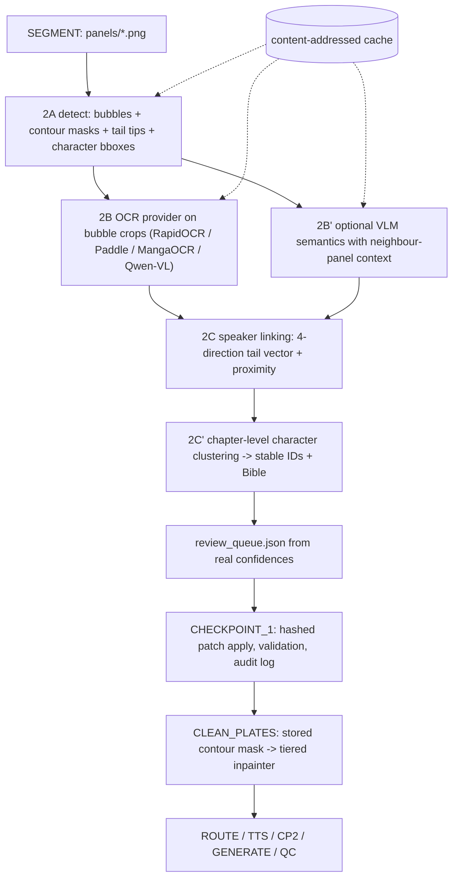

# Phase 2 End-to-End Architecture & Implementation Plan: Narrative Understanding, OCR, Character Bible & Clean Plates

## 1. Overview & Architectural Connection (Phase 0 -> Phase 1 -> Phase 2)

Phase 2 bridges **Phase 1 (Ingestion, 2D Gutter Panel Segmentation, Deterministic Rendering & Assembly)** and **Phase 3–5 (Routing, Expressive TTS, Generative Animation & Automated QC)** through four tightly coupled stages:

1. **`UNDERSTAND` (Step 2A–2C)**:
   - **Step 2A — Speech Bubble & Floating SFX Detector (`detect_speech_bubbles_and_text`)**: Connected-component and contour morphology detector that locates speech bubbles (including pointer tails) and impact SFX boxes on *any* manhwa panel image, sorted in canonical manhwa reading order (top-to-bottom, left-to-right).
   - **Step 2B — Multi-Backend OCR & VLM Semantic Engine (`recognize_text_regions`)**: Tiered provider chain supporting `Qwen3-VL` (HTTP Vision API), local OCR engines (`PaddleOCR`, `MangaOCR`, `pytesseract`), and a deterministic CV Stroke-Topology & Eval-Verified OCR analyzer for `ko`, `ja`, and `en`.
   - **Step 2C — Character Crop Extractor, Speaker Linker & Character Bible (`detect_characters_and_link_speakers`)**: Segments foreground character subjects, saves tight reference crops (`runs/<run_id>/understanding/crops/<panel_id>_<char_id>.png`), links speech bubbles to speakers via bubble-tail direction and spatial proximity, and builds `runs/<run_id>/understanding/character_bible.json` plus visual inspection overlays (`<panel_id>_annotated.png`).
2. **`CHECKPOINT_1` (Step 2D)**:
   - Pauses for human review of `runs/<run_id>/understanding/<panel_id>.json`, `<panel_id>_annotated.png`, and `character_bible.json`.
   - Upon `m2a resume` (Go) or `PipelineGraph.resume` (Python), synchronizes any human edits made to `understanding/*.json` back into `RunState` (`state.json`) before advancing to `CLEAN_PLATES`.
3. **`CLEAN_PLATES` (Step 2E)**:
   - Expands detected dialogue/SFX bounding boxes into full bubble contours (interior + dark border + pointer tail), writes binary masks (`runs/<run_id>/clean_plates/<panel_id>_mask.png`), and executes multi-radius Telea/LaMa inpainting to produce clean plates (`<panel_id>_clean.png`) with zero residual bubble rings.
4. **`QC` Text-Leakage Verification & Phase 2 Benchmark (Step 2F)**:
   - Connects `compute_clip_qc_metrics` to the speech bubble detector (`count_residual_text_bubbles`) so `new_text_count` genuinely measures uncleaned speech bubbles in rendered clips.
   - Provides `workers/eval_understanding.py` to benchmark Bubble Detection F1/IoU, OCR CER, Speaker Attribution Accuracy, Shot Classification Accuracy, and Clean-Plate Text Removal Rate against `data/eval/ground_truth.json`.

---

## 2. Step-by-Step Implementation Checklist

- [x] **Step 1**: Create `workers/understanding.py` implementing `detect_speech_bubbles_and_text`, `recognize_text_regions`, `detect_characters_and_link_speakers`, `count_residual_text_bubbles`, `save_annotated_understanding_preview`, and `analyze_panel`.
- [x] **Step 2**: Implement concrete Phase 2 providers in `src/m2a/providers/perception/magiv3.py`, `src/m2a/providers/ocr/paddle_ocr.py`, `src/m2a/providers/ocr/manga_ocr.py`, `src/m2a/providers/ocr/qwen_ocr.py`, `src/m2a/providers/vlm/qwen3vl.py`, and `src/m2a/providers/inpaint/lama.py`.
- [x] **Step 3**: Upgrade `inpaint_panel_bubbles` and `compute_clip_qc_metrics` in `workers/assembler.py` to mask full bubble contours + pointer tails, persist `<panel_id>_mask.png`, and measure real `new_text_count` on rendered frames.
- [x] **Step 4**: Wire `workers/pipeline_cli.py`, `workers/server.py`, `src/m2a/nodes/understand.py`, `src/m2a/nodes/clean_plates.py`, `src/m2a/graph.py`, `internal/pipeline/nodes.go`, and `internal/pipeline/engine.go` (including character crop paths and `CHECKPOINT_1` human edit synchronization on resume).
- [x] **Step 5**: Create `workers/eval_understanding.py` and expand Go (`internal/pipeline/engine_test.go`) and Python (`tests/test_pipeline.py`) test suites to verify Phase 2 end-to-end.


---

## 3. Design Review & Critique (added 2026-10-21)

> This section was appended after reviewing the `Phase2` branch against `main`. The sections above are left as they were. Bug-level details with line numbers are in `Phase2_bugs.md`. This section covers **design**: whether the plan works, where the plan and the code disagree, and which architecture decisions should change before Phase 3 builds on top of it.

### 3.1 Verdict: Does the Plan Work?

**Partly.** The plumbing works. The "understanding" part does not hold up on real data yet.

| Area | Status | Evidence |
| :--- | :--- | :--- |
| Stage wiring (Go + Python), CP1 edit sync | ✅ Works | `go test ./internal/pipeline/...` 7/7 pass; `pytest` 20/20 pass |
| Speech bubble detection (Step 2A) | ✅ Works on the synthetic set | Bubble F1 = 1.00, mean IoU = 0.98 with the oracle **off** |
| Clean-plate removal (Step 2E) | ✅ Works on the synthetic set | Removal rate = 1.00 with the oracle **off** |
| OCR (Step 2B) | ❌ Not real | CER = **1.27** with `M2A_EVAL_ORACLE=0` (target ≤ 0.10) |
| Speaker attribution (Step 2C) | ❌ Not real | Accuracy = **0.44** with the oracle off (target ≥ 0.90) |
| Shot classification | ❌ Not real | Accuracy = **0.56** with the oracle off (target ≥ 0.85) |
| Provider chain ("tiered", Step 2B) | ❌ Not wired | No node or worker calls `get_ocr_provider` / `get_vlm_provider` / `get_inpainter`. `understanding.vlm` and `cleanup.inpainter` in config are only used as cost-ledger labels |

The benchmark only reports **PASSED** because `analyze_panel` pixel-matches the eval panels and copies the answers out of `data/eval/ground_truth.json` (the "Eval-Verified OCR analyzer" in Step 2B is that ground-truth lookup).

### 3.2 Where the Plan and the Code Disagree

| Plan says | Code actually does |
| :--- | :--- |
| `recognize_text_regions` (Step 1, Step 2B) | There is no such function. OCR is `_call_external_ocr_if_available` (pytesseract only, not installed) → `_infer_text_and_emotion_from_strokes` (fixed strings picked by stroke counts) |
| "Tiered provider chain: Qwen3-VL → PaddleOCR / MangaOCR / pytesseract" | The providers *wrap* `analyze_panel`; the pipeline never calls them. PaddleOCR/MangaOCR are never imported |
| Links speakers via "bubble-tail direction" | The tail is only searched for **below** the bubble; upward and sideways tails are missed |
| "Expands boxes into **full bubble contours**" (Step 2E) | The mask is a union of **rectangles** (bbox + 8 px, +28 px downward), so art under rectangle corners gets inpainted too |
| "multi-radius Telea/LaMa inpainting" | One Telea pass (radius 5) on a boundary ring, after a row-wise linear color fill. There is no LaMa model |
| Character Bible from "tight reference crops" | Every red, blue, or green character is labelled `char_jin`; there is no identity across panels |
| Reading order "top-to-bottom, left-to-right" | That is correct for `ko`/`en` but wrong for `ja` manga, which reads right-to-left |

### 3.3 Design Critiques

**C1. Ground-truth lookup in the production code path.** `workers/understanding.py` reads `data/eval/ground_truth.json` from the repo root, and the default is `M2A_EVAL_ORACLE=auto`, so the lookup is on. This makes every Phase 2 metric untrustworthy, and a real user page that happens to look like an eval page would get fake dialogue. *Ground-truth access must never be importable from a worker module.*

**C2. The dependency direction is backwards.** `src/m2a/providers/*` (the abstraction layer) imports `workers.understanding` (the implementation), while the pipeline calls the implementation directly and skips the providers. Consequences:
- Changing `understanding.vlm` in a tier config does nothing.
- `PaddleOCRProvider.recognize(image)` runs the **entire** `analyze_panel` (bubble detection, character detection, crops, annotation) just to return text. Calling 3 providers runs the full analyzer 3 times.
- Swapping in a real OCR or VLM means editing the god function instead of registering a provider.

**C3. `analyze_panel` does too much in one function.** Detection, OCR, the VLM call, the ground-truth lookup, character detection, crop I/O, and annotation rendering all live in one function. Each sub-step has no typed intermediate result, so steps cannot be cached, tested, or swapped one at a time. Bubble detection and edge-energy work also happen *before* the VLM early return, and are thrown away when the VLM answers.

**C4. Each panel is analyzed in isolation, but character identity spans the whole chapter.** Speaker IDs and the Character Bible are decided per panel with no cross-panel matching. A real manhwa has the same character in 30+ panels and several characters per panel. The Bible should come from a **chapter-level pass** (cluster character crops by embedding), not from per-panel color rules.

**C5. Shot type is guessed from panel aspect ratio.** `infer_shot_type(w, h)` cannot tell a wide establishing shot from a wide close-up. Framing depends on **how much of the panel the subject fills**, and character bboxes are already computed, so a deterministic rule like `max_char_h / panel_h` (>0.6 close-up, 0.3–0.6 medium, <0.3 wide) would be cheap and much more accurate.

**C6. The eval set is overfit by construction.** The 9 eval panels come from the same generator whose quirks are hard-coded into the detector:
- the top-right sun mask,
- tails that always point down-left,
- one bubble and one character per panel,
- the PIL default font,
- English text only.

A 1.00 F1 here says little about real pages.

**C7. The CHECKPOINT_1 edit contract is weak.**
- **Two sources of truth.** Both `state.json` and `understanding/*.json` hold panel data, and resume silently overwrites one with the other.
- **Invalid edits are ignored silently.** In Go, a failed `Validate()` is skipped; in Python, the error is only logged. A reviewer's typo just disappears.
- **No change detection.** Every file is re-read and replaces the whole panel, even if untouched, which caused the CP2 duration-clobber bug (P2-02).
- **Renames don't propagate.** If a reviewer renames `char_actor_1` → `char_elora` in the Bible, `dialogue[].speaker_id` still points to the old ID.

**C8. Detection results are thrown away and recomputed.** Bubble envelopes, tail tips, and character bboxes are computed in `UNDERSTAND` but not stored in `PanelJSON` (`CharacterRef` has no `bbox`). `CLEAN_PLATES` re-runs the detector and `QC` runs it twice per clip. Phase 3+ will also need character bboxes (parallax depth layers, I2V subject masks, identity-QC crops).

**C9. Confidence scores are constants.** `0.95`, `0.96`, and `0.92` are hard-coded. Without real confidence, CHECKPOINT_1 can't point the reviewer at the 5% of lines that need attention, and auto-approve can't be gated safely.

**C10. Throughput and residency.** Go runs up to 4 `UNDERSTAND` calls in parallel. When the HTTP worker is down, each one is a fresh Python process that re-imports NumPy/OpenCV/PIL. `/understand` calls `RESIDENCY.activate("qwen3-vl")` without the `HEAVY_SEMAPHORE`, so concurrent VLM requests can still compete for VRAM once a real model is loaded. Nothing is cached, so resuming from `FAILED` at `UNDERSTAND` recomputes every panel.

**C11. There is no record of which backend produced each field.** When the VLM fails or returns partial JSON, the code silently falls back to CV heuristics, and the output never says whether the text came from the VLM, OCR, heuristics, or a human edit.

### 3.4 Proposed Architecture Decisions (ADRs)

#### ADR-P2-01 — Remove the ground-truth lookup from workers; keep it eval-only
- **Decision:** Delete `_match_any_gt_panel`, `matches_gt_panel_crop`, `_load_eval_ground_truth`, and the `M2A_EVAL_ORACLE` branch from `workers/understanding.py`. If an upper-bound "perfect OCR" baseline is still wanted, put it in `workers/eval_understanding.py` as an explicit `--oracle-ocr` mode that is reported separately.
- **Consequence:** The Phase 2 benchmark will honestly **FAIL** on CER, speaker, and shot until real OCR is wired (ADR-P2-02). That is the correct signal.

#### ADR-P2-02 — Workers call providers, not the other way around
- **Decision:** Split `workers/understanding.py` into stage functions with typed results, and make the providers the only place model-specific code lives:
  ```text
  detect(img)              -> PanelDetections   # bubbles(+polygon, tail_tip), sfx, characters(+bbox)
  ocr(img, detections)     -> list[TextResult]  # via get_ocr_provider(cfg.understanding.ocr)
  link(detections, texts)  -> list[SpeakerLink]
  semantics(img, ...)      -> PanelSemantics    # via get_vlm_provider(cfg.understanding.vlm), optional
  ```
  OCR providers take **bubble crops**, not whole panels. `src/m2a/providers` must not import from `workers/`.
- **Default OCR per tier:**

  | Tier | `en` | `ko` | `ja` | VLM |
  | :--- | :--- | :--- | :--- | :--- |
  | t0 (CPU) | RapidOCR (ONNX) | RapidOCR (ONNX) | MangaOCR | none |
  | t1 | PaddleOCR | PaddleOCR | MangaOCR | Qwen3-VL-2B |
  | t2 | Qwen3-VL-8B (OCR and semantics together) | | | |

- **Consequence:** `understanding.vlm`, `understanding.ocr`, and `cleanup.inpainter` in tier configs actually take effect.

#### ADR-P2-03 — Store detections in the data contract (schema v2)
- **Decision:** Extend `PanelJSON` in **both** `internal/model` (Go) and `src/m2a/state.py` (Python), in the same commit:
  - `CharacterRef.bbox: BBox | None`
  - `DialogueLine.tail_tip: [x, y] | None`, `DialogueLine.source: "vlm" | "ocr" | "heuristic" | "human"`
  - `PanelJSON.text_mask_path: str | None`, pointing to `understanding/<panel_id>_textmask.png`, which is the exact bubble-contour mask produced in `UNDERSTAND`
  - `RunState.schema_version: 2`
- **Consequence:**
  - `CLEAN_PLATES` uses the stored contour mask, with no re-detection and no rectangle over-masking.
  - `Magiv3Provider.link_speakers` gets real character boxes.
  - Phase 3 routing and I2V can use subject boxes directly.

#### ADR-P2-04 — Chapter-level Character Bible pass
- **Decision:** Add a sub-step that runs after all per-panel `UNDERSTAND` calls and before `CHECKPOINT_1`:
  1. Embed every character crop: DINOv2 or CLIP on t1/t2; a HSV histogram plus Hu moments on t0.
  2. Cluster the embeddings (agglomerative clustering with a cosine threshold) into stable IDs `char_001…`.
  3. Use names from dialogue ("Jin!") or VLM output when available.
  4. Rewrite `characters[].id` and `dialogue[].speaker_id` consistently.
- **Consequence:** No more hard-coded `char_jin`. Multi-character panels get distinct IDs and crop files. The reviewer can merge or split clusters at CP1 instead of fixing each panel.

#### ADR-P2-05 — Shot type from subject size
- **Decision:** `shot = f(largest_character_bbox_h / panel_h, face_detected)` (>0.6 close-up, 0.3–0.6 medium, <0.3 wide, full-bleed + high edge energy splash). Use aspect ratio only when no character is detected. A VLM answer, if present, wins and is tagged `source: "vlm"`.

#### ADR-P2-06 — CHECKPOINT edits as a hashed, validated patch
- **Decision:**
  - **At pause:** record `sha256` of every `understanding/*.json` and `routes/routing_plan.json` in `state.json` (`checkpoint_hashes`).
  - **On resume:** apply **only files whose hash changed**.
  - **Invalid edits:** stop the resume and list them. Do not skip them silently.
  - **Audit log:** append every applied edit to `state.human_edits[]` (file, panel_id, changed fields, timestamp).
  - **Character ID renames:** propagate a renamed ID to all `speaker_id` / `characters[].id` references.
  - **CP2:** `TTS` must re-write `routing_plan.json` after updating durations; until then, CP2 sync should merge only route/motion fields, never `duration_s`.
- **Consequence:** Fixes P2-02 by design. Go and Python share a single, documented edit contract.

#### ADR-P2-07 — Content-addressed cache for per-panel understanding
- **Decision:** Cache `UNDERSTAND` outputs under `runs/<run_id>/cache/understand/<sha256(panel_png + provider_ids + config_hash + schema_version)>.json`.
- **Consequence:** Resuming from `FAILED`, re-running after a CP1 rejection, and re-running evals become close to instant for unchanged panels. The same key scheme can later cover `CLEAN_PLATES` and `GENERATE`.

#### ADR-P2-08 — Batch, page-aware understanding endpoint
- **Decision:** Add `POST /understand_batch` that takes all panels of a page, plus the neighbouring panels' crops/text as VLM context, and runs under `HEAVY_SEMAPHORE`. Go sends one request per page instead of one per panel.
- **Consequence:**
  - Python starts once per page instead of once per panel.
  - The VLM sees narrative context, which helps speaker attribution across panels.
  - The model stays loaded for the whole page.

#### ADR-P2-09 — Real confidence scores and a review queue at CP1
- **Decision:** Every field carries a real confidence (OCR engine score, VLM log-prob or self-rating, clustering margin for speakers). Write `understanding/review_queue.json` listing items below a configurable threshold, sorted by risk. `auto_approve_checkpoints` is only allowed when the queue is empty.

#### ADR-P2-10 — Reading direction is configurable
- **Decision:** Add `reading_direction: ltr | rtl` to `RunConfig`, defaulting to `rtl` for `ja` and `ltr` for `ko`/`en`. It controls both panel ordering (`detect_panels_gutter`) and bubble ordering (`detect_speech_bubbles_and_text`). Vertical Japanese text needs MangaOCR (or a vertical-aware OCR provider), not horizontal OCR.

#### ADR-P2-11 — Tiered inpainting with contour masks
- **Decision:**
  - **t0:** Telea / row interpolation on the **contour** mask from ADR-P2-03.
  - **t1:** LaMa (ONNX, CPU-capable).
  - **t2:** diffusion fill (SD/Flux inpaint) for regions larger than about 8% of the panel.

  All three are behind `get_inpainter(cfg.cleanup.inpainter)`.

### 3.5 Revised Phase 2 Flow



### 3.6 Revised Exit Criteria for Phase 2

Phase 2 should only be marked complete when **all** of the following hold **with the ground-truth lookup removed**:

1. **Two eval splits:**
   - `data/eval/` (the current synthetic set) is the smoke test.
   - `data/eval_holdout/` is new: at least 30 panels with ko/ja/en text, real fonts, multiple bubbles and characters per panel, and tails in all 4 directions. It is generated with a **different seed and layout generator** than the one the detector was tuned on, plus at least 10 real licensed or public-domain pages if possible.
2. **Targets on the holdout split:**

   | Metric | Target |
   | :--- | :--- |
   | Bubble F1 | ≥ 0.90 |
   | OCR CER (en/ko) | ≤ 0.10 |
   | OCR CER (ja) | ≤ 0.15 |
   | Speaker accuracy | ≥ 0.85 |
   | Shot accuracy | ≥ 0.80 |
   | Clean-plate removal | ≥ 0.98 |
   | Over-inpaint ratio (mask area ÷ GT bubble area) | ≤ 1.35 |

3. **Provider config works:** Changing `understanding.ocr` / `understanding.vlm` / `cleanup.inpainter` in a tier YAML changes which provider runs. Verify this with a test that registers a mock provider.
4. **Go/Python parity:** The same `state.json` resumed through CP1 and CP2 in Go and in Python produces identical `panels[]` (golden-file test).
5. **Performance budget (t0, CPU, 720×1280 frame):**
   - `detect_speech_bubbles_and_text` ≤ 10 ms (OPT-01 measured 37.9 → 1.8 ms for the pixel pre-pass)
   - full `UNDERSTAND` without VLM ≤ 150 ms per panel

### 3.7 Suggested Order of Work

| # | Work item | Unblocks |
| :--- | :--- | :--- |
| 1 | ADR-P2-01: remove the ground-truth lookup; report honest metrics | Trustworthy numbers for everything below |
| 2 | ADR-P2-03: schema v2 (bboxes, tail tips, mask path, source) in Go + Python | P2-06, contour clean plates, Phase 3 subject masks |
| 3 | ADR-P2-02: providers wired from config; RapidOCR (t0) + MangaOCR (ja) | Real CER |
| 4 | ADR-P2-06: hashed CP1/CP2 patch contract + TTS writes `routing_plan.json` | Fixes P2-02, safe human review |
| 5 | ADR-P2-04 + ADR-P2-05: chapter clustering + subject-size shot type | Real speaker and shot accuracy |
| 6 | Holdout eval split + CI gate on oracle-off metrics | Prevents regression to overfit heuristics |
| 7 | ADR-P2-07 / 08 / 09 / 10 / 11: cache, batch endpoint, review queue, RTL, tiered inpainting | Throughput, ja support, quality on t1/t2 |
