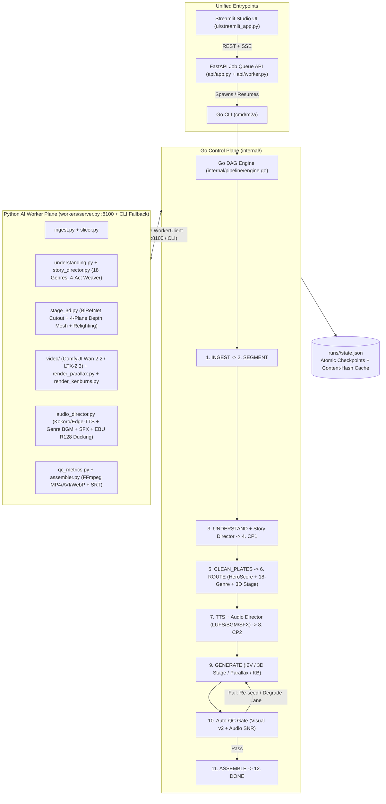
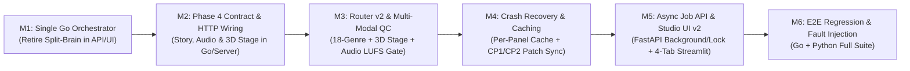

# Phase 5 — Orchestration, Director Integration, Router, Auto-QC & Studio UI: Implementation Plan

> **Project:** Manhwa → Anime (M2A), Hybrid Go + Python · **Phase:** 5 of 6 · **Plan date:** 23 Oct 2026  
> **Inputs used:** `Manhwa_to_Anime_Prototype_Proposal.pdf` (v0.2 §4, §8, §9), `phase2_plan.md`, `Phase3_implemn.md`, `context_report.md`, and current `Phase4` branch (`0af797e`).

---

## 0. Goal (TL;DR)

Phase 5 unifies the **Go Control Plane** (`cmd/m2a`, `internal/`) and the **Python AI Worker Plane** (`workers/`, `api/`, `ui/`) into a single, crash-resilient, production-grade orchestration system that connects Phases 0–3 with the newly implemented **Phase 4 Multimodal Story Director, Genre-Adaptive Audio Director, and 2D→3D Depth-Mesh Stage**.

By the end of Phase 5:
1. **Single Canonical Orchestrator (Zero Split-Brain):** Every entrypoint—Go CLI (`cmd/m2a`), FastAPI Job API (`api/app.py`), Background Job Worker (`api/worker.py`), and Streamlit Studio UI (`ui/streamlit_app.py`)—executes through the compiled **Go DAG Engine** (`internal/pipeline/engine.go`), retiring duplicate orchestration in Python `PipelineGraph`.
2. **Full Phase 4 Integration in Go & HTTP Worker (`:8100`):** The 18-genre **Story Director** (`workers/story_director.py`), **2D→3D Depth-Mesh Stage** (`workers/stage_3d.py`), and **EBU R128 Audio Director** (`workers/audio_director.py`) are wired into the Go `RunState` contract (`internal/model/state.go`), `WorkerClient` (`internal/client/worker_client.go`), and persistent FastAPI Worker Server (`workers/server.py`).
3. **Topology- & Story-Aware Shot Router + Multi-Modal Auto-QC Gate:** `RouteNode` (`internal/pipeline/nodes.go`) combines Phase 3 `HeroScore` and GPU-seconds knapsack budgeting with Phase 4 panel layout topologies (`diagonal_action_slash`, `full_bleed_splash`, etc.), 4-act narrative climax weights, and 3D depth-stage eligibility (`i2v` → `stage_3d` / `parallax` → `kenburns`). `QCNode` (`internal/qc/evaluator.go`) enforces both calibrated visual QC v2 thresholds and audio loudness/SNR gates (`dialogue_to_bgm_snr_db`, zero clipping).
4. **Crash-Safe Resumability & Content-Hash Caching:** Per-stage and per-panel SHA-256 input/config hashing skips already-verified work on `m2a resume`, while PID-aware lock recovery in `api/worker.py` safely reclaims orphaned runs after worker crashes.
5. **Interactive Studio UI & Async Job API:** `api/app.py` supports non-blocking job queuing, Server-Sent Events (SSE) progress streaming, and validated CP1/CP2 patch updates; `ui/streamlit_app.py` provides an end-to-end visual editor for panel bounding boxes, OCR dialogue, Character Bible clusters, 18-genre themes, shot routing, and QC/LUFS telemetry.

---

## 1. Current State & Gap Analysis (Verified on `Phase4` / `0af797e`)

| ID | Area | Current State in Repository | Phase 5 Gap to Close |
| :--- | :--- | :--- | :--- |
| **G1** | **Split-Brain Orchestration (`api/` & `ui/` vs. Go)** | [api/app.py](file:///run/media/hihry/OS/hihry/Ani/api/app.py), [api/worker.py](file:///run/media/hihry/OS/hihry/Ani/api/worker.py), and [ui/streamlit_app.py](file:///run/media/hihry/OS/hihry/Ani/ui/streamlit_app.py) still import and run Python `PipelineGraph` ([src/m2a/graph.py](file:///run/media/hihry/OS/hihry/Ani/src/m2a/graph.py)). | Python `PipelineGraph` lacks Go's knapsack router, model/route fallback ladder, parallel worker pools, and QC v2 evaluator. API, Worker, and UI must delegate execution to the Go engine (`m2a run` / `m2a resume`). |
| **G2** | **Phase 4 Modules Missing from Go Contract & `:8100` Server** | Phase 4 added [workers/story_director.py](file:///run/media/hihry/OS/hihry/Ani/workers/story_director.py), [workers/audio_director.py](file:///run/media/hihry/OS/hihry/Ani/workers/audio_director.py), and [workers/stage_3d.py](file:///run/media/hihry/OS/hihry/Ani/workers/stage_3d.py) with 18 genres in [configs/themes.yaml](file:///run/media/hihry/OS/hihry/Ani/configs/themes.yaml). | [internal/model/state.go](file:///run/media/hihry/OS/hihry/Ani/internal/model/state.go) and [workers/server.py](file:///run/media/hihry/OS/hihry/Ani/workers/server.py) do not yet expose `genre_id`, `layout_topology`, `arc_mode`, `story_expansion`, `stage_3d`, or `audio_director` LUFS/SNR metrics in `RunState` or HTTP endpoints. |
| **G3** | **Checkpoint Edit Validation & Rename Propagation** | Go `syncCheckpoint1Edits` and `syncCheckpoint2Edits` in [internal/pipeline/engine.go](file:///run/media/hihry/OS/hihry/Ani/internal/pipeline/engine.go) sync `understanding/*.json` and `routes/routing_plan.json`, while `PUT /jobs/{id}/checkpoint` in [api/app.py](file:///run/media/hihry/OS/hihry/Ani/api/app.py) only overwrites `state.panels`. | Edits made via API/UI do not update `understanding/*.json` or `routing_plan.json`, so Go `Resume` clobbers API/UI edits with stale disk files! Character ID renames in `character_bible.json` also do not propagate to `dialogue[].speaker_id`. |
| **G4** | **Per-Panel Content-Hash Caching & Crash Recovery** | [internal/pipeline/engine.go](file:///run/media/hihry/OS/hihry/Ani/internal/pipeline/engine.go) resumes at stage granularity (`state.CurrentStage`). [api/worker.py](file:///run/media/hihry/OS/hihry/Ani/api/worker.py) creates `.lock` files with PID but never reclaims stale locks if a worker process dies. | If `GENERATE` crashes on panel 8 of 10, resuming re-renders panels 1–7. If a worker process is `SIGKILL`ed, `.lock` blocks the run forever. |
| **G5** | **Synchronous Blocking `POST /jobs` & Minimal Streamlit UI** | `POST /jobs` in [api/app.py](file:///run/media/hihry/OS/hihry/Ani/api/app.py) blocks until the pipeline finishes or hits a checkpoint. [ui/streamlit_app.py](file:///run/media/hihry/OS/hihry/Ani/ui/streamlit_app.py) is a 68-line raw JSON text box. | `POST /jobs` must enqueue asynchronously (or run via background task/worker) with live status polling/SSE, and the Streamlit UI needs structured visual editors for CP1, CP2, genre selection, and QC/audio review. |

---

## 2. Phase 5 Milestones & Architecture Plan

### Milestone 1 (M1): Single-Orchestrator Unification (Eliminate Split-Brain)
- **Objective:** Make the Go DAG Engine (`cmd/m2a` / `internal/pipeline/engine.go`) the sole execution orchestrator across CLI, REST API, background worker, and UI.
- **Implementation Details:**
  1. **Go Binary Invocation Bridge (`src/m2a/orchestrator.py`):**
     - Add a thin Python bridge (`run_go_engine(run_dir, pages, tier, lang, genre, auto_approve)` and `resume_go_engine(run_dir, auto_approve)`) that invokes the compiled `m2a` binary (or `go run ./cmd/m2a` fallback in dev) and streams structured JSON logs.
  2. **Rewire `api/app.py`, `api/worker.py`, and `ui/streamlit_app.py`:**
     - Replace `PipelineGraph.run()` / `PipelineGraph.resume()` in `api/app.py`, `api/worker.py`, and `ui/streamlit_app.py` with the Go orchestrator bridge.
     - Keep `src/m2a/graph.py` strictly as a lightweight unit-test/library shim that delegates stage execution to `workers/pipeline_cli.py` with identical stage ordering (`INGEST → SEGMENT → UNDERSTAND → CHECKPOINT_1 → CLEAN_PLATES → ROUTE → TTS → CHECKPOINT_2 → GENERATE → QC → ASSEMBLE → DONE`).
  3. **CLI Flag Parity (`cmd/m2a/main.go`):**
     - Add `--genre <genre_id|auto>` (default `"auto"`), `--run-id <id>`, and `--run-dir <path>` flags to `cmd/m2a/main.go` so API-created run directories (`runs/<job_id>/`) are executed in place by the Go engine.

---

### Milestone 2 (M2): Go ↔ Python Contract & HTTP Server Wiring for Phase 4 Modules
- **Objective:** Expose Phase 4's **Story Director**, **Audio Director**, and **2D→3D Depth-Mesh Stage** as first-class citizens in `RunState` (`internal/model/state.go` and `src/m2a/state.py`), `WorkerClient` (`internal/client/worker_client.go`), and `workers/server.py`.
- **Implementation Details:**
  1. **Unified Schema Extensions (`internal/model/state.go` & `src/m2a/state.py`):**
     - Add `GenreID string` (`genre_id`, default `"auto"` / resolved from `ALL_18_GENRES`) to `RunConfig`.
     - Extend `PanelJSON` with optional Phase 4 fields:
       - `LayoutTopology string` (`layout_topology`, e.g., `vertical_webtoon_scroll`, `diagonal_action_slash`, `full_bleed_splash`)
       - `ArcRole string` (`arc_role`, e.g., `setup`, `rising_action`, `climax`, `resolution`, or synthesized bridge role)
       - `IsBridgePanel bool` (`is_bridge_panel`)
       - `Stage3D map[string]any` (`stage_3d`, camera FOV, 4-plane depth Z values, Kelvin relighting, rim-light RGB)
     - Extend `RunState` with:
       - `StoryPlan *StoryDirectorPlan` (`story_plan`: detected `genre_id`, `arc_mode`, 4-act completeness scores, injected narration hooks/bridge panels, persisted at `understanding/story_plan.json`).
       - `AudioReport *AudioMixReport` (`audio_report`: integrated LUFS, dialogue-to-BGM SNR dB, BGM stem path, SFX event count, clipping sample count, persisted at `audio/audio_report.json`).
  2. **HTTP Worker Endpoints (`workers/server.py` & `workers/pipeline_cli.py`):**
     - Update `POST /understand` (`workers/server.py`) and `pipeline_cli.py understand` to invoke `workers/story_director.py` after panel analysis, populating `layout_topology`, `genre_id`, `story_plan.json`, and optional incomplete-story fallback narration/bridge panels.
     - Update `POST /render` and `pipeline_cli.py render` to support `route="stage_3d"` (and enriched `parallax` via `workers/stage_3d.py` when 3D depth-stage is enabled in config/theme).
     - Update `POST /tts` and `POST /assemble` to run `workers/audio_director.py` (genre BGM synthesis, transition-aligned SFX, and EBU R128 sidechain ducking) and return `audio_report.json` metrics to Go.

---

### Milestone 3 (M3): Intelligent Shot Router v2 & Multi-Modal Auto-QC Gate
- **Objective:** Upgrade Go's `RouteNode` and `QCNode` to leverage Phase 4's genre/topology/3D stage intelligence and audio loudness telemetry.
- **Implementation Details:**
  1. **Topology- & Narrative-Aware `HeroScore` (`internal/pipeline/nodes.go`):**
     - Incorporate Phase 4 signals into `HeroScore(p, idx, total, maskRatio)`:
       - Boost panels with `layout_topology` in `{"full_bleed_splash", "diagonal_action_slash", "split_screen_standoff"}` or `arc_role == "climax"`.
       - Select between `i2v` (hero budget via GPU-seconds knapsack), `parallax` / `stage_3d` (4-plane depth-mesh compositor with dynamic relighting for medium/character shots), and `kenburns` (aspect-safe P10 letterbox for wide establishing/low-energy shots).
     - Record full decision provenance (`genre_id`, `layout_topology`, `hero_score`, `est_gpu_s`, `motion_prompt`) in `routes/routing_plan.json`.
  2. **Multi-Modal Auto-QC Gate (`internal/qc/evaluator.go` & `internal/pipeline/nodes.go`):**
     - **Visual QC Gate (per clip):** Evaluate `IdentitySimilarity`, `FlickerScore`, `NewTextCount`, `MotionScore`, and v2 metrics (`WarpError`, `FirstFrameFidelity`, `StyleDrift`) against per-route calibrated thresholds (`configs/qc/calibrated_t1.yaml` / `cfg.QC.PerRoute`).
     - **Fallback Ladder Execution:**
       `i2v (take 1)` → `i2v (re-seed take 2)` → `next fallback I2V model` → `parallax (3D stage)` → `kenburns (terminal guaranteed pass)`.
     - **Audio QC Gate (`TTSNode` / `AssembleNode`):** Validate `AudioReport` from `workers/audio_director.py`:
       - Verify `clipping_samples == 0` and `dialogue_to_bgm_snr_db >= min_dialogue_to_bgm_snr_db`.
       - If SNR is below threshold, automatically re-run sidechain ducking with +3 dB deeper BGM attenuation before final FFmpeg muxing.

---

### Milestone 4 (M4): Deterministic Crash Recovery, Per-Panel Caching & Checkpoint Sync
- **Objective:** Ensure any pipeline interruption (`SIGINT`, OOM, power loss, worker timeout) or human checkpoint edit resumes cleanly without redundant computation or lost edits.
- **Implementation Details:**
  1. **Per-Panel Artifact & Stage Caching (`internal/pipeline/nodes.go`):**
     - Compute a deterministic per-panel cache key: `sha256(source_crop_bytes + stage_name + panel_config_json)`.
     - In `UnderstandNode`, `CleanPlatesNode`, `TTSNode`, and `GenerateNode`, if the target artifact exists on disk, is non-empty, and matches the panel cache key in `state.json`, skip recomputation.
  2. **Bidirectional Checkpoint Synchronization (`internal/pipeline/engine.go` & `api/app.py`):**
     - Unify checkpoint persistence so both `PUT /jobs/{id}/checkpoint` and file-based edits write to `state.json` **and** mirror to `understanding/<panel_id>.json` (at CP1) or `routes/routing_plan.json` (at CP2).
     - Add speaker-rename propagation: when a reviewer renames a character ID or name in `character_bible.json` at CP1, automatically update all matching `panels[].characters[].id` and `panels[].dialogue[].speaker_id` references.
     - Invalidate cached downstream artifacts (`clean_plates`, `audio`, `clips`) **only** for panels whose text, bbox, speaker, or route changed at CP1/CP2.
  3. **Stale Lock Recovery & Dead-Letter Handling (`api/worker.py`):**
     - Store `{"pid": <pid>, "hostname": <host>, "started_at": <iso>}` inside `runs/<run_id>/.lock`.
     - When polling, check if `pid` is alive (`os.kill(pid, 0)`) or if lock age exceeds `max_job_wall_seconds`. Reclaim dead locks automatically and resume from the last committed stage in `state.json`.

---

### Milestone 5 (M5): Asynchronous FastAPI Job Service & 4-Tab Streamlit Studio UI
- **Objective:** Upgrade the developer-facing API and UI into a responsive studio workflow.
- **Implementation Details:**
  1. **FastAPI Job Queue API v2 (`api/app.py`):**
     - `POST /jobs`: Create `runs/<job_id>/state.json` with `genre_id`, `compute_tier`, `source_language`, and `auto_approve`. Launch execution asynchronously via FastAPI `BackgroundTasks` (or leave queued for `api/worker.py` when `async_queue=True`) so HTTP returns `202 Accepted` immediately.
     - `GET /jobs/{job_id}/events`: Server-Sent Events (SSE) endpoint streaming real-time `current_stage`, `progress`, completed panel counts, and `StageHistory` transitions as `state.json` updates.
     - `PUT /jobs/{job_id}/checkpoint`: Validate CP1 (`PanelJSON` + `CharacterBible` + `genre_id`) or CP2 (`route` + `motion_prompt` + `duration_s`) edits, persist to both `state.json` and stage files, and trigger background `m2a resume`.
     - `GET /jobs/{job_id}/artifacts/{kind}`: Serve panel crops, annotated CP1 overlays, clean plates, per-panel clips, WAV tracks, and `output/final_anime.mp4`.
  2. **Streamlit Studio UI v2 (`ui/streamlit_app.py`):**
     - **Tab 1 — Job Launcher & Live DAG Monitor:** Upload pages or pick sample strips, select Compute Tier (`t0`, `t1s`, `t1`, `t2`), Language (`ko`, `ja`, `en`), and Genre (`auto` or any of the 18 genres), and watch live stage progress with cost/latency metrics.
     - **Tab 2 — Checkpoint 1 (Understanding, OCR & Character Bible Editor):** Side-by-side view of `<panel_id>_annotated.png` and editable table of dialogue lines (`speaker_id`, `text`, `emotion`, `confidence`), character bible cards with crop thumbnails, and 4-act Story Director summary.
     - **Tab 3 — Checkpoint 2 (Shot Router, GPU Budget & 3D Stage Preview):** Visual cards per panel showing clean plate vs. original, `HeroScore`, estimated GPU seconds, route selector (`kenburns`, `parallax`, `stage_3d`, `i2v`), and editable camera motion prompt.
     - **Tab 4 — QC Telemetry, Audio LUFS Mix & Final Video Player:** Interactive table of per-panel `QCScores` (Identity, Flicker, Motion, Warp, Style Drift, fallback takes), EBU R128 audio loudness report (LUFS, SNR dB, BGM stem player), subtitle `.srt` preview, and embedded 9:16 `final_anime.mp4` player.

---

### Milestone 6 (M6): End-to-End Verification, Fault-Injection & Regression Suite
- **Objective:** Prove end-to-end reliability across Go and Python with automated tests and fault injection.
- **Test Matrix:**
  1. **Go Unit & Integration Tests (`go test ./... -v`):**
     - `internal/pipeline/engine_test.go`: Full 12-stage run, pause/resume at CP1 and CP2, speaker rename propagation, per-panel cache hit verification on resume, and stage fallback activation on simulated worker failure.
     - `internal/qc/evaluator_test.go`: Route-specific QC v2 threshold checks, model-level re-seed → fallback model → parallax → kenburns degradation ladder, and audio SNR gate validation.
  2. **Python Integration & API Tests (`pytest tests/ -v`):**
     - `tests/test_pipeline.py`: End-to-end Go ↔ Python consistency check verifying identical `state.json` schema validation in both Go and Pydantic.
     - `tests/test_api_and_worker.py` (new): Tests non-blocking `POST /jobs`, `PUT /jobs/{id}/checkpoint` edit persistence across Go resume, stale `.lock` PID recovery in `api/worker.py`, and artifact streaming endpoints.
     - `tests/test_director.py` & `tests/test_genre_datasets.py`: Verify all 18 genres, 10 layout topologies, 8 arc modes, 3D stage depth planes, and EBU R128 LUFS/SNR compliance through the unified orchestrator.

---

## 3. Step-by-Step Implementation Checklist

- [ ] **Step 1 (M1 — Single Orchestrator):** Create `src/m2a/orchestrator.py` bridge to `cmd/m2a`, add `--genre`, `--run-id`, and `--run-dir` flags to `cmd/m2a/main.go`, and wire `api/app.py`, `api/worker.py`, and `ui/streamlit_app.py` to execute via the Go DAG Engine.
- [ ] **Step 2 (M2 — Phase 4 State & Worker Wiring):** Extend `internal/model/state.go` and `src/m2a/state.py` with `genre_id`, `layout_topology`, `arc_role`, `story_plan`, `stage_3d`, and `audio_report`; wire `workers/story_director.py`, `workers/stage_3d.py`, and `workers/audio_director.py` into `workers/server.py` (`:8100`) and `internal/client/worker_client.go`.
- [ ] **Step 3 (M3 — Router v2 & Multi-Modal QC):** Update `HeroScore` and `RouteNode` in `internal/pipeline/nodes.go` for topology/climax/3D-stage routing, and add audio SNR/LUFS verification alongside visual QC v2 in `internal/qc/evaluator.go`.
- [ ] **Step 4 (M4 — Caching, Lock Recovery & CP Patch Sync):** Add per-panel SHA-256 artifact caching in `internal/pipeline/nodes.go`, bidirectional CP1/CP2 edit + speaker-rename sync in `internal/pipeline/engine.go`, and stale PID `.lock` recovery in `api/worker.py`.
- [ ] **Step 5 (M5 — Async API & 4-Tab Studio UI):** Upgrade `api/app.py` with background execution, SSE progress (`/jobs/{id}/events`), and artifact endpoints; upgrade `ui/streamlit_app.py` into the 4-tab Studio & Checkpoint Editor.
- [ ] **Step 6 (M6 — Verification & Benchmarks):** Add `tests/test_api_and_worker.py` and fault-injection tests in `internal/pipeline/engine_test.go`, and verify `go test ./... -v` and `pytest -v` pass 100%.

---

## 4. Acceptance Criteria & Target Metrics

| Metric / Capability | Target | Verification Method |
| :--- | :--- | :--- |
| **Orchestrator Unity** | 100% of CLI, API, Worker, and UI runs execute through Go `Engine` | `pytest tests/test_api_and_worker.py` + `go test ./internal/...` |
| **Checkpoint Edit Fidelity** | 100% of CP1 (text, speaker rename, bbox) & CP2 (route, prompt) edits preserved after resume | Automated CP1/CP2 round-trip test via `PUT /jobs/{id}/checkpoint` + `m2a resume` |
| **Crash-Resume Efficiency** | 0 redundant panel renders for already-completed panels on `m2a resume` | Fault-injection test killing run at panel $k$ of $N$ and asserting only panels $[k..N]$ render on resume |
| **Auto-QC Safety Net** | 100% of rejected I2V clips degrade cleanly (`re-seed → fallback model → stage_3d/parallax → kenburns`); 0 failed pipeline runs due to single-panel QC failure | `go test ./internal/qc/... ./internal/pipeline/... -v` |
| **Audio Loudness & Clarity** | Integrated loudness within $\pm 1.0\text{ LU}$ of genre target; $\text{SNR}_{\text{dialogue-to-BGM}} \ge \text{target dB}$; `clipping_samples == 0` | `pytest tests/test_director.py -v` + `audio/audio_report.json` |
| **Stale Worker Lock Recovery** | Orphaned `.lock` with dead PID reclaimed within $\le 2\text{ s}$ polling cycle | `pytest tests/test_api_and_worker.py -k test_stale_lock_recovery` |
